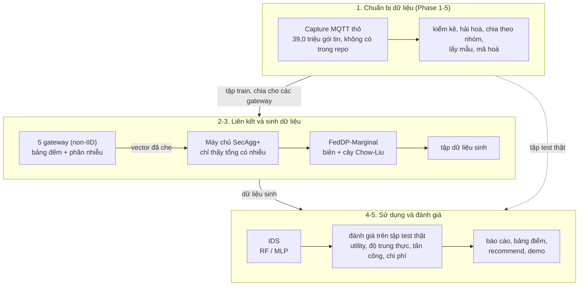

# PP-FedData

[English](README.md) | **Tiếng Việt**

Dữ liệu sinh bảo toàn quyền riêng tư cho học liên kết (FL): các gateway IoT / MQTT không được chia sẻ lưu lượng thô cùng tạo một tập dữ liệu sinh, dưới quyền riêng tư vi sai (DP) và tổng hợp bảo mật, để huấn luyện hệ phát hiện xâm nhập (IDS) cho tấn công MQTT DoS / DDoS.

## Tóm tắt

| | |
|---|---|
| **Bài toán** | IDS cần lưu lượng tấn công có nhãn từ nhiều gateway, nhưng gói tin thô là dữ liệu riêng và mỗi gateway chỉ thấy một số lớp tấn công (dữ liệu non-IID). |
| **Cách làm** | **FedDP-Marginal**: mỗi gateway (client FL) đếm gói tin của mình vào các bảng theo lớp và thêm phần nhiễu DP của mình; các bảng được cộng bằng tổng hợp bảo mật (Flower SecAgg+), nên máy chủ chỉ thấy tổng đã có nhiễu. Tập dữ liệu sinh được lấy mẫu từ đó để huấn luyện IDS (Random Forest, MLP). |
| **Đối chứng** | Thiết kế ban đầu của spec: CVAE có điều kiện nhãn huấn luyện bằng FL với DP-SGD và/hoặc SecAgg+ (M1, M2, M3). |
| **Kết quả chính** | IDS chỉ học trên dữ liệu sinh đạt macro-F1 trên test 0,37 / 0,43 / 0,43 ở ε 1 / 5 / 10, so với 0,18-0,28 của CVAE có DP và 0,41 của CVAE không DP, trong 3 vòng và dưới 1 MB lưu lượng (mục 9.9b của báo cáo). Không có DP, chính FedDP-Marginal đạt 0,46, tức DP tốn của nó khoảng 0,1 ở ε 1 và tối đa 0,03 ở ε 5 và 10 (mục 9.12). |
| **Mô hình đe dọa** | Máy chủ tổng hợp honest-but-curious. Mặc định ε bảo vệ một gói tin; có tuỳ chọn để ε bảo vệ cả một TCP stream, hoặc vẫn đúng khi chỉ còn t gateway trung thực (mục 9.11). |
| **Bạn nhận được** | Khung sinh dữ liệu và CLI, đánh giá đầy đủ (utility, độ trung thực, tấn công suy luận thành viên, chi phí), hướng dẫn chọn cấu hình theo yêu cầu triển khai (`recommend`), báo cáo sinh tự động và demo Streamlit. |
| **Tính mới** | Sinh dữ liệu DP dựa trên biên không mới (MST, AIM, FLAIM). Nghiên cứu này thêm DP phân tán chính xác qua một cài đặt tổng hợp bảo mật thật, phép so sánh với CVAE dưới cùng FL / DP / SecAgg cho phát hiện tấn công MQTT, và hướng dẫn chọn cấu hình theo yêu cầu. |

## Cách hoạt động



1. **Chuẩn bị dữ liệu (Phase 1-5).** Các tệp gói tin thô được kiểm kê, hài hoà schema, chia train / val / test theo nhóm capture (nhóm của test không bao giờ xuất hiện khi huấn luyện), lấy mẫu theo hạn mức lớp và mã hoá. Sáu lớp: NORMAL, BCF, DELAYED, SYN, INVALID, WILL; mỗi dòng là một gói tin.
2. **Liên kết.** Tập train được chia cho 5 client theo Dirichlet từng lớp (α = 0,5), nên phần lớn client thiếu một số lớp tấn công.
3. **Sinh dữ liệu.** FedDP-Marginal chạy ba lần công bố qua Flower SecAgg+: bảng 1 chiều theo lớp, mọi cặp thuộc tính (máy chủ dựng cây Chow-Liu từ đó), rồi các bảng của cây. Mỗi client thêm một phần nhiễu Skellam; ngân sách quyền riêng tư được kế toán chính xác. Máy chủ lấy mẫu tập dữ liệu sinh từ các bảng có nhiễu.
4. **Đánh giá.** IDS học trên dữ liệu sinh (TSTR) hoặc trên thật + sinh (TAug) được kiểm trên tập test thật; đo độ trung thực, tấn công suy luận thành viên và chi phí; mọi lựa chọn làm trên val bằng 3 seed.
5. **Phân tích.** Sổ chạy nuôi báo cáo, bảng điểm của mọi cấu hình và hướng dẫn theo yêu cầu; các con số trong README này được sinh tự động từ đó.

Các hướng CVAE (B2, B3, M1-M3) đi qua cùng các bước 1, 2, 4 và 5. Sơ đồ một lần chạy, luồng dữ liệu và bản đồ mã: [docs/ARCHITECTURE.vi.md](docs/ARCHITECTURE.vi.md).

## Thuật ngữ

| Tên | Nghĩa |
|---|---|
| **B0, B1a, B1b** | mốc học trên dữ liệu thật: chỉ dữ liệu thật, có trọng số lớp, có SMOTE |
| **B2, B3** | CVAE huấn luyện tập trung (B2) hoặc bằng FedAvg trên các client non-IID (B3); không DP, không SecAgg |
| **M1, M2, M3** | B3 + DP-SGD ở mỗi client (M1), + SecAgg+ (M2), + cả hai (M3). M1o / M3o: tune lại ở quy mô đầy đủ; M3f: DP-FedSGD |
| **FedDP-Marginal (MG)** | bộ sinh của khung. MGs: nhiễu Skellam chia cho các client, cộng qua Flower SecAgg+. MGr: MGs + hậu xử lý. MGd: nhiễu Gaussian chia cho client (mô phỏng). MGl: DP cục bộ, mỗi client thêm đủ nhiễu. MGb: tuỳ chọn mạng Bayes |
| **MG-eps1 / 5 / 10** | các cấu hình chính của khung: MGs, hoặc MGr ở mức ε mà tìm kiếm trên val giữ hậu xử lý (vòng R: MGs-eps1, MGr-eps5, MGs-eps10) |
| **MGs-nodp, MGp-nodp** | FedDP-Marginal không DP (vòng Q1): cùng ba lần công bố, qua Flower SecAgg+ (MGs-nodp, tương ứng M2) hoặc qua các vòng Flower thường (MGp-nodp, tương ứng B3); hai cấu hình công bố cùng một dữ liệu, chỉ khác chi phí |
| <code>-&#8288;eps&lt;e&gt;</code>, **ε, δ** | ngân sách DP trên mỗi bản ghi, ε ∈ {1, 5, 10} (FedDP-Marginal thêm 0,5, 2, 20), δ = 1e-5 |
| <code>-&#8288;strm&lt;m&gt;</code><br><code>-&#8288;cap&lt;m&gt;</code><br><code>-&#8288;t&lt;t&gt;</code> | ε bảo vệ cả một TCP stream / capture (tối đa m dòng mỗi đơn vị); nhiễu hiệu chỉnh cho t client trung thực |
| **TRTR, TSTR, TAug, TAugR** | học trên thật; học trên dữ liệu sinh; học trên thật + sinh; thật + sinh chỉ cho lớp hiếm. Luôn kiểm trên tập test **thật** |
| **macro-F1, binary F1, recall lớp hiếm** | F1 trung bình trên 6 lớp (chỉ số chính); tấn công hay bình thường; recall trung bình của DELAYED, SYN, INVALID, WILL |
| **MIA, C2ST** | AUC của tấn công suy luận thành viên (0,5 = kẻ tấn công không biết gì); kiểm định bộ phân loại thật hay sinh (0,5 = không phân biệt được) |
| **SecAgg+** | tổng hợp bảo mật của Flower: máy chủ chỉ nhận được tổng các vector của client |
| **K, α, h, t** | số client (5); tham số non-IID Dirichlet (0,5); số client trung thực; số client trung thực mà nhiễu được hiệu chỉnh cho |
| **Phase 0-13, O0-O5, P1-P2, G1-G4** | các bước của spec, vòng tối ưu, vòng tiếp theo, các cổng duyệt của người dùng |

## Đọc gì để biết gì

| Muốn... | Đọc |
|---|---|
| hiểu thiết kế và mã | [docs/ARCHITECTURE.vi.md](docs/ARCHITECTURE.vi.md), rồi README của từng thư mục ([src/ppfeddata](src/ppfeddata/README.md), [configs](configs/README.md), [results](results/README.md), [tests](tests/README.md), [tools](tools/README.md), [demo](demo/README.md); tiếng Anh) |
| xem mọi kết quả và cách diễn giải | [results/reports/final_report.md](results/reports/final_report.md): 9.0 tóm tắt, 9.9b vì sao chọn FedDP-Marginal, 9.10b theo yêu cầu, 9.11 vòng tiếp theo, 9.12 FedDP-Marginal không DP |
| chọn cấu hình cho một triển khai | [results/reports/recommend.md](results/reports/recommend.md), trang tương tác `results/reports/recommend.html` (tải về rồi mở), trang 3 của demo |
| biết các luật công việc tuân theo | [docs/PP-FedData_Implementation_Spec.vi.md](docs/PP-FedData_Implementation_Spec.vi.md) |
| biết vì sao có chỗ khác spec, kèm bằng chứng | [docs/SPEC_DEVIATIONS.vi.md](docs/SPEC_DEVIATIONS.vi.md) |
| kiểm tra nguồn gốc dữ liệu thô | [results/reports/data_provenance.md](results/reports/data_provenance.md), mục "Nguồn gốc dữ liệu" bên dưới |
| chạy lại toàn bộ | Cài đặt, Dữ liệu, Chạy từng Phase, Tái lập (bên dưới) |

## Kết quả và cách đọc

Khối dưới đây do `python -m ppfeddata.cli aggregate` ghi từ `results/interpretation.json`; không sửa tay. Mọi con số do máy điền, kể cả ở bản tiếng Việt; phần câu trả lời đầy đủ
giữ nguyên tiếng Anh của báo cáo. Toàn văn, khoảng tin cậy và phương pháp ở [báo cáo cuối](results/reports/final_report.md), mục 9; cấu hình nào hợp với triển khai nào ở `results/reports/recommend.md` và trang 3 của demo.

<!-- BEGIN GENERATED: results -->
*Sinh bởi `ppfeddata aggregate` từ `results/interpretation.json`: 219 lần chạy, seed 0, 1, 2, 30.000 gói test thật từ 11 nhóm capture. Điểm là macro-F1 trên tập test thật (0 đến 1, cao hơn là tốt hơn), trung bình các seed.*

### Kết quả chính

IDS học **chỉ trên dữ liệu sinh** (TSTR), gói tin thô không rời gateway:

| ε | FedDP-Marginal (khung) | CVAE có DP tốt nhất | so với mốc dữ liệu thật 0,448 (MG · CVAE) |
|---|---|---|---|
| 1 | **0,366** | 0,176 | 82 % · 39 % |
| 5 | **0,425** | 0,254 | 95 % · 57 % |
| 10 | **0,433** | 0,275 | 97 % · 61 % |
| không DP | **0,459** | 0,413 (B3) | 102 % · 92 % |

FedDP-Marginal: 3 vòng, 0,16-0,18 MB mỗi vòng. CVAE: 15-50 vòng, tổng 14-126 MB.

### Trả lời ngắn

| câu hỏi | trả lời | báo cáo |
|---|---|---|
| **R1** Thêm dữ liệu sinh vào dữ liệu thật có giúp IDS? | Hầu như không. RF: 2/13 bộ sinh giúp được, tối đa +0,001 (SMOTE +0,057). MLP: 9/13 bộ sinh giúp được, tối đa +0,038 (SMOTE +0,134). | 9.1 |
| **R2** CVAE có hơn cách cân bằng lớp đơn giản? | Không. Thua class weights và SMOTE ở 6/6 phép so (−0,118 đến −0,047). | 9.2 |
| **R3** Học liên kết non-IID tốn bao nhiêu? | 6,1 % TSTR macro-F1 (RF), B2 tập trung so với B3 liên kết. | 9.3 |
| **R4** DP tốn gì, đem lại gì? | CVAE: TSTR giảm tới 0,232, và tấn công suy luận thành viên không phát hiện gì kể cả khi không DP. FedDP-Marginal: −0,122 đến −0,076 ở ε 1, −0,033 đến +0,012 ở ε 5-10; tấn công phát hiện được bảng công bố không DP (AUC 0,573) và kém hơn khi có DP (0,515-0,539). | 9.4, 9.12 |
| **R5** SecAgg tốn gì? | Không mất utility (0/8 phép so kém hơn). CVAE: 1,12× thời gian, 1,52× byte mỗi tham số. FedDP-Marginal: 1,06× thời gian, 1,39× byte. | 9.5, 9.12 |
| **R6** Chọn cấu hình nào? | Utility không quyết định được: TAug macro-F1 của mọi ứng viên nằm trong 0,4465-0,4489; luật của đề cương chọn M3-eps5 nhờ phá hoà. Chọn theo yêu cầu triển khai bằng `recommend`. | 9.6, 9.10b |

### Cách đọc

- **Khi gộp được dữ liệu thật**, dữ liệu sinh không giúp gì: dùng class weights hoặc SMOTE (B1a 0,496 / B1b 0,505 so với 0,448 khi chỉ dùng dữ liệu thật).
- **Khi gói thô phải ở lại gateway**, FedDP-Marginal huấn luyện được IDS đạt 82-97 % mốc dữ liệu thật dưới DP, vượt xa CVAE.
- **So với huấn luyện thẳng IDS bằng FL** (không bộ sinh, MLP với MLP): không DP thì ngang nhau (0,467 so với 0,459; SMOTE liên kết 0,445); với DP phân tán ε 1: 0,350 so với 0,337 (ngang); ε 5: 0,369 so với 0,425 (kém hơn); ε 10: 0,389 so với 0,433 (kém hơn), và cần 2.593 vòng thay vì 3.
- **Độ bền:** 6/10 kết luận giữ nguyên ở cả 5 thế giới độ nhạy (nhóm test khác, hạn ngạch lớp hiếm khác, giới hạn gói mỗi luồng).
- **Cờ đỏ:** bật 1/5 (F2), đã điều tra ở mục 9.7.

<details><summary>Câu trả lời đầy đủ (mục 9.0 của báo cáo, tiếng Anh)</summary>

- **R1 - Does synthetic data improve the IDS?** Short answer: RF: 2 of 13 generators pass, the best by +0.001 (SMOTE +0.057); MLP: 9 of 13 generators pass, the best by +0.038 (SMOTE +0.134). Test macro-F1, real + synthetic minus real only: RF: 2 of 13 generators better, 10 no effect, 1 worse (delta -0.0012 to +0.0012); MLP: 9 of 13 generators better, 4 no effect, 0 worse (delta +0.0049 to +0.0378). Recall of the rare classes (DELAYED/SYN/INVALID/WILL, RF) moves by at most 0.007 for any generator, against +0.070 to +0.096 (mean of the four) for the SMOTE / class-weight references. Reference macro-F1 deltas: B1a +0.048 (RF), B1b +0.057 (RF), B1b +0.134 (MLP).
- **R2 - Is the CVAE better than the simple methods?** No. TAug with the CVAE (B2, B3) against class weights (B1a, RF) and SMOTE (B1b): 6 of 6 comparisons worse, 0 no effect, 0 better (macro-F1 delta -0.1177 to -0.0471; rare-class recall delta -0.167 to -0.068).
- **R3 - What does non-IID FL cost?** B2 minus B3 in test macro-F1: TSTR-RF +0.0257, TSTR-MLP +0.0129, TAug-RF +0.0001, TAug-MLP +0.0181. Relative loss in TSTR-RF: 6.1 %. Reported only; the spec sets no pass / fail threshold.
- **R4 - What does DP cost, and what does it bring?** Cost, plain decoder against the epsilon = infinity point: TSTR macro-F1 delta -0.2317 to +0.0465 (9 of 12 comparisons worse), TAug delta -0.0307 to -0.0008 (4 of 12 no effect). Over epsilon = 1, 5, 10 the TSTR-RF curve is monotone within noise and not flat (range 0.168 against seed std up to 0.022). Benefit: no empirical benefit is measurable. MIA AUC is 0.488-0.494 at every epsilon including infinity (spread 0.006), it does approach 0.5 as epsilon shrinks, and the attack did not detect an over-fitted CVAE (AUC 0.510), so the positive control of the spec is not met for the CVAE. What DP brings is the formal guarantee (record level, see 9.8). A second attack, with access to the released model (record fit under the model, calibrated by a reference model), passes its positive control (AUC 0.647 on the over-fitted CVAE against 0.510 for the attack on the synthetic data); against the federated models it gives B3 0.506, M1-eps10 0.497, M1-eps5 0.499, M1-eps1 0.502; it detects nothing (AUC < 0.55) in any of them. For FedDP-Marginal a benefit is measured: the attack on its released tables detects the release without DP (calibrated AUC 0.573) and less those with DP (0.515-0.539; 9.12).
- **R5 - What does SecAgg cost?** Utility (M2 - B3 and M3 - M1-eps5, 8 comparisons): 7 no effect, 1 better, 0 worse (largest |delta| 0.0216); some differences pass the rule. Overhead: M2 / B3: 1.12x time per round, 1.52x bytes per parameter per round; M3-eps5 / M1-eps5: 1.02x time per round, 1.62x bytes per parameter per round.
- **R6 - Recommended configuration.** Rule: MIA AUC <= 0.55, epsilon <= 5 when DP is used, time per round <= 3x plain FL (B3), then the highest TAug macro-F1 (RF). Eligible: B3, M1-eps1, M1-eps5, M2, M3-eps5, MG-eps1, MG-eps5, MGl-eps1, MGl-eps5. The literal rule picks B3; tied within noise: B3, M1-eps5, M2, M3-eps5; the tie is broken in favour of the stronger protection: **M3-eps5**. DP configurations pass the filters, not utility or MIA: every candidate's TAug-RF macro-F1 lies in 0.4465-0.4489. If a formal DP guarantee is required, the DP option the rule would pick without the overhead filter is M1-eps1 (tied: M1-eps1, M1-eps5, M3-eps5).
- **Which of M1, M2, M3 for which requirement?** Utility does not decide it (the TAug-RF macro-F1 of every candidate lies in 0.4465-0.4489); what each one protects and what it costs does (9.10). **M2** if only the aggregation server must not see the updates (1.12x time per round, 1.52x bytes per parameter, utility: 3 of 4 comparisons with B3 show no effect; no epsilon); **M1-eps1** if a formal guarantee on the released model or synthetic data is required (TSTR macro-F1 -58 to 12 % against epsilon = infinity, recall of the rare classes 0.05-0.37 against 0.32, 1.9x time per round); **M3-eps5** if both are needed (on top of M1-eps5: 1.02x time, 1.62x bytes per parameter, 4 of 4 utility comparisons show no effect). These are costs and guarantees, not a measured privacy benefit: the empirical attacks are at chance for every CVAE configuration (R4); FedDP-Marginal differs, the attack on its released tables detects the release without DP (calibrated AUC 0.573) and less those with DP (0.515-0.539; 9.12). If the goal is only a detector, training it directly by FL is the alternative to all three (9.9).
- **Do the answers depend on the test groups or the sampling?** Extensions A4-s1, A4-s2, A5-cap20, A2-r10, A2-r200 re-ran the study from Phase 3 with one setting changed: 6 of 10 comparisons (R1, synthetic-only against real data, DP cost) keep their verdict in every world; those that change: real + synthetic (B3) minus real only (RF): R1 (main better, A4-s1 none, A4-s2 none, A5-cap20 none, A2-r10 none, A2-r200 better); FedDP-Marginal eps 5 minus the CVAE without DP (B3), synthetic only (RF) (main better, A4-s1 better, A4-s2 better, A5-cap20 none, A2-r10 none, A2-r200 none); synthetic only (B3) minus real only (MLP) (main better, A4-s1 better, A4-s2 none, A5-cap20 better, A2-r10 none, A2-r200 better); FedDP-Marginal eps 5 minus the CVAE without DP (B3), synthetic only (MLP) (main better, A4-s1 better, A4-s2 better, A5-cap20 none, A2-r10 better, A2-r200 none). Section 8c has the numbers; the choice of other datasets, quotas and client counts is not covered.
- **Why a CVAE at all?** R1 and R2 support the CVAE only in part as a way to improve the IDS (worse than class weights and SMOTE in 6 of 6 comparisons; generators better than real data only: RF 2 of 13, at most +0.001 against +0.057 for SMOTE, MLP 9 of 13, at most +0.038 against +0.134 for SMOTE). The CVAE is the premise of the spec (a federated, label-conditional generator whose data balance the classes of the IDS), not the outcome of a comparison between generators, and this study is its test. What is left of the case is the setting where raw data cannot be pooled, which TAug, B0 and B1 all need: there the synthetic data alone give RF 0.397 (B3), 0.392 (M2) against 0.448 for real data only, without pooling the raw data. Tested after the main study: training the MLP itself by FedAvg on the same clients (no generator) reaches macro-F1 0.410 with class weights (the clients then share their class counts) and 0.326 without, against 0.413 for the CVAE route (synthetic data only, TSTR-MLP): the class-weighted federated MLP is not different from (inside the noise) it (delta -0.003), the plain one below it (delta -0.087). Given the same protections (SecAgg numerics, DP at epsilon 1, 5, 10, both) and a little tuning on validation, the direct classifier is above the CVAE route with the same protection in 4 of 6 cases, not different in 2 and below in 0. Federated SMOTE (each client oversamples its own rows with SMOTE, then FedAvg; no generator, no protection) reaches 0.445, above the CVAE route (0.413; delta +0.033). Not tested: other generators. See 9.9.
- **Why FedDP-Marginal and not the CVAE?** Under DP the CVAE route stays far from its non-DP version even after re-tuning per epsilon at full scale (O1), while the federated DP marginal generator does not (TSTR macro-F1, test, mean over seeds: ε 1: MGs-eps1 0.366 against the best CVAE route M1-eps1 0.176; ε 5: MGr-eps5 0.425 against the best CVAE route M3o-eps5 0.254; ε 10: MGs-eps10 0.433 against the best CVAE route M1o-eps10 0.275; B3, the CVAE without DP: 0.413; FedDP-Marginal without DP: 0.459). It also sends three small rounds instead of tens of model rounds, and its noise can be split over the clients through secure aggregation with exact accounting. The framework therefore uses FedDP-Marginal; the CVAE stays as the baseline. Not an algorithmic novelty (FLAIM, MST, AIM); see 9.9b.
- **Follow-up round (9.11).** On this data, epsilon for a whole TCP stream costs FedDP-Marginal 0.03-0.05 TSTR macro-F1, for a whole capture it falls to 0.09-0.18; calibrating the noise for 3 honest clients of 5 changes it by -0.005 to +0.016; class-probability weights chosen on validation raise the TSTR of the IDS (MG-eps5 RF 0.427 → 0.428, MG-eps5 MLP 0.428 → 0.423); a client that adds FedDP-Marginal rows for the classes it lacks gains +0.042 macro-F1 on average (0.384 → 0.426, 13 of 15 client models better).
- **Without DP (round Q1, 9.12).** FedDP-Marginal without DP reaches TSTR macro-F1 0.459 (against B3, the CVAE without DP: RF +0.044 better, MLP +0.046 better); DP costs it ε 1 -0.122 to -0.076; ε 5 -0.033 to -0.017; ε 10 -0.026 to +0.012 (worse in 5 of 6 comparisons, rule of R1); SecAgg+ costs its releases 1.39x bytes and 1.06x time and nothing in utility (the same tables and synthetic data with and without it); the membership attack detects the tables released without DP (AUC 0.573 > 0.55) and less those with DP (0.515-0.539).
- **Red flags** (spec Phase 12): F1 (macro-F1 near 1.00, B0 included): not triggered; F2 (TSTR above TRTR): TRIGGERED, investigated: not above the class-balanced real reference; F3 (model copies training data): not triggered; F4 (large spread between seeds): not triggered; F5 (reported epsilon far from an independent recomputation): not triggered. Details in 9.7.

</details>

<details><summary>Các cấu hình ứng viên của luật khuyến nghị (R6)</summary>

Macro-F1 của bộ phân loại RF, trung bình các seed:

| cấu hình | TAug macro-F1 | TSTR macro-F1 | MIA AUC | ε (lớn nhất) | thời gian mỗi vòng so với B3 | đủ điều kiện |
|---|---|---|---|---|---|---|
| B2 | 0,4489 | 0,4232 | 0,493 | - | - | không |
| B3 | 0,4488 | 0,3975 | 0,493 | - | 1,00 | có |
| M1-eps1 | 0,4476 | 0,1632 | 0,494 | 1,000 | 1,93 | có |
| M1-eps5 | 0,4488 | 0,1855 | 0,491 | 4,999 | 1,93 | có |
| M1-eps10 | 0,4471 | 0,1967 | 0,491 | 9,999 | 1,94 | không |
| M2 | 0,4482 | 0,3919 | 0,493 | - | 1,12 | có |
| M3-eps5 | 0,4482 | 0,1834 | 0,491 | 4,999 | 1,96 | có |
| MG-eps1 | 0,4467 | 0,3662 | 0,492 | 1,000 | - | có |
| MG-eps5 | 0,4468 | 0,4248 | 0,490 | 5,000 | - | có |
| MG-eps10 | 0,4486 | 0,4535 | 0,493 | 10,000 | - | không |
| MGl-eps1 | 0,4472 | 0,2672 | 0,491 | 1,000 | - | có |
| MGl-eps5 | 0,4465 | 0,3967 | 0,491 | 5,000 | - | có |
| MGl-eps10 | 0,4488 | 0,4354 | 0,494 | 10,000 | - | không |

Để tham chiếu (học và chấm trên dữ liệu thật): B0 chỉ dữ liệu thật: RF 0,448, MLP 0,343; B1a class weights: RF 0,496; B1b SMOTE: RF 0,505, MLP 0,477.

</details>
<!-- END GENERATED: results -->

## Demo

```bash
python -m ppfeddata.cli demo
```

Mở trang Streamlit gồm 5 phần: (1) tổng quan dữ liệu và phân bố lớp, (2) bảng và hình kết quả, (3) đánh đổi utility - privacy - overhead, khuyến nghị và cấu hình nào cho yêu cầu nào, (4) tạo mẫu (chọn cấu hình, lớp, số lượng; tải CSV),
(5) mô hình đe dọa và hạn chế. Demo chỉ đọc `results/` và `artifacts/` do các thí nghiệm tạo ra, và lấy mẫu từ các bộ sinh đã huấn luyện (FedDP-Marginal hoặc CVAE) bằng đúng đường mã của phần đánh giá. Cấu hình
CVAE có DP chỉ sinh bằng bộ giải mã thuần (nhiễu dư theo lớp được ước lượng từ toàn bộ train nên nằm ngoài ε). Không gửi telemetry (`.streamlit/config.toml`). Các trang và dữ liệu đầu vào: [demo/README.md](demo/README.md).

## Cài đặt

Cần Python ≥ 3.10 (đã chạy trên Python 3.13, Windows 11, CPU).

```bash
python -m venv .venv
# Windows: .venv\Scripts\activate     Linux/macOS: source .venv/bin/activate
python -m pip install -r requirements.txt
python -m pip install -e .
python -m ppfeddata.cli --help
python -m pytest -q
```

Để có đúng các phiên bản đã dùng cho kết quả: `python -m pip install -r requirements-lock.txt` (bản `pip freeze`, cũng có ở `results/repro/pip_freeze.txt`).

Flower mô phỏng FL bằng **Ray** (`ray` có trong `requirements.txt`; extra `flwr[simulation]` không cài Ray trên Windows với Python 3.13). Trên Windows Ray là thử nghiệm với Flower: ở đây vẫn chạy được, nhưng có hai lần actor chết giữa chừng
(SPEC_DEVIATIONS 8.1, 9.8), nên một vòng FL thiếu phản hồi của client sẽ dừng ngay và `run_fl` tự chạy lại từ checkpoint tối đa 2 lần. Với PyTorch, nếu cần bản CPU: `python -m pip install torch --index-url https://download.pytorch.org/whl/cpu`.

### Phiên bản thư viện

<!-- BEGIN GENERATED: libraries -->
Python 3.13.5 on Windows 11. Versions installed when `ppfeddata aggregate` last wrote this block; the exact lock is `requirements-lock.txt` (a copy is in `results/repro/pip_freeze.txt`).

| library | version |
|---|---|
| numpy | 2.3.2 |
| pandas | 2.3.1 |
| pyarrow | 25.0.1 |
| scikit-learn | 1.9.1 |
| scipy | 1.18.1 |
| imbalanced-learn | 0.14.2 |
| torch | 2.14.1 |
| flwr | 1.39.0 |
| opacus | 1.6.0 |
| ray | 2.59.0 |
| optuna | 5.0.0 |
| joblib | 1.6.0 |
| matplotlib | 3.10.5 |
| pyyaml | 6.0.3 |
| streamlit | 1.65.0 |
| pytest | 9.1.1 |
| psutil | 7.2.2 |
<!-- END GENERATED: libraries -->

## Dữ liệu

Dữ liệu thô (bộ DoS-DDoS-MQTT-IoT: 39,0 triệu dòng gói tin được dùng, khoảng 12 GB CSV) **không nằm trong repo**; repo không chứa dòng dữ liệu nào (kể cả bản đã xử lý). Đặt đường dẫn máy bạn trong `configs/local.yaml` (không commit)
hoặc biến môi trường `PPFEDDATA_RAW_ROOT`:

```yaml
# configs/local.yaml
paths:
  raw_root: "D:/path/to/DoS-DDoS-MQTT-IoT_Dataset"
```

### Nguồn gốc dữ liệu

Bộ dữ liệu là DoS/DDoS-MQTT-IoT ([Alatram và cộng sự, Computer Networks, 2023](https://www.sciencedirect.com/science/article/pii/S1389128623002542)),
lấy từ bản chính các tác giả phát hành trên Kaggle (`alaaalatram/dosddos-mqtt-iot`: 362 tệp PCAP và 49 tệp CSV). Các dòng có hai
nguồn, và lệnh `python -m ppfeddata.cli check-extraction` kiểm chứng cả hai ([results/reports/data_provenance.md](results/reports/data_provenance.md)):

- **Dòng tấn công: CSV của chính tác giả, dùng nguyên như bản phát hành** (48 capture; tệp thứ 49 rỗng ngay trên Kaggle). Vì vậy dữ liệu
  tấn công đúng là dữ liệu đã công bố, không đổi.
- **Dòng Normal: trích từ PCAP của tác giả theo đúng thiết lập tác giả dùng khi xuất CSV**, vì bản phát hành chỉ có lưu lượng Normal dạng
  PCAP (49 capture). Lệnh `python -m ppfeddata.cli extract-normal` chạy script trích `tools/extract_normal_pcap.py`
  ([tools/README.md](tools/README.md)) với hai thiết lập tái tạo được CSV tấn công của tác giả: phân tích hai lượt và bộ lọc hiển thị
  chỉ giữ gói gửi tới broker. Bộ lọc dòng của nghiên cứu đến sau (Phase 3) và áp như nhau cho cả hai nguồn.

| Câu hỏi | Kết quả kiểm tra |
|---|---|
| Các tệp trên máy có đúng là của bản phát hành? | có: 411/411 tệp trùng đường dẫn và kích thước Kaggle liệt kê (49 CSV tấn công, 313 PCAP tấn công, 49 PCAP Normal) |
| Quy trình trích có cho đúng giá trị của tác giả? | trên 48 PCAP tấn công, với hai thiết lập: trùng tập khung với CSV của tác giả ở 48/48 capture (bộ lọc `ip.dst==192.168.80.49` ở 47 capture, `ip`, giữ cả hai chiều, ở SYN_DDoS-AD_1), khoảng cách thời gian 100 % số dòng, iRTT 99,99 %; chỉ 0,04 % số dòng còn khác ở một cột mô hình dùng (một nửa là gói TCP truyền lại, Wireshark của tác giả và TShark 4.4.7 giải mã khác nhau) |
| Bản Normal có đầy đủ? | có: 24.955.877 dòng, mỗi gói bộ lọc giữ một dòng, kiểm ở 49/49 capture so với bản trích đầy đủ của cùng PCAP (giữ mọi gói client gửi tới broker, không có gói nào của broker, khoảng cách thời gian đo tới gói được giữ liền trước ở 100 % số dòng) |
| Có tái lập được? | có: trích xuất là tất định; trích đầy đủ lại ba capture cho tệp giống từng byte |

Nghiên cứu thứ nhất (tới commit `a4c4601`) dùng bản trích một lượt, giữ mọi gói Normal: 44 % dòng Normal là gói do broker gửi, loại gói
không có trong CSV tấn công. Vòng R trích lại Normal như trên và chạy lại toàn bộ nghiên cứu; kết quả lần đầu vẫn ở lịch sử git
([docs/SPEC_DEVIATIONS.vi.md](docs/SPEC_DEVIATIONS.vi.md), Phase 17 và 18).

Được commit: `results/manifests/split_manifest_<mode>.json` (mã nhóm, số lượng, hash, phiên bản thư viện; không có dòng dữ liệu) và `results/manifests/feature_schema_<mode>.json` (tham số mã hoá, đếm).
Không commit: `data/`, `artifacts/`, `results/*.csv`, `configs/local.yaml`.

## Chạy từng Phase

Mọi lệnh chạy từ thư mục gốc của repo. Mọi tiến trình dài ghi checkpoint và chạy tiếp được (một run đã xong thì bị bỏ qua); `--no-resume` buộc chạy lại. Hai chế độ nhãn: `6class` (mặc định, dùng cho mọi thí nghiệm) và `11class`
(`--label-mode 11class`: chỉ chuẩn bị dữ liệu, không run nào của ma trận dùng chế độ này).

| Phase | Việc | Lệnh | Đầu ra chính |
|---|---|---|---|
| 0 | kiểm tra môi trường | `python -m pytest -q` |  |
| 1 | nguồn gốc dữ liệu thô: các tệp so với bản phát hành trên Kaggle, CSV Normal so với PCAP của nó, cách trích so với CSV của tác giả (cần TShark; khoảng 1,5 giờ) | `python -m ppfeddata.cli check-extraction` | `results/data_provenance.json`, `results/reports/data_provenance.md` |
| 1 | vòng R: trích PCAP Normal theo thiết lập xuất của tác giả (phân tích hai lượt, bộ lọc hiển thị giữ gói gửi tới broker; cần TShark; khoảng 30 phút) | `python -m ppfeddata.cli extract-normal` | `NormalData/CSV_Authors_Settings/` dưới `paths.raw_root` |
| 1 | kiểm kê dữ liệu thô | `python -m ppfeddata.cli inventory` | `data/inventory/*.csv` |
| 2 | hài hoà schema, kiểm toán định dạng (Gate G1) | `python -m ppfeddata.cli harmonize` | `configs/feature_decisions.yaml`, `results/reports/g1_feature_review.md` |
| 3 | chia theo nhóm, lấy mẫu streaming | `python -m ppfeddata.cli sample` | `data/interim/<mode>/`, `results/manifests/split_manifest_<mode>.json` |
| 4 | tiền xử lý | `python -m ppfeddata.cli preprocess` | `data/processed/<mode>/` (`train/val/test.npz`, `feature_schema.json`, `preprocessor.joblib`) |
| 5 | kiểm tra rò rỉ (Gate G2) | `python -m ppfeddata.cli check` | `results/reports/leakage_report.md` |
| 6 | baseline B0, B1a, B1b (Gate G3) | `python -m ppfeddata.cli baseline` | `results/runs.csv`, `results/reports/g3_baseline.md` |
| 7 | tune siêu tham số CVAE (Optuna, chạy tiếp được) | `python -m ppfeddata.cli tune` | `configs/best_cvae.yaml` |
| 7 | B2: CVAE tập trung | `python -m ppfeddata.cli b2` | `results/reports/b2_cvae.md` |
| 7 | benchmark tài nguyên | `python -m ppfeddata.cli benchmark` | `results/reports/compute_budget.md` |
| 8 | B3: CVAE + FedAvg non-IID | `python -m ppfeddata.cli b3` | `results/reports/b3_fl.md` |
| 9 | M1: + DP-SGD ở client | `python -m ppfeddata.cli m1` | `results/reports/m1_dp.md` |
| 9 | tìm siêu tham số riêng cho DP | `python -m ppfeddata.cli tune-dp` | `artifacts/optuna_dp_eps5_<mode>.db` |
| 9 | chạy FL thật cho các trial tốt nhất và chọn trial thắng trên val | `python -m ppfeddata.cli verify-dp --trials <số trial của tune-dp>` | `configs/best_cvae_dp.yaml` |
| 9 | M1 với siêu tham số riêng cho DP | `python -m ppfeddata.cli m1 --tuned` | `results/reports/m1_dp_tuned.md` |
| 10 | M2: + SecAgg+ | `python -m ppfeddata.cli m2` | `results/runs.csv` |
| 10 | M3: DP + SecAgg+ | `python -m ppfeddata.cli m3` | `results/runs.csv` |
| 10 | kiểm tra SecAgg trên dữ liệu thật (T-SA1, T-SA2, T-SA3) | `python -m ppfeddata.cli secagg-check` | `artifacts/secagg_checks_<mode>.json` |
| 10 | báo cáo SecAgg | `python -m ppfeddata.cli secagg-report` | `results/reports/m2_m3_secagg.md` |
| 11 | chạy thử một seed cho cả ma trận (Gate G4) | `python -m ppfeddata.cli run --stage trial` | `results/reports/g4_trial.md` |
| 11 | chạy đủ ba seed, chỉ sau khi đã đọc `g4_trial.md` | `python -m ppfeddata.cli run --stage full --approve-g4` | `results/runs.csv` |
| 11-12 | tổng hợp và diễn giải | `python -m ppfeddata.cli aggregate` | `results/summary.csv`, `results/figures/*.png`, `results/reports/final_report.md`, `results/interpretation.json`, các khối sinh tự động của README |
| 13 | demo | `python -m ppfeddata.cli demo` |  |
| 13 | gói tái lập | `python -m ppfeddata.cli package` | `results/repro/`, `results/manifests/feature_schema_<mode>.json`, `requirements-lock.txt` |
| 13 | nghiệm thu: đối chiếu từng mục của Definition of Done với các file | `python -m ppfeddata.cli accept` | `results/reports/dod_checklist.md` |
| 13+ | huấn luyện chính bộ phân loại IDS bằng FedAvg trên cùng các client (phương án thay cho route CVAE); chạy `aggregate` sau đó (với `--protected`: tune và thêm SecAgg số học và DP tại từng client; với `--distributed`: DP với nhiễu chia cho các client) | `python -m ppfeddata.cli fed-baseline` (rồi `python -m ppfeddata.cli fed-baseline --protected`, `python -m ppfeddata.cli fed-baseline --distributed`) | `results/fed_classifier.json` |
| 13+ | mở rộng A4 (nhóm test khác) và A5 (giới hạn packet mỗi stream): chạy lại Phase 3-4, B0, B3 (và M1-eps5) trong các thế giới riêng | `python -m ppfeddata.cli sensitivity` | `results/sensitivity.json`, `results/reports/sensitivity.md` |
| 13+ | suy luận thành viên có truy cập mô hình đã phát hành, kèm đối chứng dương (B3 và M1 trên hai nửa ngẫu nhiên của train pool; nhiều giờ CPU) | `python -m ppfeddata.cli mia` | `results/mia_model.json` |
| O0 | vòng tối ưu: bảng điểm B3, M1, M2, M3 trên mọi chỉ số (macro-F1, F1 nhị phân, recall lớp hiếm, mức lợi TAug, epsilon, SecAgg, MIA, chi phí) và mặt Pareto; `--freeze-baseline` một lần, làm mốc cho các giai đoạn sau | `python -m ppfeddata.cli scorecard` | `results/scorecard.json`, `results/reports/scorecard.md` |
| O1 | vòng tối ưu: tìm siêu tham số DP ở quy mô đầy đủ (chạy FL thật, seed 0), một study cho mỗi epsilon, tìm cả số vòng, số epoch cục bộ, trọng số lớp và thống kê phần dư có DP; chỉ dùng val. Với `--final`: thử nghiệm tốt nhất của mỗi epsilon chạy với mọi seed thành `M1o-...` và `M3o-...` | `python -m ppfeddata.cli tune-dp-full` (sau đó `python -m ppfeddata.cli tune-dp-full --final`) | `configs/best_cvae_dp_full.yaml`, `results/runs.csv` |
| O1 | vòng tối ưu: TAugR = toàn bộ dữ liệu thật + dữ liệu sinh chỉ cho các lớp hiếm (tỉ lệ × số dòng thật của lớp, chọn trên val với seed 0), lấy từ các tập sinh đã lưu của các bộ sinh trong bảng điểm; không huấn luyện lại bộ sinh nào | `python -m ppfeddata.cli taug-rare` | `results/runs.csv` (`<prefix>-TAugR-<clf>`), cột "TAugR gain" của bảng điểm |
| O2 | vòng tối ưu: M3-distributed = DP-FedSGD (mỗi vòng một bước gradient, mỗi client thêm 1/K nhiễu Gauss, tổng lấy qua tổng hợp an toàn; mô phỏng trong tiến trình, có lượng tử hoá của SecAgg+), tìm siêu tham số theo từng epsilon trên val; với `--final`: thử nghiệm tốt nhất của mỗi epsilon chạy với mọi seed thành `M3f-...`; báo cáo thêm epsilon khi chỉ một client trung thực | `python -m ppfeddata.cli tune-fedsgd` (sau đó `python -m ppfeddata.cli tune-fedsgd --final`) | `configs/best_cvae_fedsgd.yaml`, `results/runs.csv` |
| O2 | vòng tối ưu (băng thông): M2 với vector đã che của SecAgg+ gửi dạng uint32 (`c32`, modulus 2^32, tổng giống M2) hoặc uint16 (`c16`, modulus 2^16, 2^13 mức lượng tử) thay cho int64 của Flower; `--m3-eps 5` chạy thêm cấu hình thắng của O1 với SecAgg+ ở mức đó | `python -m ppfeddata.cli secagg-bits` | `results/runs.csv` (`M2-c32`, `M2-c16`, `M3o-...-c16`) |
| O3 | vòng tối ưu: bộ sinh thứ hai = bảng đếm biên có DP theo kiểu liên bang với cây Chow-Liu (ba lần công bố bảng đếm, cộng qua tổng hợp an toàn, nhiễu Gauss chia cho các client hoặc cục bộ); tìm lưới số bin thô × cách chia ngân sách theo từng epsilon trên val, sau đó mọi seed thành `MGd-eps<e>` (phân tán) và `MGl-eps<e>` (cục bộ) | `python -m ppfeddata.cli tune-marginal` (sau đó `python -m ppfeddata.cli tune-marginal --final`) | `configs/best_marginal.yaml`, `results/runs.csv` |
| O3 | vòng tối ưu: các tuỳ chọn của FedDP-Marginal (mạng Bayes theo lớp: bậc 2, cấu trúc riêng mỗi lớp, bin riêng mỗi lớp, số bin mịn, cách chia ngân sách), thử từng cái rồi ghép các cái thắng, chấm bằng trung bình 3 seed trên val; chỉ giữ khi hơn cây quá độ lệch seed | `python -m ppfeddata.cli tune-marginal --bn` | `configs/best_marginal_bn.yaml` |
| O3 | vòng tối ưu: tấn công suy luận thành viên khi có các bảng FedDP-Marginal đã công bố (log-likelihood, hiệu chỉnh bằng mô hình tham chiếu fit trên dòng khác), kèm đối chứng dương không nhiễu | `python -m ppfeddata.cli mia-marginal` | `results/mia_marginal.json` (cột MIA của bảng điểm) |
| O4 | vòng tối ưu: FedDP-Marginal với các kiểu liên bang khác (Dirichlet α 0,1 / 10 và 10 / 20 client, ε 5; biến thể phân tán 1 seed vì tổng đã công bố không phụ thuộc cách chia, biến thể cục bộ 3 seed) và với 11 lớp (B0, MGs, MGr, 3 seed) | `python -m ppfeddata.cli robustness` | `results/robustness.json`, `results/reports/robustness.md` |
| P1 | vòng tiếp theo: DP mức nhóm cho FedDP-Marginal (đơn vị bảo vệ là một stream TCP hoặc một capture: mỗi đơn vị thuộc trọn một client, tối đa m dòng, m chọn trên val bằng 3 seed) và ngưỡng client trung thực t (mỗi client thêm 1/t nhiễu); 3 seed qua Flower SecAgg+ | `python -m ppfeddata.cli privacy-units` | `configs/best_group_dp.yaml`, `results/reports/privacy_units.md` |
| P2 | vòng tiếp theo: các tuỳ chọn phía IDS trên dữ liệu sinh (đủ 20.000 dòng mỗi lớp, trọng số xác suất từng lớp chọn trên val; mọi bộ sinh) và tăng cường cục bộ ở từng client (dữ liệu thật của client + dữ liệu sinh của liên bang cho các lớp nó thiếu) | `python -m ppfeddata.cli ids-followup` | `results/ids_followup.json`, `results/reports/ids_followup.md` |
| Q1 | vòng Q1: FedDP-Marginal không DP, cùng ba lần công bố qua Flower SecAgg+ (`MGs-nodp`) và qua các vòng Flower thường (`MGp-nodp`); số bin thô chọn trên val bằng 3 seed, mỗi cấu hình 3 seed, tấn công suy luận thành viên trên các bảng công bố | `python -m ppfeddata.cli mg-nodp` | `configs/best_marginal_nodp.yaml`, `results/mg_nodp.json`, `results/reports/mg_nodp.md` |
| O4 | vòng tối ưu: cấu hình nào cho yêu cầu triển khai nào (có tin server / client không, ngân sách epsilon, MB mỗi vòng, MB tổng, số vòng, ưu tiên macro / nhị phân / lớp hiếm, recall lớp hiếm tối thiểu); không có tuỳ chọn thì chạy các kịch bản IoT mẫu; kèm trang tĩnh có cùng bộ lọc | `python -m ppfeddata.cli recommend` | `results/recommend.json`, `results/reports/recommend.md`, `results/reports/recommend.html` |

`configs/best_cvae.yaml` và `configs/best_cvae_dp.yaml` được commit: có thể bỏ qua `tune`, `tune-dp`, `verify-dp` và dùng thẳng siêu tham số đã chọn. Các cấu hình của ma trận nằm ở `configs/exp/*.yaml`
(`python -m ppfeddata.cli run --stage trial --dry-run` in kế hoạch mà không chạy gì).

## Tái lập

1. Cài đúng phiên bản: `python -m pip install -r requirements-lock.txt` rồi `python -m pip install -e .`.
2. Chuẩn bị dữ liệu (Phase 1-5). Seed chia nhóm và lấy mẫu là `split.split_seed` (mặc định 0); đối chiếu `results/manifests/split_manifest_<mode>.json` (hash parquet) với bản của bạn.
3. Chạy ma trận: `python -m ppfeddata.cli run --stage trial` chạy lại **toàn bộ ma trận cho một seed trong một không gian riêng** (`artifacts/_trial`) và so với kết quả đã có; báo cáo `results/reports/g4_trial.md`.
   Sau khi đọc báo cáo, `run --stage full --approve-g4` chạy đủ ba seed.
4. `python -m ppfeddata.cli aggregate` sinh lại bảng, hình, báo cáo và các khối sinh tự động của README.
5. `python -m ppfeddata.cli package` ghi `results/repro/`: `pip_freeze.txt`, bản sao `configs/`, `environment.json` (Python, nền tảng, phiên bản thư viện, git commit, cây có sạch không) và `MANIFEST.json`
   (SHA-256 của sổ chạy, bảng tổng hợp, báo cáo, manifest, schema, configs). Seed của mọi run là `{0, 1, 2}`; mỗi dòng của `results/runs.csv` ghi seed, `config_hash` và `git_commit`.

## Cấu trúc thư mục

```
PP-FedData/
├── src/ppfeddata/        gói mã; mỗi bước một lệnh con của CLI (cli.py)
│   ├── data/             Phase 1-4: kiểm kê, hài hoà schema, chia theo nhóm + lấy mẫu, tiền xử lý
│   ├── checks/           Phase 5: kiểm tra rò rỉ
│   ├── eval/             Phase 6: bộ phân loại, giao thức, chỉ số, độ trung thực, quyền riêng tư, bootstrap, sổ chạy
│   ├── models/           bộ sinh: CVAE (cvae, train, generate) và FedDP-Marginal (marginal, marginal_bn)
│   ├── fl/               Flower: FedAvg (B3), DP-SGD (M1), SecAgg+ (M2, M3), FedDP-Marginal qua SecAgg+ (mg_app)
│   └── *.py              phân hoạch, điều phối thí nghiệm và tune, phân tích (aggregate, interpret, scorecard,
│                         recommend), báo cáo (interpret_report, limitations, readme_gen), logic demo, nghiệm thu, đóng gói
├── configs/              default.yaml (mọi tham số), best_*.yaml (thiết lập chọn trên val), exp/ (ma trận thí nghiệm),
│                         feature_decisions.yaml, label_map.yaml; local.yaml (đường dẫn riêng máy, không commit)
├── results/              kết quả được commit: reports/, figures/, *.json, manifests/, repro/; runs.csv và summary.csv không commit
├── docs/
│   ├── ARCHITECTURE.md, ARCHITECTURE.vi.md   thành phần, luồng dữ liệu, cơ chế bảo vệ, bản đồ mã
│   ├── PP-FedData_Implementation_Spec.md     các luật (spec v1.5); .vi.md: tiếng Việt
│   └── SPEC_DEVIATIONS.md                    mọi chỗ lệch spec, kèm bằng chứng; .vi.md: tiếng Việt
├── tests/                pytest cho mọi bước
├── tools/                extract_normal_pcap.py: script đã tạo CSV Normal từ PCAP (giữ nguyên như lúc chạy)
├── demo/                 app.py (Streamlit)
├── .streamlit/           config.toml: demo không gửi thống kê sử dụng
├── notebooks/            cố ý để trống; dành cho notebook chỉ để xem (không chứa logic)
├── data/                 do các lần chạy ghi: dữ liệu đã xử lý, phân hoạch (không commit)
├── artifacts/            do các lần chạy ghi: mô hình, dữ liệu sinh, dự đoán, nghiên cứu Optuna, log (không commit)
└── README.md, README.vi.md, LICENSE, pyproject.toml, requirements.txt, requirements-lock.txt
```

README (tiếng Anh) của từng thư mục liệt kê các tệp và cách chúng được tạo: [src/ppfeddata](src/ppfeddata/README.md),
[configs](configs/README.md), [results](results/README.md), [tests](tests/README.md), [tools](tools/README.md), [demo](demo/README.md),
[.streamlit](.streamlit/README.md), [notebooks](notebooks/README.md), [artifacts](artifacts/README.md) (những gì các lần chạy để lại trên đĩa). Các phần phối hợp với nhau thế nào: [docs/ARCHITECTURE.vi.md](docs/ARCHITECTURE.vi.md).

## Thời gian chạy tham khảo

<!-- BEGIN GENERATED: times -->
Wall time of the whole matrix for **one seed**, run from scratch with one command (`python -m ppfeddata.cli run --stage trial`, seed [0]), on Python 3.13.5, torch 2.14.1+cpu, Opacus 1.6.0, CUDA available: False (all timings are CPU, 10 threads), Intel64 Family 6 Model 186 Stepping 2, GenuineIntel: **28.0 min**. The evaluation of every generator (fidelity, privacy, TSTR and TAug with RF and MLP) is included. Source: `results/reports/g4_trial.md`; a Colab CPU session will differ.

| configuration | status | minutes |
|---|---|---|
| B0 | done | 0.4 |
| B1a | done | 0.0 |
| B1b | done | 1.7 |
| B2 | done | 2.5 |
| B3 | done | 2.6 |
| M2 | done | 3.5 |
| M1-eps1 | done | 5.3 |
| M1-eps5 | done | 3.8 |
| M1-eps10 | done | 4.1 |
| M3 | done | 4.2 |
<!-- END GENERATED: times -->

Chi phí của một epoch (thường và DP-SGD) và phép ngoại suy: `results/reports/compute_budget.md`.

## Hạn chế

Danh sách đầy đủ, dùng chung với báo cáo cuối (mục 10) và trang 5 của demo:

<!-- BEGIN GENERATED: limitations -->
<details><summary>27 limitations (the list of section 10 of the final report and of page 5 of the demo)</summary>

- **Packet-level data, record-level epsilon.** The data are packet-level and epsilon is per record (one packet). Packets of one TCP stream and of one capture are correlated, so what DP protects about a whole attack session or capture is much weaker than epsilon suggests (group privacy). In the train split a stream gives 1.0-1.2 rows on average, but one capture group gives up to 63-188 rows of a rare class, so the correlated unit of this data is the capture, not the stream (section 9.10). FedDP-Marginal now offers epsilon for a whole unit (follow-up round P1: each unit held by one client, at most m of its rows used): a TCP stream costs 0.03-0.05 TSTR macro-F1 (0.334 vs 0.366 at epsilon 1; 0.376 vs 0.425 at epsilon 5; 0.382 vs 0.433 at epsilon 10), a whole capture does not fit the data (TSTR macro-F1 0.09-0.18, 3,675 rows kept), so captures stay protected only through the group bound. *(spec Definition of Done; sections 9.8, 9.10; results/reports/privacy_units.md)*
- **Labels are not protected.** As in the spec, the claim of epsilon is scoped to the features of a record: the class label is treated as known side information. Epsilon is not claimed to hide labels, class counts or which classes a client holds. *(spec Definition of Done)*
- **Time features and independent packets.** The time features (gap to the previous frame, time since the first frame of the stream, round-trip time) depend on how the capture was exported, and the CVAE generates every packet independently: a generated packet has no stream context, so the temporal structure of a session is not reproduced. *(spec Definition of Done; leakage_report.md (ablation without the time columns))*
- **Non-private tuning.** The hyper-parameters of the CVAE (and of the DP variant) were tuned on real, non-private validation data; tuning is not covered by epsilon. *(SPEC_DEVIATIONS 7.3, 9.5, 9.14)*
- **Single-machine simulation.** Federated training is simulated on one machine (Flower simulation, the clients are Ray actors sharing the same CPU): no network latency is measured, so the times per round are compute time on this machine, neither the sum of the clients' times nor what a deployment would see. Ray on Windows was unstable (SPEC_DEVIATIONS 9.8). *(compute_budget.md; SPEC_DEVIATIONS 8.10, 9.8)*
- **Normalisation uses central statistics.** Standardisation, the log1p choices, the category lists and the mask of unused categories were computed centrally on the pooled train split (88,500 rows), as if every client had shared its data once. A real federation would have to compute them securely or fix them beforehand. They are not covered by epsilon, and neither are the per-class scales of the residual-noise variant (the rows without the `-plain` suffix). *(spec Definition of Done; SPEC_DEVIATIONS 7.1, 8.8)*
- **Test split from few capture groups.** The real test split comes from 11 capture groups and 20,485 TCP streams. Sensitivity A4 was run with 2 other choices of the validation and test groups (test groups shared with the main study: 1, 0): 8 of 10 comparisons keep the same verdict in every world (section 8c). The groups still come from few captures, and the sensitivity covers only these choices. *(leakage_report.md; SPEC_DEVIATIONS 3.3-3.5)*
- **Thresholds are heuristics.** The thresholds of the evaluation (`thresholds` in configs/default.yaml; mia_auc_max = 0.55, eps_max_recommend = 5, overhead_ratio_max = 3, seed_std_max = 0.02, seed_std_redflag = 0.05) are heuristics fixed by the user, not derived from data. Verdicts such as "eligible" in R6 and the red flags depend on them; four were added in Phase 12 (SPEC_DEVIATIONS 12.1). *(configs/default.yaml; SPEC_DEVIATIONS 12.1)*
- **One dataset.** All results come from one dataset (the MQTT-IoT-IDS DoS/DDoS capture); nothing here shows that they carry over to other traffic or other networks. *(spec Definition of Done)*
- **Attack classes are hard to tell apart packet by packet.** The real-data-only classifiers reach macro-F1 0.448 (RF) and 0.343 (MLP). A generator of independent packets cannot create separability that the features do not contain. *(g3_baseline.md; section 9.1)*
- **Block splits inside one capture.** 8 of the 11 sub-classes come from a single capture file, so their validation and test rows are consecutive blocks of the same capture, not other captures. Dropping the TCP streams that straddle two blocks removes 1.2 % to 9.9 % of the eligible rows of each such sub-class (a bias toward short connections). *(results/manifests/split_manifest_6class.json; SPEC_DEVIATIONS 3.3, 3.5)*
- **Normal rows extracted by the group.** The attack rows are the CSV exports of the dataset's authors; the release has no CSV of the Normal traffic, so the group extracted it from the Normal PCAP with the authors' export settings: two-pass dissection and the display filter `ip.dst==192.168.80.49` (only the packets sent to the broker), the settings that reproduce the authors' rows exactly in 47 of 48 attack captures. The authors exported SYN_DDoS-AD_1 with `ip` (both directions); it is used as published, so the SYN class also holds packets sent by the broker (18.1 % of its train rows). The Normal extraction (24,955,877 rows) is checked in 49 of 49 captures (one row per kept frame, none missing from a full extraction of the same PCAP) and its time gap is the gap to the previous kept packet in 100.0 % of the rows. The first study used a one-pass extraction of every packet (44.2 % of its Normal train rows were packets sent by the broker); round R re-ran the study on the new extraction, and the first results stay in the git history. *(results/reports/data_provenance.md; SPEC_DEVIATIONS 17.1-17.4, R.1)*
- **Protocol filter.** Only rows with protocol TCP or MQTT are kept. The filter removes about 0.5 % of the Normal rows and the 128 RIPv2 rows of the attack data. *(SPEC_DEVIATIONS 2.9, 3.5)*
- **Multi-valued cells.** Only the first element of a multi-valued cell is kept (policy `first_only`). The information of several MQTT messages in one packet is lost; part of it remains in `tcp_segment_len`. *(SPEC_DEVIATIONS 2.4, 4.3)*
- **Tail of the time-gap feature.** The tail of `time_delta_from_previous_displayed_frame` is still clipped at 5 sigma: 1 of 88,500 train rows (0.00 %) after the x1000 scaling; without the scaling it was 1.04 %. Extreme gaps are therefore merged in the features and in the generated rows. *(feature_schema.json audit; SPEC_DEVIATIONS 4.10)*
- **Very sparse columns.** Columns that are empty in almost every row (but not all) use the statistics of the rows where they apply, with an `_is_na` flag (`ultra_sparse_fix`); this departs from the rule of spec v1.1. *(SPEC_DEVIATIONS 4.5)*
- **DoS and DDoS are merged.** In the 6-class mode used for the experiment matrix the DoS / DDoS sub-classes of an attack family are one class, so neither the classifiers nor the generator separate them. Besides the leakage check C5, the 11-class data are used only by extension A3 (section 9.10b): the real-data-only RF reaches test macro-F1 0.336 (0.448 in 6 classes), TSTR with FedDP-Marginal 0.238-0.308 (epsilon 1-10), with the CVAE without DP (B3) 0.249, so telling DoS from DDoS packet by packet is harder still; the CVAE with DP, SecAgg+ and the follow-up rounds were not run in 11 classes. *(spec Definition of Done; leakage_report.md C5; configs/default.yaml g2_log; results/reports/robustness.md)*
- **Weak fidelity and privacy diagnostics.** C2ST AUC is 0.9995-1.0000 for the generators (a classifier tells synthetic rows from real ones almost perfectly). The attack did not detect an over-fitted CVAE (AUC 0.510), so the positive control the spec asks for is not met for the CVAE: an AUC near 0.5 does not show privacy. A second attack, with access to the released model (record fit under the model, calibrated by a reference model), passes its positive control (AUC 0.647 on the over-fitted CVAE against 0.510 for the attack on the synthetic data); against the federated models it gives B3 0.506, M1-eps10 0.497, M1-eps5 0.499, M1-eps1 0.502; it detects nothing (AUC < 0.55) in any of them. It tests one attack family at record level, not group privacy. *(b2_cvae.md; section 4 and 9.4)*
- **Seed-to-seed spread.** Seed-to-seed spread includes the sensitivity of FL training to tiny perturbations: two runs that differ only by noise of 1e-5 differ by about 0.03 macro-F1 in TSTR. A standard deviation over three seeds is a rough estimate. *(SPEC_DEVIATIONS 10.4)*
- **Intervals and verdicts.** The intervals and verdicts of section 9 reflect the sampling of test rows (or of whole streams) and three training seeds only. They do not cover the choice of capture groups, the hyper-parameters or the data sampling. *(section 9)*
- **What was not compared.** The CVAE was the premise of the spec; the optimisation round compared it with one other generator, FedDP-Marginal, which the framework now uses (section 9.9b). Training the classifier itself by FL was tested with and without the protections, and with federated SMOTE (round R), and with distributed DP (DP-FedSGD with the noise split over the clients, Gaussian accounting) (section 9.9). Not tested: FLAIM / AIM (Private-PGM was not installed), DP-CTGAN or other deep generators in the federation, a discrete (Skellam) mechanism for the classifier trained with distributed DP. *(sections 9.9, 9.9b; SPEC_DEVIATIONS 12.10, O3.2, R.6, R.7)*
- **Distributed DP assumes honest clients.** The distributed variant of FedDP-Marginal splits the noise over the clients: its epsilon holds when every client adds its share. If only h of the K clients do (the others collude with the aggregator), the epsilon is larger; it is reported for every h (at epsilon 5 with 5 clients: 14.2 with one honest client) and it grows with the number of clients. The local variant (every client adds the full noise) needs no such trust but loses utility. With a threshold t (every client adds 1/t of the noise, follow-up round P1) the epsilon holds with any t honest clients and is smaller when all are honest; on this data t = 3 changed TSTR macro-F1 by -0.005 to +0.016, t = 2 changed TSTR macro-F1 by -0.022 to +0.000 across epsilon 1, 5, 10. *(SPEC_DEVIATIONS O2.3, O4.2, P1.2; results/reports/robustness.md)*
- **Pairwise dependencies only.** FedDP-Marginal models each class with a Chow-Liu tree: every attribute depends on one parent. Higher-order structure (degree 2, a structure per class) was tried and did not help on this data, but it may on others; within a coarse bin the numeric values are drawn uniformly inside a fine bin. *(SPEC_DEVIATIONS O3.2)*
- **Synthetic rows remain distinguishable.** A classifier separates the synthetic rows from the real ones almost perfectly (C2ST AUC 0.999-1.000 for every generator, the CVAE and FedDP-Marginal alike); utility for an IDS trained on the synthetic data does not imply that the rows look real. *(SPEC_DEVIATIONS O3.2; scorecard.md)*
- **Rare classes and augmentation.** With the best protected generator the recall of the rare classes stays below the non-private federated CVAE (B3), and adding synthetic rows to the real data does not help when the real data can be pooled (TAug and TAugR gains near 0): the value of the framework is training an IDS where the raw data cannot be pooled. *(SPEC_DEVIATIONS O1.7, O3.2)*
- **Accounting choices.** The Skellam variant uses the RDP bound of Agarwal et al. (2021) and the RDP to (epsilon, delta) conversion of Opacus; the Gaussian variant uses zCDP with the simpler conversion, which is looser, so part of the gap between the two at the same epsilon comes from the conversion, not from the mechanism. The released marginals are post-processed (fusion, IPF) at no privacy cost; the tuning of these choices on validation is not covered by epsilon. *(SPEC_DEVIATIONS O2.3, O3.3)*
- **Abandoned and unrun parts of the round.** The full-scale DP search of the CVAE did not improve it (one-seed validation choices did not hold on test); the DP-FedSGD variant of the CVAE and the SecAgg bit sweep for the CVAE were written but not run after the pivot to FedDP-Marginal. *(SPEC_DEVIATIONS O1.9, O2.1, O2.2)*

</details>
<!-- END GENERATED: limitations -->

## Giấy phép

MIT (xem [`LICENSE`](LICENSE)).
