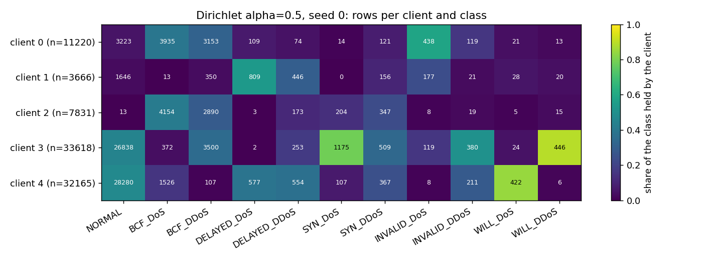

# Phase 8 - B3 CVAE + FedAvg, non-IID (11class)

Auto-generated by `ppfeddata b3`. Flower 1.39.0 simulation on one machine (Ray backend), 5 clients, Dirichlet alpha = 0.5, 30 rounds x 2 local epochs, FedAvg weighted by local rows, fresh Adam optimiser each round, KL warm-up over the global epoch count. Evaluation on the real test split exactly as B2. Seeds [0, 1, 2]. No DP, no secure aggregation.

## Utility (mean ± std over seeds)

| config | runs | macro-F1 (test) | balanced acc | PR-AUC macro |
|---|---|---|---|---|
| B0-rf | 3 | 0.3363 ± 0.0004 | 0.3364 ± 0.0004 | 0.3826 ± 0.0004 |
| B0-mlp | 3 | 0.2460 ± 0.0024 | 0.2786 ± 0.0044 | 0.3771 ± 0.0072 |
| B3-TSTR-rf | 3 | 0.2490 ± 0.0177 | 0.2646 ± 0.0117 | 0.2761 ± 0.0197 |
| B3-TSTR-mlp | 3 | 0.2511 ± 0.0101 | 0.2733 ± 0.0117 | 0.2910 ± 0.0186 |
| B3-TAug-rf | 3 | 0.3354 ± 0.0009 | 0.3354 ± 0.0007 | 0.3797 ± 0.0011 |
| B3-TAug-mlp | 3 | 0.2478 ± 0.0036 | 0.2747 ± 0.0023 | 0.3405 ± 0.0032 |

## Recall per class (test)

| config | NORMAL | BCF_DoS | BCF_DDoS | DELAYED_DoS | DELAYED_DDoS | SYN_DoS | SYN_DDoS | INVALID_DoS | INVALID_DDoS | WILL_DoS | WILL_DDoS |
|---|---|---|---|---|---|---|---|---|---|---|---|
| B0-rf | 0.966 | 0.402 | 0.461 | 0.074 | 0.218 | 0.359 | 0.615 | 0.132 | 0.117 | 0.195 | 0.161 |
| B0-mlp | 0.986 | 0.279 | 0.480 | 0.000 | 0.062 | 0.408 | 0.567 | 0.005 | 0.007 | 0.154 | 0.117 |
| B3-TSTR-rf | 0.692 | 0.065 | 0.200 | 0.287 | 0.332 | 0.077 | 0.601 | 0.370 | 0.016 | 0.145 | 0.125 |
| B3-TSTR-mlp | 0.681 | 0.016 | 0.395 | 0.336 | 0.305 | 0.166 | 0.589 | 0.221 | 0.027 | 0.144 | 0.125 |
| B3-TAug-rf | 0.966 | 0.402 | 0.460 | 0.073 | 0.218 | 0.345 | 0.614 | 0.136 | 0.116 | 0.197 | 0.162 |
| B3-TAug-mlp | 0.979 | 0.279 | 0.493 | 0.001 | 0.068 | 0.302 | 0.568 | 0.050 | 0.005 | 0.159 | 0.117 |

## Paired difference of B3 (test macro-F1, stratified bootstrap)

Criterion: paired CI excludes 0 and |diff| > std of macro-F1 over seeds. B3 - B2 is the cost of federating the generator.

| comparison | seed | diff | 95% CI | excludes 0 | \|diff\| > seed std |
|---|---|---|---|---|---|
| B3-TSTR-rf - B0-rf | 0 | -0.0673 | [-0.0734, -0.0613] | True | True |
| B3-TSTR-rf - B0-rf | 1 | -0.1102 | [-0.1161, -0.1042] | True | True |
| B3-TSTR-rf - B0-rf | 2 | -0.0844 | [-0.0904, -0.0783] | True | True |
| B3-TSTR-mlp - B0-mlp | 0 | +0.0009 | [-0.0035, +0.0054] | False | False |
| B3-TSTR-mlp - B0-mlp | 1 | -0.0034 | [-0.0080, +0.0011] | False | False |
| B3-TSTR-mlp - B0-mlp | 2 | +0.0178 | [+0.0135, +0.0223] | True | True |
| B3-TAug-rf - B0-rf | 0 | -0.0025 | [-0.0047, -0.0003] | True | True |
| B3-TAug-rf - B0-rf | 1 | +0.0000 | [-0.0021, +0.0020] | False | False |
| B3-TAug-rf - B0-rf | 2 | -0.0001 | [-0.0022, +0.0020] | False | False |
| B3-TAug-mlp - B0-mlp | 0 | +0.0093 | [+0.0067, +0.0120] | True | True |
| B3-TAug-mlp - B0-mlp | 1 | -0.0046 | [-0.0076, -0.0015] | True | True |
| B3-TAug-mlp - B0-mlp | 2 | +0.0009 | [-0.0024, +0.0043] | False | False |

## Fidelity and privacy of the synthetic set (mean over classes)

| seed | C2ST AUC | Wasserstein | JS | corr dist | dup rate | DCR ratio | MIA AUC |
|---|---|---|---|---|---|---|---|
| 0 | 1.000 | 0.155 | 0.006 | 0.105 | 0.0001 | 0.933 | 0.503 |
| 1 | 1.000 | 0.177 | 0.010 | 0.121 | 0.0000 | 0.925 | 0.498 |
| 2 | 1.000 | 0.149 | 0.005 | 0.085 | 0.0000 | 0.950 | 0.494 |

## Cost of the federated run

Bytes/round = model size x clients x 2 (download + upload), exact for the payload; the single-machine simulation measures compute but not network latency; peak RAM is the server process only (the Ray client workers are separate processes and are not included). Round 1 includes starting the Ray actors, so the median of the later rounds is the number to use for extrapolation.

| seed | rounds | round 1 (incl. Ray start-up) | median s/round (rounds 2+) | total FL time | mean client s/round | bytes/round | server peak RAM GB | final val loss |
|---|---|---|---|---|---|---|---|---|
| 0 | 30 | 22.6 s | 0.91 | 48 s | 0.41 | 1,485,880 | 0.55 | 2.2683 |
| 1 | 30 | 22.7 s | 1.21 | 58 s | 0.39 | 1,485,880 | 0.55 | 3.1239 |
| 2 | 30 | 22.6 s | 1.01 | 53 s | 0.41 | 1,485,880 | 0.55 | 2.2965 |

## Partition (gate)

Seed 0, alpha 0.5: client sizes [11220, 3666, 7831, 33618, 32165] (minimum required 500, 1 Dirichlet draw(s)); disjoint: True; union = whole train pool (88500 rows): True.

| client | NORMAL | BCF_DoS | BCF_DDoS | DELAYED_DoS | DELAYED_DDoS | SYN_DoS | SYN_DDoS | INVALID_DoS | INVALID_DDoS | WILL_DoS | WILL_DDoS | n |
|---|---|---|---|---|---|---|---|---|---|---|---|---|
| 0 | 3223 | 3935 | 3153 | 109 | 74 | 14 | 121 | 438 | 119 | 21 | 13 | 11220 |
| 1 | 1646 | 13 | 350 | 809 | 446 | 0 | 156 | 177 | 21 | 28 | 20 | 3666 |
| 2 | 13 | 4154 | 2890 | 3 | 173 | 204 | 347 | 8 | 19 | 5 | 15 | 7831 |
| 3 | 26838 | 372 | 3500 | 2 | 253 | 1175 | 509 | 119 | 380 | 24 | 446 | 33618 |
| 4 | 28280 | 1526 | 107 | 577 | 554 | 107 | 367 | 8 | 211 | 422 | 6 | 32165 |

## Gate Phase 8 checks

- partition: OK
