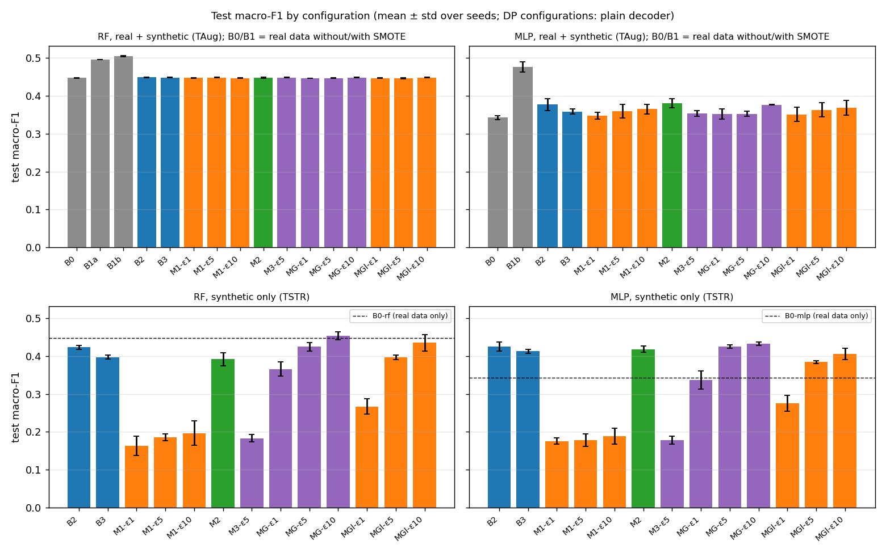
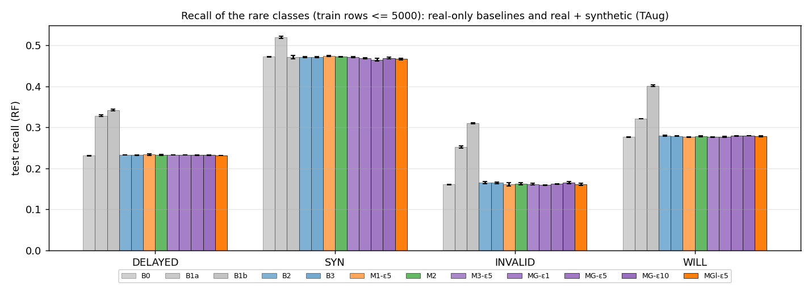
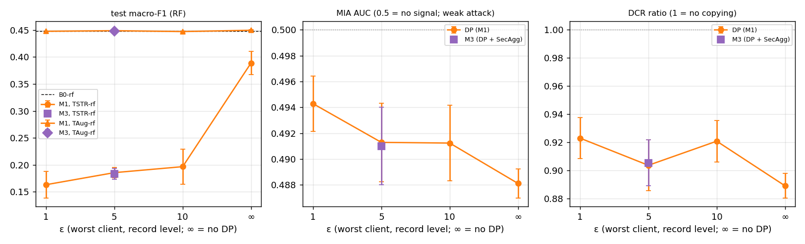
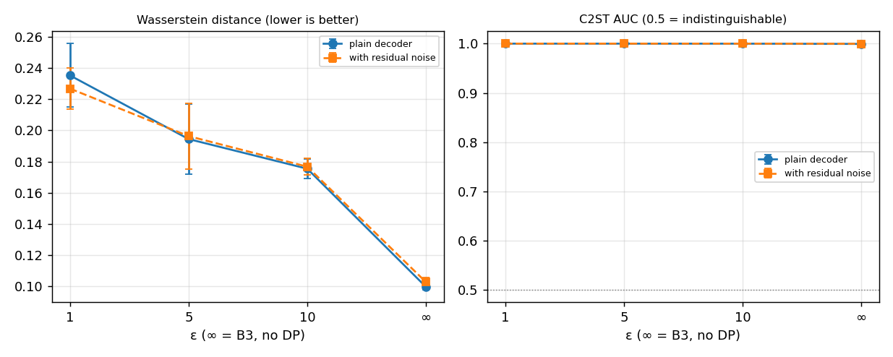
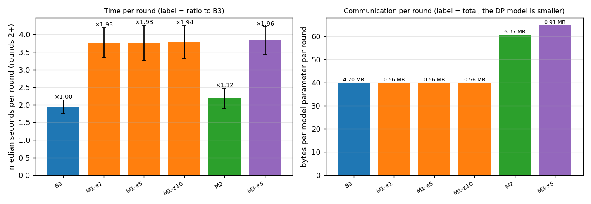
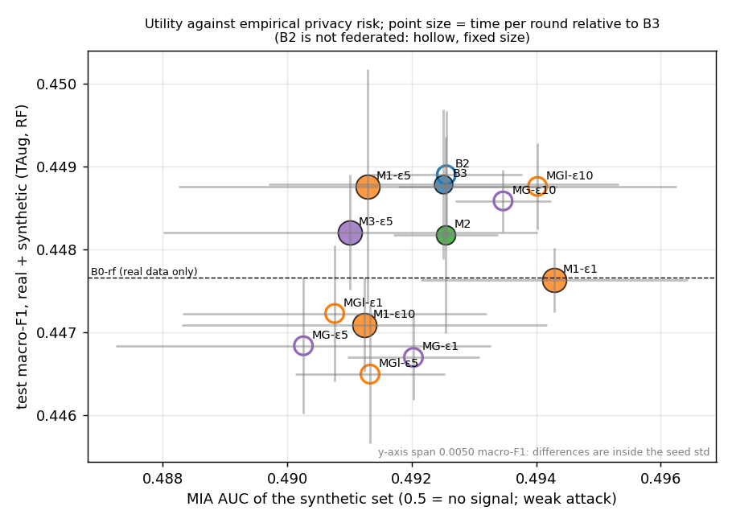

# PP-FedData - final report (6class)

Auto-generated by `ppfeddata aggregate` from the run ledger (`results/runs.csv`), the FL round logs and the config; no number is typed by hand. Seeds [0, 1, 2]; 1237 ledger rows (431 configurations). Utility is measured on the real test split. DP configurations are shown with the **plain decoder**, the variant that depends only on the DP-trained weights and is covered by epsilon (epsilon = worst client, record level, delta 1e-05); B3 at epsilon = infinity is B3-plain. The headline DP family is M1d-t18 / M3d-t18 (hyper-parameters searched under DP-SGD, SPEC_DEVIATIONS 9.11-9.14). Section 9 applies the interpretation rules of Phase 12 (answers R1-R6, red flags, recommendation).

## 1. Provenance and completeness

Status of the spec matrix in this ledger (done = every expected ledger row exists with its predictions):

| configuration | title | seed 0 | seed 1 | seed 2 |
|---|---|---|---|---|
| B0 | Real data only (RF and MLP) | done | done | done |
| B1a | class_weight balanced (RF) | done | done | done |
| B1b | SMOTE oversampling (RF and MLP) | done | done | done |
| B2 | Centralised CVAE | done | done | done |
| B3 | CVAE + FedAvg (non-IID) | done | done | done |
| M2 | FedAvg + SecAgg+ | done | done | done |
| M1-eps1 | FedAvg + DP-SGD, epsilon 1 (DP-tuned hyper-parameters) | done | done | done |
| M1-eps5 | FedAvg + DP-SGD, epsilon 5 (DP-tuned hyper-parameters) | done | done | done |
| M1-eps10 | FedAvg + DP-SGD, epsilon 10 (DP-tuned hyper-parameters) | done | done | done |
| M3 | FedAvg + DP-SGD (epsilon 5) + SecAgg+ | done | done | done |

Every configuration was produced with one config hash and one git commit across its seeds. The hashes below differ between phases because the config file grew (new keys for later phases, none of them read by the earlier methods); `ppfeddata run --stage trial` re-runs the whole matrix from scratch under one commit and compares it with these rows (`results/reports/g4_trial.md`). **Reproduction check:** the isolated one-seed trial (seed [0]) re-ran the matrix from scratch and reproduced 53 of 53 ledger rows exactly (largest difference of a result metric 0.0e+00; byte counts of SecAgg runs differ by up to 31 bytes because they depend on random keys).

| config hash | git commit | ledger configurations | methods |
|---|---|---|---|
| 1a186b09a1c2 | a4c4601 | 4 | MG |
| 6a5e21c85ae8 | a4c4601 | 8 | MG |
| 8c86c0b143d4 | a4c4601 | 407 | A1, B0, B1a, B1b, B2, B3, M1, M2, M3, MG |
| cf05c2c71a73 | a4c4601 | 8 | MG |
| d21d82c44798 | a4c4601 | 4 | MG |

Libraries installed when this report was generated: torch 2.14.1, flwr 1.39.0, opacus 1.6.0, ray 2.59.0, scikit-learn 1.9.1, numpy 2.3.2, pandas 2.3.1, optuna 5.0.0, imbalanced-learn 0.14.2.

Rows per class [train, val, test] (quotas; the splits are by capture group, see leakage_report.md):

| class | train | val | test |
|---|---|---|---|
| NORMAL | 60000 | 2000 | 5000 |
| BCF | 20000 | 2000 | 5000 |
| DELAYED | 3000 | 2000 | 5000 |
| SYN | 3000 | 2000 | 5000 |
| INVALID | 1500 | 2000 | 5000 |
| WILL | 1000 | 2000 | 5000 |

## 2a. Utility, RF (test macro-F1, mean ± std over seeds)

| configuration | real-only / SMOTE | TSTR (synthetic only) | TAug (real + synthetic) | balanced acc (TAug / baseline) |
|---|---|---|---|---|
| B0 | 0.4477 ± 0.0005 | - | - | 0.4807 ± 0.0003 |
| B1a | 0.4960 ± 0.0005 | - | - | 0.5180 ± 0.0005 |
| B1b | 0.5051 ± 0.0015 | - | - | 0.5160 ± 0.0014 |
| B2 | - | 0.4232 ± 0.0054 | 0.4489 ± 0.0008 | 0.4815 ± 0.0006 |
| B3 | - | 0.3975 ± 0.0053 | 0.4488 ± 0.0009 | 0.4814 ± 0.0006 |
| M1-eps1 | - | 0.1632 ± 0.0249 | 0.4476 ± 0.0004 | 0.4809 ± 0.0002 |
| M1-eps5 | - | 0.1855 ± 0.0092 | 0.4488 ± 0.0014 | 0.4815 ± 0.0009 |
| M1-eps10 | - | 0.1967 ± 0.0326 | 0.4471 ± 0.0006 | 0.4805 ± 0.0005 |
| M2 | - | 0.3919 ± 0.0173 | 0.4482 ± 0.0012 | 0.4809 ± 0.0009 |
| M3-eps5 | - | 0.1834 ± 0.0097 | 0.4482 ± 0.0007 | 0.4811 ± 0.0005 |
| MG-eps1 | - | 0.3662 ± 0.0181 | 0.4467 ± 0.0005 | 0.4801 ± 0.0004 |
| MG-eps5 | - | 0.4248 ± 0.0117 | 0.4468 ± 0.0008 | 0.4799 ± 0.0008 |
| MG-eps10 | - | 0.4535 ± 0.0102 | 0.4486 ± 0.0004 | 0.4812 ± 0.0001 |
| MGl-eps1 | - | 0.2672 ± 0.0208 | 0.4472 ± 0.0008 | 0.4805 ± 0.0006 |
| MGl-eps5 | - | 0.3967 ± 0.0063 | 0.4465 ± 0.0008 | 0.4797 ± 0.0006 |
| MGl-eps10 | - | 0.4354 ± 0.0219 | 0.4488 ± 0.0005 | 0.4815 ± 0.0002 |

## 2b. Utility, MLP (test macro-F1, mean ± std over seeds)

| configuration | real-only / SMOTE | TSTR (synthetic only) | TAug (real + synthetic) | balanced acc (TAug / baseline) |
|---|---|---|---|---|
| B0 | 0.3427 ± 0.0056 | - | - | 0.4179 ± 0.0018 |
| B1b | 0.4765 ± 0.0139 | - | - | 0.4848 ± 0.0120 |
| B2 | - | 0.4258 ± 0.0116 | 0.3769 ± 0.0154 | 0.4312 ± 0.0086 |
| B3 | - | 0.4129 ± 0.0054 | 0.3589 ± 0.0071 | 0.4196 ± 0.0024 |
| M1-eps1 | - | 0.1756 ± 0.0085 | 0.3476 ± 0.0093 | 0.4130 ± 0.0058 |
| M1-eps5 | - | 0.1784 ± 0.0166 | 0.3597 ± 0.0183 | 0.4229 ± 0.0068 |
| M1-eps10 | - | 0.1890 ± 0.0213 | 0.3649 ± 0.0123 | 0.4271 ± 0.0034 |
| M2 | - | 0.4186 ± 0.0081 | 0.3805 ± 0.0115 | 0.4348 ± 0.0047 |
| M3-eps5 | - | 0.1785 ± 0.0104 | 0.3541 ± 0.0072 | 0.4201 ± 0.0040 |
| MG-eps1 | - | 0.3371 ± 0.0241 | 0.3522 ± 0.0137 | 0.4181 ± 0.0060 |
| MG-eps5 | - | 0.4252 ± 0.0041 | 0.3528 ± 0.0062 | 0.4158 ± 0.0011 |
| MG-eps10 | - | 0.4328 ± 0.0044 | 0.3768 ± 0.0004 | 0.4272 ± 0.0036 |
| MGl-eps1 | - | 0.2761 ± 0.0209 | 0.3512 ± 0.0184 | 0.4183 ± 0.0051 |
| MGl-eps5 | - | 0.3844 ± 0.0042 | 0.3631 ± 0.0191 | 0.4214 ± 0.0068 |
| MGl-eps10 | - | 0.4061 ± 0.0151 | 0.3683 ± 0.0193 | 0.4223 ± 0.0099 |

## 3. Recall of the rare classes (DELAYED, SYN, INVALID, WILL; RF, real + synthetic or baseline)

| configuration | DELAYED | SYN | INVALID | WILL |
|---|---|---|---|---|
| B0 | 0.231 ± 0.001 | 0.472 ± 0.001 | 0.161 ± 0.000 | 0.276 ± 0.000 |
| B1a | 0.328 ± 0.002 | 0.520 ± 0.003 | 0.252 ± 0.002 | 0.321 ± 0.000 |
| B1b | 0.342 ± 0.002 | 0.470 ± 0.004 | 0.309 ± 0.001 | 0.401 ± 0.002 |
| B2 | 0.233 ± 0.000 | 0.471 ± 0.001 | 0.165 ± 0.003 | 0.279 ± 0.001 |
| B3 | 0.232 ± 0.001 | 0.471 ± 0.001 | 0.165 ± 0.003 | 0.279 ± 0.000 |
| M1-eps1 | 0.231 ± 0.000 | 0.472 ± 0.002 | 0.159 ± 0.002 | 0.277 ± 0.000 |
| M1-eps5 | 0.233 ± 0.002 | 0.474 ± 0.001 | 0.162 ± 0.004 | 0.276 ± 0.001 |
| M1-eps10 | 0.231 ± 0.001 | 0.473 ± 0.002 | 0.158 ± 0.001 | 0.276 ± 0.000 |
| M2 | 0.233 ± 0.002 | 0.472 ± 0.001 | 0.163 ± 0.003 | 0.278 ± 0.001 |
| M3-eps5 | 0.232 ± 0.000 | 0.471 ± 0.001 | 0.162 ± 0.002 | 0.277 ± 0.001 |
| MG-eps1 | 0.233 ± 0.000 | 0.468 ± 0.001 | 0.159 ± 0.001 | 0.277 ± 0.001 |
| MG-eps5 | 0.233 ± 0.001 | 0.465 ± 0.003 | 0.162 ± 0.001 | 0.279 ± 0.001 |
| MG-eps10 | 0.233 ± 0.001 | 0.469 ± 0.002 | 0.166 ± 0.003 | 0.280 ± 0.000 |
| MGl-eps1 | 0.232 ± 0.001 | 0.470 ± 0.001 | 0.160 ± 0.002 | 0.277 ± 0.000 |
| MGl-eps5 | 0.231 ± 0.000 | 0.467 ± 0.002 | 0.161 ± 0.003 | 0.278 ± 0.001 |
| MGl-eps10 | 0.233 ± 0.001 | 0.472 ± 0.001 | 0.164 ± 0.003 | 0.279 ± 0.000 |

All classes:

| configuration | NORMAL | BCF | DELAYED | SYN | INVALID | WILL | BCF_DoS | BCF_DDoS | DELAYED_DoS | DELAYED_DDoS | SYN_DoS | SYN_DDoS | INVALID_DoS | INVALID_DDoS | WILL_DoS | WILL_DDoS |
|---|---|---|---|---|---|---|---|---|---|---|---|---|---|---|---|---|
| B0 | 0.964 ± 0.000 | 0.780 ± 0.000 | 0.231 ± 0.001 | 0.472 ± 0.001 | 0.161 ± 0.000 | 0.276 ± 0.000 | n/a | n/a | n/a | n/a | n/a | n/a | n/a | n/a | n/a | n/a |
| B1a | 0.914 ± 0.000 | 0.774 ± 0.001 | 0.328 ± 0.002 | 0.520 ± 0.003 | 0.252 ± 0.002 | 0.321 ± 0.000 | n/a | n/a | n/a | n/a | n/a | n/a | n/a | n/a | n/a | n/a |
| B1b | 0.930 ± 0.001 | 0.643 ± 0.003 | 0.342 ± 0.002 | 0.470 ± 0.004 | 0.309 ± 0.001 | 0.401 ± 0.002 | n/a | n/a | n/a | n/a | n/a | n/a | n/a | n/a | n/a | n/a |
| B2 | 0.963 ± 0.000 | 0.778 ± 0.001 | 0.233 ± 0.000 | 0.471 ± 0.001 | 0.165 ± 0.003 | 0.279 ± 0.001 | n/a | n/a | n/a | n/a | n/a | n/a | n/a | n/a | n/a | n/a |
| B3 | 0.964 ± 0.000 | 0.778 ± 0.001 | 0.232 ± 0.001 | 0.471 ± 0.001 | 0.165 ± 0.003 | 0.279 ± 0.000 | n/a | n/a | n/a | n/a | n/a | n/a | n/a | n/a | n/a | n/a |
| M1-eps1 | 0.964 ± 0.000 | 0.781 ± 0.000 | 0.231 ± 0.000 | 0.472 ± 0.002 | 0.159 ± 0.002 | 0.277 ± 0.000 | n/a | n/a | n/a | n/a | n/a | n/a | n/a | n/a | n/a | n/a |
| M1-eps5 | 0.964 ± 0.000 | 0.780 ± 0.001 | 0.233 ± 0.002 | 0.474 ± 0.001 | 0.162 ± 0.004 | 0.276 ± 0.001 | n/a | n/a | n/a | n/a | n/a | n/a | n/a | n/a | n/a | n/a |
| M1-eps10 | 0.965 ± 0.000 | 0.780 ± 0.002 | 0.231 ± 0.001 | 0.473 ± 0.002 | 0.158 ± 0.001 | 0.276 ± 0.000 | n/a | n/a | n/a | n/a | n/a | n/a | n/a | n/a | n/a | n/a |
| M2 | 0.963 ± 0.000 | 0.777 ± 0.003 | 0.233 ± 0.002 | 0.472 ± 0.001 | 0.163 ± 0.003 | 0.278 ± 0.001 | n/a | n/a | n/a | n/a | n/a | n/a | n/a | n/a | n/a | n/a |
| M3-eps5 | 0.964 ± 0.000 | 0.780 ± 0.001 | 0.232 ± 0.000 | 0.471 ± 0.001 | 0.162 ± 0.002 | 0.277 ± 0.001 | n/a | n/a | n/a | n/a | n/a | n/a | n/a | n/a | n/a | n/a |
| MG-eps1 | 0.964 ± 0.001 | 0.779 ± 0.001 | 0.233 ± 0.000 | 0.468 ± 0.001 | 0.159 ± 0.001 | 0.277 ± 0.001 | n/a | n/a | n/a | n/a | n/a | n/a | n/a | n/a | n/a | n/a |
| MG-eps5 | 0.963 ± 0.001 | 0.778 ± 0.000 | 0.233 ± 0.001 | 0.465 ± 0.003 | 0.162 ± 0.001 | 0.279 ± 0.001 | n/a | n/a | n/a | n/a | n/a | n/a | n/a | n/a | n/a | n/a |
| MG-eps10 | 0.963 ± 0.000 | 0.776 ± 0.000 | 0.233 ± 0.001 | 0.469 ± 0.002 | 0.166 ± 0.003 | 0.280 ± 0.000 | n/a | n/a | n/a | n/a | n/a | n/a | n/a | n/a | n/a | n/a |
| MGl-eps1 | 0.964 ± 0.001 | 0.780 ± 0.001 | 0.232 ± 0.001 | 0.470 ± 0.001 | 0.160 ± 0.002 | 0.277 ± 0.000 | n/a | n/a | n/a | n/a | n/a | n/a | n/a | n/a | n/a | n/a |
| MGl-eps5 | 0.964 ± 0.000 | 0.778 ± 0.001 | 0.231 ± 0.000 | 0.467 ± 0.002 | 0.161 ± 0.003 | 0.278 ± 0.001 | n/a | n/a | n/a | n/a | n/a | n/a | n/a | n/a | n/a | n/a |
| MGl-eps10 | 0.963 ± 0.000 | 0.777 ± 0.001 | 0.233 ± 0.001 | 0.472 ± 0.001 | 0.164 ± 0.003 | 0.279 ± 0.000 | n/a | n/a | n/a | n/a | n/a | n/a | n/a | n/a | n/a | n/a |

## 4. Privacy: epsilon achieved and empirical checks

The formal guarantee is epsilon (record level, packets of one TCP stream are correlated, labels are not protected; SecAgg adds no accounting). The duplicate rate, the DCR ratio and the membership-inference AUC are empirical checks of the synthetic set; the MIA only detects near-copies (positive control in b2_cvae.md), so 0.5 means 'no copying', not 'no leakage'.

| configuration | target eps | eps achieved (max / median over clients) | duplicate rate | DCR ratio | MIA AUC |
|---|---|---|---|---|---|
| B2 | - | - | 0.0002 ± 0.0000 | 0.9199 ± 0.0061 | 0.4926 ± 0.0012 |
| B3 | - | - | 0.0001 ± 0.0000 | 0.9215 ± 0.0047 | 0.4925 ± 0.0028 |
| M1-eps1 | 1 | 0.997 ± 0.002 / 0.993 ± 0.001 | 0.0000 ± 0.0000 | 0.9229 ± 0.0146 | 0.4943 ± 0.0021 |
| M1-eps5 | 5 | 4.999 ± 0.000 / 4.995 ± 0.002 | 0.0000 ± 0.0000 | 0.9036 ± 0.0182 | 0.4913 ± 0.0030 |
| M1-eps10 | 10 | 9.997 ± 0.002 / 9.994 ± 0.001 | 0.0001 ± 0.0000 | 0.9208 ± 0.0147 | 0.4912 ± 0.0029 |
| M2 | - | - | 0.0003 ± 0.0001 | 0.9229 ± 0.0042 | 0.4925 ± 0.0008 |
| M3-eps5 | 5 | 4.999 ± 0.000 / 4.995 ± 0.002 | 0.0000 ± 0.0000 | 0.9054 ± 0.0163 | 0.4910 ± 0.0030 |
| MG-eps1 | 1 | 1.000 ± 0.000 / 1.000 ± 0.000 | 0.0002 ± 0.0001 | 0.9347 ± 0.0233 | 0.4920 ± 0.0011 |
| MG-eps5 | 5 | 5.000 ± 0.000 / 5.000 ± 0.000 | 0.0003 ± 0.0001 | 0.8914 ± 0.0376 | 0.4903 ± 0.0030 |
| MG-eps10 | 10 | 10.000 ± 0.000 / 10.000 ± 0.000 | 0.0003 ± 0.0001 | 0.8577 ± 0.0012 | 0.4935 ± 0.0008 |
| MGl-eps1 | 1 | 1.000 ± 0.000 / 1.000 ± 0.000 | 0.0001 ± 0.0000 | 0.9005 ± 0.0176 | 0.4908 ± 0.0024 |
| MGl-eps5 | 5 | 5.000 ± 0.000 / 5.000 ± 0.000 | 0.0002 ± 0.0000 | 0.9098 ± 0.0268 | 0.4913 ± 0.0012 |
| MGl-eps10 | 10 | 10.000 ± 0.000 / 10.000 ± 0.000 | 0.0003 ± 0.0001 | 0.8495 ± 0.0106 | 0.4940 ± 0.0022 |

Thresholds from the config (heuristics to be confirmed by the user): duplicate rate <= 0.01, DCR ratio >= 0.5, MIA AUC <= 0.55.

## 5. Fidelity of the synthetic set (mean over classes)

C2ST AUC close to 1 means a classifier tells synthetic from real rows almost perfectly (threshold in the config: <= 0.95); the mean-squared-error decoder reproduces discrete columns as continuous values (SPEC_DEVIATIONS 7.1, 7.6), so this holds for every generator, DP or not.

| configuration | Wasserstein | JS | correlation distance | C2ST AUC |
|---|---|---|---|---|
| B2 | 0.1065 ± 0.0027 | 0.0022 ± 0.0001 | 0.0639 ± 0.0034 | 0.9996 ± 0.0001 |
| B3 | 0.1029 ± 0.0030 | 0.0024 ± 0.0004 | 0.0633 ± 0.0062 | 0.9997 ± 0.0001 |
| M1-eps1 | 0.2352 ± 0.0204 | 0.0159 ± 0.0016 | 0.1649 ± 0.0151 | 1.0000 ± 0.0000 |
| M1-eps5 | 0.1944 ± 0.0225 | 0.0128 ± 0.0030 | 0.1390 ± 0.0164 | 1.0000 ± 0.0000 |
| M1-eps10 | 0.1755 ± 0.0061 | 0.0103 ± 0.0014 | 0.1244 ± 0.0078 | 0.9999 ± 0.0000 |
| M2 | 0.1012 ± 0.0022 | 0.0024 ± 0.0006 | 0.0624 ± 0.0026 | 0.9997 ± 0.0001 |
| M3-eps5 | 0.1944 ± 0.0222 | 0.0128 ± 0.0031 | 0.1389 ± 0.0161 | 1.0000 ± 0.0000 |
| MG-eps1 | 0.1941 ± 0.0215 | 0.0232 ± 0.0041 | 0.1691 ± 0.0041 | 0.9998 ± 0.0000 |
| MG-eps5 | 0.0374 ± 0.0005 | 0.0003 ± 0.0000 | 0.0581 ± 0.0055 | 0.9997 ± 0.0001 |
| MG-eps10 | 0.0489 ± 0.0028 | 0.0025 ± 0.0004 | 0.0740 ± 0.0039 | 0.9995 ± 0.0001 |
| MGl-eps1 | 0.2691 ± 0.0244 | 0.0376 ± 0.0018 | 0.2191 ± 0.0043 | 0.9999 ± 0.0000 |
| MGl-eps5 | 0.1132 ± 0.0045 | 0.0094 ± 0.0011 | 0.1244 ± 0.0028 | 0.9998 ± 0.0000 |
| MGl-eps10 | 0.0722 ± 0.0049 | 0.0059 ± 0.0009 | 0.0995 ± 0.0026 | 0.9997 ± 0.0001 |

## 6. Cost

Time per round is the median of rounds 2+ of the FL round logs (round 1 includes starting Ray), averaged over seeds. Bytes per round: plain FL = float32 model x clients x 2; SecAgg = counted on the grid (all four protocol stages). The DP-tuned model (hidden 128-64) is smaller than the B3 / M2 model (hidden 256-128), so compare bytes per parameter, and compare M2 with B3 and M3 with M1. Overhead threshold in the config: 3.0x the plain FL round.

| configuration | median s/round (rounds 2+) | ratio to B3 | bytes/round | bytes/param/round |
|---|---|---|---|---|
| B3 | 1.95 | 1.00 | 4,202,040 | 40.0 |
| M1-eps1 | 3.76 | 1.93 | 561,720 | 40.0 |
| M1-eps5 | 3.76 | 1.93 | 561,720 | 40.0 |
| M1-eps10 | 3.79 | 1.94 | 561,720 | 40.0 |
| M2 | 2.18 | 1.12 | 6,369,062 | 60.6 |
| M3-eps5 | 3.83 | 1.96 | 908,509 | 64.7 |

## 7. DP configurations: plain decoder against the variant with residual noise

The residual-noise scales are computed from the pooled train data and are not covered by epsilon (SPEC_DEVIATIONS 8.8, 9.4); the gap shows how much utility depends on that statistic.

| configuration | TSTR-rf plain | TSTR-rf with residual noise (not covered by eps) | TAug-rf plain | TAug-rf with residual noise |
|---|---|---|---|---|
| M1-eps1 | 0.1632 ± 0.0249 | 0.2188 ± 0.0263 | 0.4476 ± 0.0004 | 0.4485 ± 0.0004 |
| M1-eps5 | 0.1855 ± 0.0092 | 0.2623 ± 0.0127 | 0.4488 ± 0.0014 | 0.4481 ± 0.0002 |
| M1-eps10 | 0.1967 ± 0.0326 | 0.2620 ± 0.0109 | 0.4471 ± 0.0006 | 0.4489 ± 0.0009 |
| M3-eps5 | 0.1834 ± 0.0097 | 0.2629 ± 0.0097 | 0.4482 ± 0.0007 | 0.4485 ± 0.0002 |
| MG-eps1 | 0.3662 ± 0.0181 | n/a | 0.4467 ± 0.0005 | n/a |
| MG-eps5 | 0.4248 ± 0.0117 | n/a | 0.4468 ± 0.0008 | n/a |
| MG-eps10 | 0.4535 ± 0.0102 | n/a | 0.4486 ± 0.0004 | n/a |
| MGl-eps1 | 0.2672 ± 0.0208 | n/a | 0.4472 ± 0.0008 | n/a |
| MGl-eps5 | 0.3967 ± 0.0063 | n/a | 0.4465 ± 0.0008 | n/a |
| MGl-eps10 | 0.4354 ± 0.0219 | n/a | 0.4488 ± 0.0005 | n/a |

## 8. Reference rows (not in the spec matrix)

B3-plain is the epsilon = infinity point; the Phase 7 family used hyper-parameters tuned without DP and a clipping bound of 1 (SPEC_DEVIATIONS 9.5); it is kept to show what the DP-specific search changed.

| configuration | TSTR-rf | TSTR-mlp | TAug-rf | TAug-mlp | eps achieved (max) |
|---|---|---|---|---|---|
| B3-plain (eps = inf) | 0.3889 ± 0.0214 | 0.4073 ± 0.0214 | 0.4496 ± 0.0008 | 0.3783 ± 0.0090 | - |
| M1 Phase 7 hp, eps 1 | 0.1663 ± 0.0281 | 0.1711 ± 0.0050 | 0.4471 ± 0.0005 | 0.3502 ± 0.0058 | 0.999 ± 0.001 |
| M1 Phase 7 hp, eps 5 | 0.1886 ± 0.0070 | 0.1918 ± 0.0110 | 0.4479 ± 0.0007 | 0.3489 ± 0.0107 | 4.998 ± 0.001 |
| M1 Phase 7 hp, eps 10 | 0.1940 ± 0.0108 | 0.2034 ± 0.0024 | 0.4476 ± 0.0004 | 0.3588 ± 0.0093 | 9.998 ± 0.001 |

## 8b. Extension A1: label skew of the clients (Dirichlet alpha)

B3 with another Dirichlet alpha and everything else equal (5 clients, 30 rounds x 2 local epochs, the same hyper-parameters, no DP, no SecAgg). Every seed draws its own partition, so the spread over seeds includes the partition draw. Macro-F1 on the real test split.

| Dirichlet alpha | TSTR-rf | TSTR-mlp | TAug-rf | TAug-mlp |
|---|---|---|---|---|
| 0.1 | 0.3474 ± 0.0228 | 0.3413 ± 0.0123 | 0.4496 ± 0.0012 | 0.3690 ± 0.0062 |
| 0.5 (B3) | 0.3975 ± 0.0053 | 0.4129 ± 0.0054 | 0.4488 ± 0.0009 | 0.3589 ± 0.0071 |
| 10 | 0.4259 ± 0.0049 | 0.4149 ± 0.0205 | 0.4491 ± 0.0002 | 0.3632 ± 0.0187 |

Generator and training side of the same runs. alpha changes more than the label mix: with a skewed split the clients also differ in size, and a larger client takes more optimiser steps and carries more FedAvg weight (SPEC_DEVIATIONS 8.6), so the effective number of steps per round differs between rows.

| Dirichlet alpha | seeds | client rows, min - max over seeds | effective optimiser steps / round | FL final val loss (ELBO) | C2ST AUC | Wasserstein | TSTR-rf recall, mean over DELAYED/SYN/INVALID/WILL |
|---|---|---|---|---|---|---|---|
| 0.1 | 3 | 917 - 71,140 | 356 | 3.1291 ± 0.8584 | 0.9997 ± 0.0002 | 0.1311 ± 0.0157 | 0.318 ± 0.027 |
| 0.5 (B3) | 3 | 2,862 - 69,578 | 308 | 1.6631 ± 0.5797 | 0.9997 ± 0.0001 | 0.1029 ± 0.0030 | 0.364 ± 0.035 |
| 10 | 3 | 11,832 - 21,931 | 144 | 1.2359 ± 0.0283 | 0.9995 ± 0.0001 | 0.1027 ± 0.0096 | 0.386 ± 0.021 |

## 8c. Extensions A2, A4 and A5: rare-class quotas, which test groups, how many packets per stream

Auto-generated by `ppfeddata sensitivity` (module `sensitivity.py`). Each world is the main study with one setting changed (A2: the train quotas of the rare classes; A4: `split.split_seed`, i.e. which capture groups form the validation and test splits; A5: `train_sampling.max_rows_per_stream`), re-run from Phase 3 on with its own data, runs and test split; the main study is the first row. Every number is read from the ledger and the saved predictions of that world; the verdict is the rule of the spec (paired-bootstrap interval of the difference excludes 0 and |delta| exceeds the seed std; 3 seeds).

### Worlds

| world | what | test rows | test groups (shared with main) | test streams | train rows / stream (mean, max) |
|---|---|---|---|---|---|
| main | the main study | 30,000 | 11 | 20,485 | 1.15, 182 |
| A4-s1 | split_seed 1: another choice of the test / validation groups | 30,000 | 11 (1) | 21,839 | 1.15, 180 |
| A4-s2 | split_seed 2: another choice of the test / validation groups | 30,000 | 11 (0) | 22,062 | 1.15, 159 |
| A5-cap20 | at most 20 packets of one TCP stream in the train pool | 30,000 | 11 (11) | 20,485 | 1.03, 5 |
| A2-r10 | rare-class train quotas x6: NORMAL : WILL = 10 : 1 | 30,000 | 11 (11) | 20,485 | 1.17, 182 |
| A2-r200 | rare-class train quotas x0.3: NORMAL : WILL = 200 : 1 | 30,000 | 11 (11) | 20,485 | 1.15, 182 |

### Test macro-F1 (mean ± std over seeds)

| world | B0-rf | B0-mlp | B3-TSTR-rf | B3-TSTR-mlp | B3-TAug-rf | B3-TAug-mlp | M1-eps5-TSTR-rf | M1-eps5-TSTR-mlp | MG-eps5-TSTR-rf | MG-eps5-TSTR-mlp |
|---|---|---|---|---|---|---|---|---|---|---|
| main | 0.448 ± 0.000 | 0.343 ± 0.006 | 0.397 ± 0.005 | 0.413 ± 0.005 | 0.449 ± 0.001 | 0.359 ± 0.007 | 0.186 ± 0.009 | 0.178 ± 0.017 | 0.425 ± 0.012 | 0.425 ± 0.004 |
| A4-s1 | 0.457 ± 0.001 | 0.350 ± 0.013 | 0.384 ± 0.021 | 0.388 ± 0.021 | 0.457 ± 0.001 | 0.374 ± 0.007 | - | - | 0.419 ± 0.015 | 0.427 ± 0.009 |
| A4-s2 | 0.462 ± 0.000 | 0.345 ± 0.009 | 0.389 ± 0.006 | 0.371 ± 0.028 | 0.463 ± 0.001 | 0.379 ± 0.003 | - | - | 0.416 ± 0.012 | 0.429 ± 0.010 |
| A5-cap20 | 0.442 ± 0.001 | 0.349 ± 0.009 | 0.390 ± 0.009 | 0.387 ± 0.019 | 0.443 ± 0.000 | 0.373 ± 0.017 | 0.179 ± 0.013 | 0.194 ± 0.020 | 0.394 ± 0.006 | 0.376 ± 0.006 |
| A2-r10 | 0.511 ± 0.000 | 0.415 ± 0.011 | 0.427 ± 0.009 | 0.428 ± 0.015 | 0.512 ± 0.001 | 0.428 ± 0.007 | - | - | 0.432 ± 0.007 | 0.446 ± 0.013 |
| A2-r200 | 0.405 ± 0.001 | 0.312 ± 0.002 | 0.372 ± 0.028 | 0.386 ± 0.038 | 0.408 ± 0.001 | 0.336 ± 0.019 | - | - | 0.388 ± 0.013 | 0.372 ± 0.004 |

### Verdicts (delta of macro-F1 and the rule of the spec)

| comparison | main | A4-s1 | A4-s2 | A5-cap20 | A2-r10 | A2-r200 | same verdict in every world that has it |
|---|---|---|---|---|---|---|---|
| real + synthetic (B3) minus real only (RF): R1 | +0.0011 better | +0.0006 none | +0.0008 none | +0.0002 none | +0.0009 none | +0.0028 better | NO |
| synthetic only (B3) minus real only (RF) | -0.0502 worse | -0.0724 worse | -0.0730 worse | -0.0524 worse | -0.0840 worse | -0.0329 worse | yes |
| DP (eps 5, plain decoder) minus eps = infinity, synthetic only (RF): R4 | -0.2033 worse | - | - | -0.1981 worse | - | - | yes |
| FedDP-Marginal eps 5, synthetic only, minus real only (RF) | -0.0229 worse | -0.0379 worse | -0.0465 worse | -0.0487 worse | -0.0785 worse | -0.0168 worse | yes |
| FedDP-Marginal eps 5 minus the CVAE without DP (B3), synthetic only (RF) | +0.0273 better | +0.0344 better | +0.0265 better | +0.0037 none | +0.0054 none | +0.0161 none | NO |
| real + synthetic (B3) minus real only (MLP): R1 | +0.0162 better | +0.0246 better | +0.0336 better | +0.0238 better | +0.0130 better | +0.0248 better | yes |
| synthetic only (B3) minus real only (MLP) | +0.0702 better | +0.0383 better | +0.0255 none | +0.0377 better | +0.0131 none | +0.0746 better | NO |
| DP (eps 5, plain decoder) minus eps = infinity, synthetic only (MLP): R4 | -0.2289 worse | - | - | -0.1883 worse | - | - | yes |
| FedDP-Marginal eps 5, synthetic only, minus real only (MLP) | +0.0826 better | +0.0768 better | +0.0833 better | +0.0264 better | +0.0314 better | +0.0608 better | yes |
| FedDP-Marginal eps 5 minus the CVAE without DP (B3), synthetic only (MLP) | +0.0123 better | +0.0385 better | +0.0578 better | -0.0114 none | +0.0184 better | -0.0138 none | NO |

**Reading.** 6 of 10 comparisons have the same verdict in every world that has them (6 worlds in all); those that change: real + synthetic (B3) minus real only (RF): R1 (main better, A4-s1 none, A4-s2 none, A5-cap20 none, A2-r10 none, A2-r200 better); FedDP-Marginal eps 5 minus the CVAE without DP (B3), synthetic only (RF) (main better, A4-s1 better, A4-s2 better, A5-cap20 none, A2-r10 none, A2-r200 none); synthetic only (B3) minus real only (MLP) (main better, A4-s1 better, A4-s2 none, A5-cap20 better, A2-r10 none, A2-r200 better); FedDP-Marginal eps 5 minus the CVAE without DP (B3), synthetic only (MLP) (main better, A4-s1 better, A4-s2 better, A5-cap20 none, A2-r10 better, A2-r200 none).

What this does and does not cover: it covers the class imbalance of the train pool (A2), the choice of the capture groups of the validation and test splits (A4) and the cap on packets per stream (A5), with the same hyper-parameters (tuned once, on the main study's validation data) and 3 seeds per world. It does not cover other datasets, the 11-class mode (A3: see robustness.md), or a different number of clients. Most sub-classes come from one capture file (their test rows are a block of that file; see the limitation on block splits), so another `split_seed` mostly moves the block, not the capture.

## 9. Interpretation (Phase 12)

Generated by `ppfeddata aggregate` (module `interpret.py`) from the run ledger and the test-set predictions saved by every run (219 runs, seeds [0, 1, 2], 30,000 real test rows). The rules are those of the spec (Phase 12); the choices it leaves open are recorded in SPEC_DEVIATIONS 12.1-12.10. Every number is recomputed from those files (the macro-F1 recomputed from the predictions equals the ledger's to 8e-17); `results/interpretation.json` holds the same numbers in machine-readable form.

**How a difference is judged.** Every comparison is a difference of test macro-F1 (or of recall) between two configurations, averaged over the 3 seeds (delta = first minus second). A difference *has an effect* only if (i) its 95 % paired-bootstrap interval excludes 0 and (ii) |delta| is larger than the seed-to-seed std of the two configurations (the larger of the two, ddof = 0, as in every table). The bootstrap draws the 30,000 real test rows with replacement, stratified by class, with the same 1000 resamples for every run, so the differences are paired. Packets of one TCP stream are correlated, which makes that interval too narrow; every verdict is therefore repeated with a bootstrap over whole streams (20,485 streams) and marked **†** when the verdict changes. Neither interval reflects which capture files form the test split (11 capture groups; extension A4 re-ran the study with 2 other choices of them, section 8c) or training randomness beyond the seeds that were run, so a verdict is a statement about this test split and these seeds.

### 9.0 Answers at a glance

- **R1 - Does synthetic data improve the IDS?** Short answer: RF: 2 of 13 generators pass, the best by +0.001 (SMOTE +0.057); MLP: 9 of 13 generators pass, the best by +0.038 (SMOTE +0.134). Test macro-F1, real + synthetic minus real only: RF: 2 of 13 generators better, 10 no effect, 1 worse (delta -0.0012 to +0.0012); MLP: 9 of 13 generators better, 4 no effect, 0 worse (delta +0.0049 to +0.0378). Recall of the rare classes (DELAYED/SYN/INVALID/WILL, RF) moves by at most 0.007 for any generator, against +0.070 to +0.096 (mean of the four) for the SMOTE / class-weight references. Reference macro-F1 deltas: B1a +0.048 (RF), B1b +0.057 (RF), B1b +0.134 (MLP).
- **R2 - Is the CVAE better than the simple methods?** No. TAug with the CVAE (B2, B3) against class weights (B1a, RF) and SMOTE (B1b): 6 of 6 comparisons worse, 0 no effect, 0 better (macro-F1 delta -0.1177 to -0.0471; rare-class recall delta -0.167 to -0.068).
- **R3 - What does non-IID FL cost?** B2 minus B3 in test macro-F1: TSTR-RF +0.0257, TSTR-MLP +0.0129, TAug-RF +0.0001, TAug-MLP +0.0181. Relative loss in TSTR-RF: 6.1 %. Reported only; the spec sets no pass / fail threshold.
- **R4 - What does DP cost, and what does it bring?** Cost, plain decoder against the epsilon = infinity point: TSTR macro-F1 delta -0.2317 to +0.0465 (9 of 12 comparisons worse), TAug delta -0.0307 to -0.0008 (4 of 12 no effect). Over epsilon = 1, 5, 10 the TSTR-RF curve is monotone within noise and not flat (range 0.168 against seed std up to 0.022). Benefit: no empirical benefit is measurable. MIA AUC is 0.488-0.494 at every epsilon including infinity (spread 0.006), it does approach 0.5 as epsilon shrinks, and the attack did not detect an over-fitted CVAE (AUC 0.510), so the positive control of the spec is not met for the CVAE. What DP brings is the formal guarantee (record level, see 9.8). A second attack, with access to the released model (record fit under the model, calibrated by a reference model), passes its positive control (AUC 0.647 on the over-fitted CVAE against 0.510 for the attack on the synthetic data); against the federated models it gives B3 0.506, M1-eps10 0.497, M1-eps5 0.499, M1-eps1 0.502; it detects nothing (AUC < 0.55) in any of them. For FedDP-Marginal a benefit is measured: the attack on its released tables detects the release without DP (calibrated AUC 0.573) and less those with DP (0.515-0.539; 9.12).
- **R5 - What does SecAgg cost?** Utility (M2 - B3 and M3 - M1-eps5, 8 comparisons): 7 no effect, 1 better, 0 worse (largest |delta| 0.0216); some differences pass the rule. Overhead: M2 / B3: 1.12x time per round, 1.52x bytes per parameter per round; M3-eps5 / M1-eps5: 1.02x time per round, 1.62x bytes per parameter per round.
- **R6 - Recommended configuration.** Rule: MIA AUC <= 0.55, epsilon <= 5 when DP is used, time per round <= 3x plain FL (B3), then the highest TAug macro-F1 (RF). Eligible: B3, M1-eps1, M1-eps5, M2, M3-eps5, MG-eps1, MG-eps5, MGl-eps1, MGl-eps5. The literal rule picks B3; tied within noise: B3, M1-eps5, M2, M3-eps5; the tie is broken in favour of the stronger protection: **M3-eps5**. DP configurations pass the filters, not utility or MIA: every candidate's TAug-RF macro-F1 lies in 0.4465-0.4489. If a formal DP guarantee is required, the DP option the rule would pick without the overhead filter is M1-eps1 (tied: M1-eps1, M1-eps5, M3-eps5).
- **Which of M1, M2, M3 for which requirement?** Utility does not decide it (the TAug-RF macro-F1 of every candidate lies in 0.4465-0.4489); what each one protects and what it costs does (9.10). **M2** if only the aggregation server must not see the updates (1.12x time per round, 1.52x bytes per parameter, utility: 3 of 4 comparisons with B3 show no effect; no epsilon); **M1-eps1** if a formal guarantee on the released model or synthetic data is required (TSTR macro-F1 -58 to 12 % against epsilon = infinity, recall of the rare classes 0.05-0.37 against 0.32, 1.9x time per round); **M3-eps5** if both are needed (on top of M1-eps5: 1.02x time, 1.62x bytes per parameter, 4 of 4 utility comparisons show no effect). These are costs and guarantees, not a measured privacy benefit: the empirical attacks are at chance for every CVAE configuration (R4); FedDP-Marginal differs, the attack on its released tables detects the release without DP (calibrated AUC 0.573) and less those with DP (0.515-0.539; 9.12). If the goal is only a detector, training it directly by FL is the alternative to all three (9.9).
- **Do the answers depend on the test groups, the rare-class quotas or the sampling?** Extensions A4-s1, A4-s2, A5-cap20, A2-r10, A2-r200 re-ran the study from Phase 3 with one setting changed: 6 of 10 comparisons (R1, synthetic-only against real data, DP cost) keep their verdict in every world; those that change: real + synthetic (B3) minus real only (RF): R1 (main better, A4-s1 none, A4-s2 none, A5-cap20 none, A2-r10 none, A2-r200 better); FedDP-Marginal eps 5 minus the CVAE without DP (B3), synthetic only (RF) (main better, A4-s1 better, A4-s2 better, A5-cap20 none, A2-r10 none, A2-r200 none); synthetic only (B3) minus real only (MLP) (main better, A4-s1 better, A4-s2 none, A5-cap20 better, A2-r10 none, A2-r200 better); FedDP-Marginal eps 5 minus the CVAE without DP (B3), synthetic only (MLP) (main better, A4-s1 better, A4-s2 better, A5-cap20 none, A2-r10 better, A2-r200 none). Section 8c has the numbers; the choice of other datasets and client counts is not covered.
- **Why a CVAE at all?** R1 and R2 support the CVAE only in part as a way to improve the IDS (worse than class weights and SMOTE in 6 of 6 comparisons; generators better than real data only: RF 2 of 13, at most +0.001 against +0.057 for SMOTE, MLP 9 of 13, at most +0.038 against +0.134 for SMOTE). The CVAE is the premise of the spec (a federated, label-conditional generator whose data balance the classes of the IDS), not the outcome of a comparison between generators, and this study is its test. What is left of the case is the setting where raw data cannot be pooled, which TAug, B0 and B1 all need: there the synthetic data alone give RF 0.397 (B3), 0.392 (M2) against 0.448 for real data only, without pooling the raw data. Tested after the main study: training the MLP itself by FedAvg on the same clients (no generator) reaches macro-F1 0.410 with class weights (the clients then share their class counts) and 0.326 without, against 0.413 for the CVAE route (synthetic data only, TSTR-MLP): the class-weighted federated MLP is not different from (inside the noise) it (delta -0.003), the plain one below it (delta -0.087). Given the same protections (SecAgg numerics, DP at epsilon 1, 5, 10, both) and a little tuning on validation, the direct classifier is above the CVAE route with the same protection in 4 of 6 cases, not different in 2 and below in 0. Federated SMOTE (each client oversamples its own rows with SMOTE, then FedAvg; no generator, no protection) reaches 0.445, above the CVAE route (0.413; delta +0.033). Not tested: other generators. See 9.9.
- **Why FedDP-Marginal and not the CVAE?** Under DP the CVAE route stays far from its non-DP version even after re-tuning per epsilon at full scale (O1), while the federated DP marginal generator does not (TSTR macro-F1, test, mean over seeds: ε 1: MGs-eps1 0.366 against the best CVAE route M1-eps1 0.176; ε 5: MGr-eps5 0.425 against the best CVAE route M3o-eps5 0.254; ε 10: MGs-eps10 0.433 against the best CVAE route M1o-eps10 0.275; B3, the CVAE without DP: 0.413; FedDP-Marginal without DP: 0.459). It also sends three small rounds instead of tens of model rounds, and its noise can be split over the clients through secure aggregation with exact accounting. The framework therefore uses FedDP-Marginal; the CVAE stays as the baseline. Not an algorithmic novelty (FLAIM, MST, AIM); see 9.9b.
- **Follow-up round (9.11).** On this data, epsilon for a whole TCP stream costs FedDP-Marginal 0.03-0.05 TSTR macro-F1, for a whole capture it falls to 0.09-0.18; calibrating the noise for 3 honest clients of 5 changes it by -0.005 to +0.016; class-probability weights chosen on validation raise the TSTR of the IDS (MG-eps5 RF 0.427 → 0.428, MG-eps5 MLP 0.428 → 0.423); a client that adds FedDP-Marginal rows for the classes it lacks gains +0.042 macro-F1 on average (0.384 → 0.426, 13 of 15 client models better).
- **Without DP (round Q1, 9.12).** FedDP-Marginal without DP reaches TSTR macro-F1 0.459 (against B3, the CVAE without DP: RF +0.044 better, MLP +0.046 better); DP costs it ε 1 -0.122 to -0.076; ε 5 -0.033 to -0.017; ε 10 -0.026 to +0.012 (worse in 5 of 6 comparisons, rule of R1); SecAgg+ costs its releases 1.39x bytes and 1.06x time and nothing in utility (the same tables and synthetic data with and without it); the membership attack detects the tables released without DP (AUC 0.573 > 0.55) and less those with DP (0.515-0.539).
- **Red flags** (spec Phase 12): F1 (macro-F1 near 1.00, B0 included): not triggered; F2 (TSTR above TRTR): TRIGGERED, investigated: not above the class-balanced real reference; F3 (model copies training data): not triggered; F4 (large spread between seeds): not triggered; F5 (reported epsilon far from an independent recomputation): not triggered. Details in 9.7.

### 9.1 R1 - Does synthetic data improve the IDS?

Delta = test macro-F1 of real + synthetic training data (TAug) minus real data only (B0). B1a (class weights) and B1b (SMOTE) are non-generative references; DP rows use the plain decoder. **†** = the stream bootstrap gives another verdict.

| configuration | RF: delta macro-F1 [95% CI] | RF: seed std | RF: verdict | MLP: delta macro-F1 [95% CI] | MLP: seed std | MLP: verdict |
|---|---|---|---|---|---|---|
| B1a (reference) | +0.0483 [+0.0449, +0.0514] | 0.0005 | better | - | - | - |
| B1b (reference) | +0.0575 [+0.0538, +0.0613] | 0.0015 | better | +0.1339 [+0.1289, +0.1384] | 0.0139 | better |
| B2 | +0.0012 [+0.0001, +0.0024] | 0.0008 | better | +0.0343 [+0.0319, +0.0365] | 0.0154 | better |
| B3 | +0.0011 [+0.0000, +0.0023] | 0.0009 | better † | +0.0162 [+0.0140, +0.0184] | 0.0071 | better |
| M1-eps1 | -0.0000 [-0.0010, +0.0008] | 0.0005 | no effect | +0.0049 [+0.0030, +0.0069] | 0.0093 | no effect |
| M1-eps5 | +0.0011 [+0.0002, +0.0020] | 0.0014 | no effect | +0.0170 [+0.0153, +0.0186] | 0.0183 | no effect |
| M1-eps10 | -0.0006 [-0.0015, +0.0004] | 0.0006 | no effect | +0.0223 [+0.0201, +0.0243] | 0.0123 | better |
| M2 | +0.0005 [-0.0005, +0.0016] | 0.0012 | no effect | +0.0378 [+0.0353, +0.0406] | 0.0115 | better |
| M3-eps5 | +0.0005 [-0.0004, +0.0014] | 0.0007 | no effect | +0.0114 [+0.0097, +0.0129] | 0.0072 | better |
| MG-eps1 | -0.0010 [-0.0020, +0.0001] | 0.0005 | no effect | +0.0096 [+0.0079, +0.0112] | 0.0137 | no effect |
| MG-eps5 | -0.0008 [-0.0020, +0.0002] | 0.0008 | no effect | +0.0101 [+0.0082, +0.0120] | 0.0062 | better |
| MG-eps10 | +0.0009 [-0.0002, +0.0021] | 0.0005 | no effect | +0.0341 [+0.0313, +0.0368] | 0.0056 | better |
| MGl-eps1 | -0.0004 [-0.0014, +0.0006] | 0.0008 | no effect | +0.0085 [+0.0064, +0.0107] | 0.0184 | no effect |
| MGl-eps5 | -0.0012 [-0.0022, -0.0001] | 0.0008 | worse | +0.0205 [+0.0182, +0.0227] | 0.0191 | better |
| MGl-eps10 | +0.0011 [-0.0000, +0.0022] | 0.0005 | no effect | +0.0256 [+0.0232, +0.0281] | 0.0193 | better |

Recall of the rare classes (DELAYED, SYN, INVALID, WILL), RF: delta TAug - B0 and verdict ('=' = no effect):

| configuration | DELAYED | SYN | INVALID | WILL | mean of the four [95% CI] |
|---|---|---|---|---|---|
| B1a (reference) | +0.097 better | +0.048 better | +0.091 better | +0.045 better | +0.070 [+0.066, +0.074] better |
| B1b (reference) | +0.111 better | -0.002 = | +0.149 better | +0.125 better | +0.096 [+0.092, +0.100] better |
| B2 | +0.002 better | -0.001 = | +0.004 better | +0.003 better | +0.002 [+0.001, +0.003] better |
| B3 | +0.001 = | -0.001 = | +0.004 better | +0.002 better | +0.002 [+0.000, +0.003] better |
| M1-eps1 | +0.000 = | -0.000 = | -0.001 = | +0.001 = | -0.000 [-0.001, +0.001] = |
| M1-eps5 | +0.002 better | +0.002 = | +0.001 = | -0.000 = | +0.001 [+0.000, +0.002] better |
| M1-eps10 | -0.000 = | +0.001 = | -0.002 worse | +0.000 = | -0.000 [-0.001, +0.001] = |
| M2 | +0.002 better | -0.000 = | +0.002 = | +0.002 better | +0.001 [+0.000, +0.003] better |
| M3-eps5 | +0.001 = | -0.001 = | +0.001 = | +0.000 = | +0.000 [-0.001, +0.001] = |
| MG-eps1 | +0.002 better † | -0.004 worse | -0.001 = | +0.001 = | -0.001 [-0.002, +0.000] = |
| MG-eps5 | +0.001 = | -0.007 worse | +0.001 = | +0.003 better | -0.000 [-0.002, +0.001] = |
| MG-eps10 | +0.002 better † | -0.003 worse † | +0.005 better | +0.004 better | +0.002 [+0.001, +0.003] better |
| MGl-eps1 | +0.001 = | -0.002 = | -0.000 = | +0.000 = | -0.000 [-0.001, +0.001] = |
| MGl-eps5 | +0.000 = | -0.005 worse | +0.000 = | +0.002 better | -0.001 [-0.002, +0.000] = |
| MGl-eps10 | +0.002 = † | +0.000 = | +0.004 better | +0.002 better | +0.002 [+0.001, +0.003] better |

Recall of the rare classes (DELAYED, SYN, INVALID, WILL), MLP: delta TAug - B0 and verdict ('=' = no effect):

| configuration | DELAYED | SYN | INVALID | WILL | mean of the four [95% CI] |
|---|---|---|---|---|---|
| B1b (reference) | +0.236 better | -0.065 worse | +0.303 better | +0.226 better | +0.175 [+0.170, +0.180] better |
| B2 | +0.013 better | -0.079 worse | +0.162 better | -0.001 = | +0.024 [+0.021, +0.026] better |
| B3 | +0.001 = | -0.048 worse | +0.079 better | +0.002 better | +0.009 [+0.006, +0.011] better |
| M1-eps1 | -0.017 = | -0.052 worse | +0.064 better | -0.002 worse | -0.001 [-0.003, +0.000] = |
| M1-eps5 | +0.002 = | -0.051 worse | +0.082 better | -0.000 = | +0.008 [+0.006, +0.010] = |
| M1-eps10 | +0.014 better | -0.023 = | +0.074 better | -0.001 = | +0.016 [+0.014, +0.018] better |
| M2 | +0.013 better | -0.059 = | +0.159 better | +0.002 better | +0.029 [+0.026, +0.032] better |
| M3-eps5 | +0.005 = | -0.030 worse | +0.047 better | -0.001 = | +0.005 [+0.004, +0.007] = |
| MG-eps1 | +0.003 = | -0.032 worse | +0.048 = | -0.000 = | +0.005 [+0.003, +0.006] = |
| MG-eps5 | +0.005 = | -0.069 worse | +0.063 better | +0.001 = | +0.000 [-0.002, +0.002] = |
| MG-eps10 | +0.015 better | -0.090 worse | +0.152 better | +0.009 better | +0.021 [+0.019, +0.024] better |
| MGl-eps1 | -0.007 = | -0.073 = | +0.079 = | -0.000 = | -0.000 [-0.002, +0.002] = |
| MGl-eps5 | +0.018 better | -0.081 worse | +0.105 better | +0.001 = | +0.011 [+0.008, +0.013] = |
| MGl-eps10 | +0.012 better | -0.082 worse | +0.126 better | +0.010 = | +0.017 [+0.014, +0.019] better |

### 9.2 R2 - Is the CVAE better than the simple methods?

Delta = TAug macro-F1 of the CVAE (B2 centralised, B3 federated) minus the simple method trained on the same real data (B1a: class weights, RF only; B1b: SMOTE to the same per-class target).

| CVAE | compared with | delta macro-F1 [95% CI] | seed std | verdict | delta rare-class recall [95% CI] | verdict (recall) |
|---|---|---|---|---|---|---|
| B2 | B1a-RF | -0.0471 [-0.0501, -0.0435] | 0.0008 | worse | -0.068 [-0.072, -0.064] | worse |
| B2 | B1b-RF | -0.0562 [-0.0602, -0.0525] | 0.0015 | worse | -0.094 [-0.098, -0.090] | worse |
| B2 | B1b-MLP | -0.0996 [-0.1041, -0.0950] | 0.0154 | worse | -0.151 [-0.156, -0.147] | worse |
| B3 | B1a-RF | -0.0472 [-0.0504, -0.0437] | 0.0009 | worse | -0.069 [-0.072, -0.065] | worse |
| B3 | B1b-RF | -0.0563 [-0.0603, -0.0525] | 0.0015 | worse | -0.094 [-0.098, -0.090] | worse |
| B3 | B1b-MLP | -0.1177 [-0.1222, -0.1130] | 0.0139 | worse | -0.167 [-0.172, -0.162] | worse |

### 9.3 R3 - What does non-IID federated training cost?

B2 (centralised CVAE) minus B3 (the same CVAE trained with FedAvg over 5 non-IID clients). Positive = the centralised generator is better. The spec asks to report the loss, with no pass / fail threshold; the verdict column applies the rule of this section for information.

| protocol / classifier | B2 | B3 | B2 - B3 [95% CI] | relative loss of B3 | seed std | verdict (information only) |
|---|---|---|---|---|---|---|
| TSTR-RF | 0.4232 | 0.3975 | +0.0257 [+0.0225, +0.0291] | +6.1 % | 0.0054 | better |
| TSTR-MLP | 0.4258 | 0.4129 | +0.0129 [+0.0098, +0.0159] | +3.0 % | 0.0116 | better |
| TAug-RF | 0.4489 | 0.4488 | +0.0001 [-0.0008, +0.0011] | +0.0 % | 0.0009 | no effect |
| TAug-MLP | 0.3769 | 0.3589 | +0.0181 [+0.0155, +0.0204] | +4.8 % | 0.0154 | better |

### 9.4 R4 - What does DP cost, and what does it bring?

**Cost.** Delta = test macro-F1 of the DP generator (plain decoder, epsilon = worst client) minus B3-plain, the epsilon = infinity point with the same decoder.

| configuration | TSTR-RF | TSTR-MLP | TAug-RF | TAug-MLP |
|---|---|---|---|---|
| M1-eps1 | -0.2257 [-0.2302, -0.2213] worse | -0.2317 [-0.2359, -0.2274] worse | -0.0019 [-0.0030, -0.0008] worse | -0.0307 [-0.0332, -0.0282] worse |
| MGl-eps1 | -0.1217 [-0.1257, -0.1175] worse | -0.1312 [-0.1350, -0.1272] worse | -0.0023 [-0.0036, -0.0010] worse | -0.0271 [-0.0297, -0.0243] worse |
| M1-eps5 | -0.2033 [-0.2072, -0.1993] worse | -0.2289 [-0.2337, -0.2242] worse | -0.0008 [-0.0019, +0.0003] no effect | -0.0187 [-0.0208, -0.0165] worse |
| MGl-eps5 | +0.0078 [+0.0041, +0.0117] no effect | -0.0229 [-0.0272, -0.0182] worse | -0.0031 [-0.0042, -0.0019] worse | -0.0152 [-0.0179, -0.0126] no effect |
| M1-eps10 | -0.1922 [-0.1960, -0.1884] worse | -0.2183 [-0.2229, -0.2137] worse | -0.0025 [-0.0037, -0.0013] worse | -0.0134 [-0.0158, -0.0112] worse |
| MGl-eps10 | +0.0465 [+0.0426, +0.0505] better | -0.0012 [-0.0054, +0.0031] no effect | -0.0008 [-0.0020, +0.0004] no effect | -0.0101 [-0.0129, -0.0074] no effect |

**Empirical privacy and generator quality against epsilon** (mean ± std over seeds; the validation ELBO is each run's own, with its own architecture and beta, so compare the infinity row with the others only roughly):

| epsilon | achieved (max over clients and seeds) | MIA AUC | DCR ratio | duplicate rate | validation ELBO (FL final) |
|---|---|---|---|---|---|
| infinity (B3-plain) | - | 0.4881 ± 0.0011 | 0.8890 ± 0.0087 | 0.00067 ± 0.00024 | 1.66 ± 0.58 |
| 10 | 10.000 | 0.4940 ± 0.0022 | 0.8495 ± 0.0106 | 0.00031 ± 0.00011 | - |
| 10 | 9.999 | 0.4912 ± 0.0029 | 0.9208 ± 0.0147 | 0.00006 ± 0.00003 | 6.82 ± 0.58 |
| 5 | 5.000 | 0.4913 ± 0.0012 | 0.9098 ± 0.0268 | 0.00023 ± 0.00005 | - |
| 5 | 4.999 | 0.4913 ± 0.0030 | 0.9036 ± 0.0182 | 0.00000 ± 0.00000 | 7.05 ± 0.78 |
| 1 | 1.000 | 0.4908 ± 0.0024 | 0.9005 ± 0.0176 | 0.00013 ± 0.00005 | - |
| 1 | 1.000 | 0.4943 ± 0.0021 | 0.9229 ± 0.0146 | 0.00000 ± 0.00000 | 8.45 ± 0.88 |

**Shape of the utility-privacy curve** (a step to a larger epsilon that is worse by more than the larger seed std of the two points would break monotonicity):

| curve | eps 1 | eps 5 | eps 10 | monotone within noise | range | largest seed std | flat (range <= std) |
|---|---|---|---|---|---|---|---|
| TSTR-rf | 0.267 ± 0.021 | 0.397 ± 0.006 | 0.435 ± 0.022 | yes | 0.168 | 0.022 | no |
| TSTR-mlp | 0.276 ± 0.021 | 0.384 ± 0.004 | 0.406 ± 0.015 | yes | 0.130 | 0.021 | no |

**Membership inference.** The AUC is within 0.5 ± 0.05 at every epsilon, infinity included (spread 0.0062); the gap to 0.5 is 0.0119 at epsilon = infinity and 0.0057 at the smallest epsilon, against a seed std of 0.0021, so the AUC does approach 0.5 as epsilon shrinks.

Positive control (b2_cvae.md): on a CVAE over-fitted on 498 members the attack reaches AUC 0.510 (threshold 0.55), so it **does not detect an over-fitted CVAE**; the spec's condition 'MIA AUC approaches 0.5 as epsilon shrinks, after passing the positive control' cannot be established with this attack. On a pure copier of the members it reaches (noise 0: 0.981, noise 0.05: 0.663, noise 0.2: 0.526, noise 0.5: 0.503). An AUC near 0.5 therefore says only that no synthetic row is a near-copy of a training row.

**Membership inference with access to the released model (`ppfeddata mia`).** The attack of the Phase 6 sees only the synthetic data and did not pass its positive control. DP-SGD bounds what the released weights reveal, so this attack holds the weights: the score of a record is how well the class-conditioned model fits it (negative ELBO, 8 posterior samples); the calibrated score subtracts the fit of a reference model trained with the same recipe on the other half of the train pool (the adversary's auxiliary data), which removes how hard a record is in itself. The train pool is split at random into two halves; model A is trained on one half and model B on the other, with the federated recipe of the main study (for DP the same epsilon), and each model is attacked in turn; AUC is taken inside each class and averaged (class-balanced), the rare classes are also given alone. Members and non-members come from the same capture groups.

| positive control (centralised CVAE, same attack) | plain AUC | calibrated AUC | calibrated AUC, rare classes | detected (>= 0.55) |
|---|---|---|---|---|
| overfit_500: 500 rows per model, 1500 epochs | 0.600 ± 0.017 | 0.647 ± 0.011 | 0.688 ± 0.025 | yes |
| mild_5000: 5000 rows per model, 100 epochs | 0.507 ± 0.001 | 0.541 ± 0.008 | 0.554 ± 0.016 | no |
| half_30ep: 44250 rows per model, 30 epochs | 0.500 ± 0.001 | 0.504 ± 0.004 | 0.506 ± 0.008 | no |

| released model | epsilon (max) | plain AUC | calibrated AUC | calibrated AUC, rare classes | TPR at 1 % FPR | detected (>= 0.55) |
|---|---|---|---|---|---|---|
| B3 | infinity | 0.501 ± 0.001 | 0.506 ± 0.003 | 0.508 ± 0.004 | 0.011 ± 0.001 | no |
| M1-eps10 | 9.999 | 0.499 ± 0.001 | 0.497 ± 0.002 | 0.495 ± 0.002 | 0.010 ± 0.000 | no |
| M1-eps5 | 4.999 | 0.500 ± 0.000 | 0.499 ± 0.002 | 0.498 ± 0.003 | 0.010 ± 0.000 | no |
| M1-eps1 | 1.000 | 0.500 ± 0.000 | 0.502 ± 0.002 | 0.502 ± 0.003 | 0.010 ± 0.001 | no |

Calibrated AUC by class (mean over seeds):

| class | B3 | M1-eps10 | M1-eps5 | M1-eps1 |
|---|---|---|---|---|
| NORMAL | 0.503 | 0.503 | 0.503 | 0.502 |
| BCF | 0.501 | 0.500 | 0.498 | 0.497 |
| DELAYED | 0.506 | 0.499 | 0.507 | 0.504 |
| SYN | 0.513 | 0.502 | 0.501 | 0.504 |
| INVALID | 0.498 | 0.488 | 0.485 | 0.498 |
| WILL | 0.515 | 0.493 | 0.500 | 0.504 |

**Reading.** The attack passes its positive control: it detects the over-fitted CVAE (calibrated AUC 0.647, threshold 0.55) and the AUC falls as the training gets milder (overfit_500 0.647, mild_5000 0.541, half_30ep 0.504), so it is able to see over-fitting where it exists. Against the released federated models the calibrated AUC is B3 0.506, M1-eps10 0.497, M1-eps5 0.499, M1-eps1 0.502: the AUC does not rise above the threshold for any of them, so for this attack, this threat model (the weights, one record) and this recipe, no leakage is detected, including for the non-private model B3. Limits: one attack family (loss-based with a reference), 3 seeds, a reference trained on disjoint rows with the same recipe, record-level only (it does not test group privacy, that is, all rows of a capture), SecAgg is not attacked separately (it does not change the released weights).

### 9.5 R5 - What does secure aggregation cost?

Utility: SecAgg aggregates the updates up to a quantisation error of the order 1e-5 per aggregation, so a difference in the table is not a systematic effect of the protocol; it comes from the sensitivity of the training to perturbations of that size (SPEC_DEVIATIONS 10.4, controls in m2_m3_secagg.md). The criterion is that the difference stays inside the seed noise ('no effect').

| pair | protocol / classifier | delta macro-F1 [95% CI] | seed std | verdict |
|---|---|---|---|---|
| M2 - B3 | TSTR-RF | -0.0056 [-0.0081, -0.0031] | 0.0173 | no effect |
| M2 - B3 | TSTR-MLP | +0.0057 [+0.0038, +0.0078] | 0.0081 | no effect |
| M2 - B3 | TAug-RF | -0.0006 [-0.0016, +0.0003] | 0.0012 | no effect |
| M2 - B3 | TAug-MLP | +0.0216 [+0.0186, +0.0244] | 0.0115 | better |
| M3-eps5 - M1-eps5 | TSTR-RF | -0.0022 [-0.0033, -0.0009] | 0.0097 | no effect |
| M3-eps5 - M1-eps5 | TSTR-MLP | +0.0001 [-0.0013, +0.0015] | 0.0166 | no effect |
| M3-eps5 - M1-eps5 | TAug-RF | -0.0006 [-0.0014, +0.0002] | 0.0014 | no effect |
| M3-eps5 - M1-eps5 | TAug-MLP | -0.0056 [-0.0071, -0.0042] | 0.0183 | no effect |

Overhead (single-machine simulation: compute and bytes are measured, network latency is not):

| pair | median s/round | time ratio | bytes / parameter / round | bytes ratio |
|---|---|---|---|---|
| M2 / B3 | 2.18 vs 1.95 | 1.12 | 60.6 vs 40.0 | 1.52 |
| M3-eps5 / M1-eps5 | 3.83 vs 3.76 | 1.02 | 64.7 vs 40.0 | 1.62 |

### 9.6 R6 - Recommended configuration

Rule (spec Phase 12; thresholds from the config): among the configurations with MIA AUC <= 0.55, epsilon (max over clients and seeds) <= 5 when DP is used and time per round <= 3x plain FL (B3), choose the highest TAug macro-F1 (RF, mean over seeds). Two additions that the spec does not state (SPEC_DEVIATIONS 12.5): B2 trains on pooled data, so it is shown but cannot be eligible in a study of federated generation; configurations whose TAug macro-F1 is not worse than the best one by the rule of this section count as tied, and a tie is broken in favour of the stronger formal protection (finite epsilon, the smaller the better; then SecAgg).

| configuration | TAug-RF | TSTR-RF | MIA AUC | epsilon (max) | time / round vs B3 | MIA <= 0.55 | eps <= 5 | overhead <= 3x | eligible |
|---|---|---|---|---|---|---|---|---|---|
| B2 | 0.4489 | 0.4232 | 0.493 | - | n/a (not federated) | yes | yes | yes | no (pooled data) |
| B3 | 0.4488 | 0.3975 | 0.493 | - | 1.00 | yes | yes | yes | yes |
| M1-eps1 | 0.4476 | 0.1632 | 0.494 | 1.000 | 1.93 | yes | yes | yes | yes |
| M1-eps5 | 0.4488 | 0.1855 | 0.491 | 4.999 | 1.93 | yes | yes | yes | yes |
| M1-eps10 | 0.4471 | 0.1967 | 0.491 | 9.999 | 1.94 | yes | NO | yes | NO |
| M2 | 0.4482 | 0.3919 | 0.493 | - | 1.12 | yes | yes | yes | yes |
| M3-eps5 | 0.4482 | 0.1834 | 0.491 | 4.999 | 1.96 | yes | yes | yes | yes |
| MG-eps1 | 0.4467 | 0.3662 | 0.492 | 1.000 | n/a (3 rounds, 20 s in total) | yes | yes | yes | yes |
| MG-eps5 | 0.4468 | 0.4248 | 0.490 | 5.000 | n/a (3 rounds, 20 s in total) | yes | yes | yes | yes |
| MG-eps10 | 0.4486 | 0.4535 | 0.493 | 10.000 | n/a (3 rounds, 20 s in total) | yes | NO | yes | NO |
| MGl-eps1 | 0.4472 | 0.2672 | 0.491 | 1.000 | n/a (3 rounds, 1 s in total) | yes | yes | yes | yes |
| MGl-eps5 | 0.4465 | 0.3967 | 0.491 | 5.000 | n/a (3 rounds, 1 s in total) | yes | yes | yes | yes |
| MGl-eps10 | 0.4488 | 0.4354 | 0.494 | 10.000 | n/a (3 rounds, 1 s in total) | yes | NO | yes | NO |

**Result.** The literal rule picks **B3** (highest TAug-RF among the eligible). Tied within noise: B3, M1-eps5, M2, M3-eps5. After the tie-break the recommendation is **M3-eps5**; the literal pick leads it by 5.8e-04 in TAug-RF, far inside the seed std.

**How much the ranking says.** The TAug-RF macro-F1 of all candidates lies in 0.4465-0.4489 (real data only, B0-RF: 0.4477); R1 found 2 of 13 generators better than real data only for the RF. The ranking therefore separates the candidates little, and the outcome is decided by the filters and the tie-break. Removed by the overhead filter: nobody; by the epsilon limit: M1-eps10, MG-eps10, MGl-eps10; by the MIA filter: nobody (the attack is at chance for every generator, so it filters nothing).

**If a formal DP guarantee is required.** Dropping only the overhead filter, the rule would pick M1-eps5 (tied within noise: M1-eps1, M1-eps5, M3-eps5); with the tie-break, **M1-eps1**: epsilon 1.000, TAug-RF 0.4476, but TSTR-RF 0.1632 and 1.93x the time per round of B3. If the synthetic data are to be released instead of the real data (the TSTR scenario), the utility column to read is TSTR, not TAug.

**Ranked by TSTR instead of TAug.** When the synthetic data replace the real data, the macro-F1 to rank by is TSTR-RF. The same rule then picks MG-eps5 (tied within noise: MG-eps5) and, after the tie-break, **MG-eps5**: a different recommendation from the one above.

**What R6 does not say.** R6 ranks the CVAE pipelines against each other; it does not say that a CVAE pipeline is better than not using one. See R1 and R2 for how a CVAE pipeline compares with the simple methods.

### 9.7 Red flags

The spec lists five situations that must be investigated and never reported as success:

| flag | triggered when | status |
|---|---|---|
| F1 macro-F1 near 1.00, B0 included | B0-rf macro-F1 >= 0.95: leakage / artefact, go back to Phase 5 | not triggered |
| F2 TSTR above TRTR | TSTR minus B0 has an effect (interval excludes 0 and abs(delta) > seed std) in favour of TSTR: suspect label leakage through the synthetic data or a misused test set | TRIGGERED, investigated: not above the class-balanced real reference |
| F3 model copies training data | duplicate rate > 0.01 or DCR ratio < 0.5 in any generator and seed | not triggered |
| F4 large spread between seeds | std of macro-F1 over seeds > 0.05 for any configuration | not triggered |
| F5 reported epsilon far from an independent recomputation | relative difference above 0.1 (either sign) between the reported epsilon and the one recomputed with own RDP code, or step counters that match neither the plan nor the loader | not triggered |

**F1** B0 macro-F1: RF 0.4477, MLP 0.3427; the highest macro-F1 of any configuration is 0.5051 (threshold 0.95).

**F2 TSTR above TRTR.** 7 of 26 generator / classifier pairs have TSTR better than B0 by the rule of this section.

| generator | classifier | TSTR - B0 [95% CI] | TSTR - B1b-MLP [95% CI] | recall NORMAL (TSTR - B0) | recall rare classes (TSTR - B0) |
|---|---|---|---|---|---|
| B2 | MLP | +0.0831 [+0.0794, +0.0868] | -0.0508 [-0.0560, -0.0457] worse | -0.206 | +0.143 |
| B3 | MLP | +0.0702 [+0.0662, +0.0742] | -0.0636 [-0.0690, -0.0586] worse | -0.208 | +0.171 |
| M2 | MLP | +0.0760 [+0.0720, +0.0799] | -0.0579 [-0.0629, -0.0528] worse | -0.199 | +0.170 |
| MG-eps5 | MLP | +0.0826 [+0.0784, +0.0868] | -0.0513 [-0.0560, -0.0470] worse | -0.102 | +0.110 |
| MG-eps10 | MLP | +0.0901 [+0.0857, +0.0944] | -0.0438 [-0.0485, -0.0394] worse | -0.144 | +0.111 |
| MGl-eps5 | MLP | +0.0417 [+0.0373, +0.0464] | -0.0921 [-0.0974, -0.0871] worse | -0.110 | +0.048 |
| MGl-eps10 | MLP | +0.0635 [+0.0593, +0.0677] | -0.0704 [-0.0753, -0.0659] worse | -0.125 | +0.087 |

Investigation: B0 is trained on the imbalanced real train pool and TSTR on a class-balanced synthetic set, so the fair real counterpart of TSTR is the class-balanced real reference (B1b, SMOTE). In every flagged pair TSTR stays below that reference (table). In every flagged pair the gain over B0 comes with lower NORMAL recall and higher rare-class recall, the signature of class balancing. For the RF, TSTR is worse than B0 in 11 of 13 pairs. The preprocessor and the generators are fitted on the train split, the validation split only stops training and selects hyper-parameters, the test split is never used for fitting or tuning (SPEC_DEVIATIONS 6.4), and the test groups are disjoint from the train groups. Status: not above the class-balanced reference, so no sign of label leakage in this comparison.

TSTR trains on 5000 synthetic rows per class (balanced by construction); B0 trains on the imbalanced real train pool (quota per class: NORMAL 60000, BCF 20000, DELAYED 3000, SYN 3000, INVALID 1500, WILL 1000).

**F3 Copying.** Largest duplicate rate 0.00090 (B3-plain-TSTR-rf, seed 2; limit 0.01); smallest DCR ratio 0.834 (MGs-t2-eps10-TSTR-rf, seed 1; limit 0.5); 226 generator / seed pairs checked.

**F4 Spread between seeds.** Largest std of macro-F1 over seeds (limit 0.05; softer note level 0.02):

| configuration | mean macro-F1 | std over seeds | in the spec matrix |
|---|---|---|---|
| M3o-t3-eps10-plain-TSTR-mlp | 0.2615 | 0.0447 | no (reference or extension) |
| MGl-eps0.5-TSTR-mlp | 0.2164 | 0.0432 | no (reference or extension) |
| MGs-cap25-eps1-TSTR-mlp | 0.0898 | 0.0413 | no (reference or extension) |
| M1o-t33-eps1-TSTR-rf | 0.1666 | 0.0382 | no (reference or extension) |
| M1o-t28-eps5-plain-TSTR-mlp | 0.2325 | 0.0381 | no (reference or extension) |
| MGs-cap25-eps1-TSTR-rf | 0.0908 | 0.0373 | no (reference or extension) |

0 of 403 configurations exceed 0.05 (0 of them in the spec matrix); the largest std inside the matrix is 0.0356. 46 configurations exceed 0.02 (by method: 21 MG, 15 M1, 6 M3, 2 A1, 2 B3; by protocol: 44 TSTR, 2 TAugR). A difference between such rows is not interpretable below the std; more seeds would narrow it (3 seeds is the size the spec asks for).

**F5 Epsilon recomputed independently.** Own implementation of the Renyi-DP accountant of the Sampled Gaussian mechanism (integer orders 2-256, the conversion Opacus uses), from each run's client sizes, noise multipliers, batch size and logged step counters; the tests check it against Opacus' own functions on the same orders (relative difference below 1e-9). 42 DP runs: the largest relative difference to the reported epsilon is 1.22 % (limit 10 %); the independent value is the same or slightly larger because Opacus also searches fractional orders.

| target epsilon | DP runs | reported (min - max) | independent (min - max) | largest relative difference (absolute) |
|---|---|---|---|---|
| 1 | 12 | 0.9942 - 1.0000 | 0.9942 - 1.0000 | 0.00 % |
| 5 | 18 | 4.9961 - 4.9996 | 4.9961 - 5.0337 | 0.69 % |
| 10 | 12 | 9.9948 - 9.9995 | 10.0288 - 10.1195 | 1.22 % |

5 runs have fewer counted DP steps than rounds x epochs x ceil(n/B) for one client: Opacus' Poisson loader has int(1 / sample_rate) batches per epoch and 1 / (1 / 99) = 98.99999999999999 truncates to 98. The report uses the counted steps (and the true sampling rate), so epsilon is right; only the noise calibration was one step per epoch more conservative than needed for that client.

### 9.8 What secure aggregation and differential privacy each protect

- **SecAgg** (M2, M3) hides each client's model update from the aggregation server: an honest-but-curious server sees only the sum of the updates of the clients that took part. It does not limit what the aggregated model, or the synthetic data generated from it, reveals about a training record, and it gives no epsilon (SecAgg+ is not credited with privacy amplification here). It does not defend against a malicious client.
- **DP-SGD** (M1, M3) bounds what the trained weights, and therefore the synthetic data generated from them, reveal about one record of one client: epsilon at the level of a record (a packet), worst case over the clients, delta 1e-5. Packets of one TCP stream and of one capture are correlated, so an entire attack session or capture is protected much less than epsilon suggests (group privacy; the sizes of these units in this sample are in 9.10); the class label that conditions the generator is not protected; the hyper-parameters were tuned on non-private validation data; the residual-noise variants of the decoder use statistics of the pooled train data and are outside epsilon (headline numbers use the plain decoder).
- **M3** combines both: the server cannot see an individual (noisy) update, and the aggregate carries the DP guarantee of the clients' noise.
- The empirical checks (duplicate rate, DCR ratio, membership inference) are weak: they detect near-copies only (section 4), so they cannot replace the formal guarantee, and a C2ST close to 1 shows that the synthetic rows are easy to tell from real ones (SPEC_DEVIATIONS 7.1, 7.6).

### 9.9 Why a CVAE, given R1 and R2

**Where the choice comes from.** The CVAE is the premise of the study, not the outcome of a comparison between generators: the spec (title and 'Idea') asks whether a label-conditional CVAE trained by federated learning on non-IID clients, protected by DP-SGD, secure aggregation or both, can produce data that balance the classes for the IDS classifiers (RF and MLP). R1 and R2 are the test of that premise, and the spec asks for results that run against the expectation to be reported as they are.

**What R1 and R2 say about that premise.** R1 and R2 support the premise only in part. RF: 2 of 13 generators better than real data only (delta -0.0012 to +0.0012); MLP: 9 of 13 generators better than real data only (delta +0.0049 to +0.0378); the simple references change macro-F1 by B1a +0.048 (RF), B1b +0.057 (RF), B1b +0.134 (MLP). TAug with the CVAE is worse than class weights and SMOTE in 6 of 6 comparisons (macro-F1 delta -0.1177 to -0.0471). The simple methods are not uniformly better; see the tables of 9.1 and 9.2.

**What the choice can still rest on.** TAug, B0 and B1 all train on the pooled real training data, so none of them is available when raw data cannot leave the clients, the setting of the threat model. There the federated CVAE is the only option of this study that produces data without pooling the raw records, and the question becomes what the synthetic data alone are worth (TSTR) and what protection can be layered on them. The table puts both settings side by side (test macro-F1, mean over seeds).

| setting | option | needs pooled real data | RF macro-F1 | MLP macro-F1 |
|---|---|---|---|---|
| real data can be pooled | B1b (SMOTE) | yes | 0.505 | 0.477 |
| real data can be pooled | B1a (class weights) | yes | 0.496 | - |
| real data can be pooled | B0 (real data only) | yes | 0.448 | 0.343 |
| real data can be pooled | B2 + real data (TAug) | yes | 0.449 | 0.377 |
| real data can be pooled | B3 + real data (TAug) | yes | 0.449 | 0.359 |
| raw data stays at the clients | B3 (synthetic data only, TSTR) | no | 0.397 | 0.413 |
| raw data stays at the clients | M1-eps1 (synthetic data only, TSTR) | no | 0.163 | 0.176 |
| raw data stays at the clients | M1-eps5 (synthetic data only, TSTR) | no | 0.186 | 0.178 |
| raw data stays at the clients | M1-eps10 (synthetic data only, TSTR) | no | 0.197 | 0.189 |
| raw data stays at the clients | M2 (synthetic data only, TSTR) | no | 0.392 | 0.419 |
| raw data stays at the clients | M3-eps5 (synthetic data only, TSTR) | no | 0.183 | 0.178 |
| raw data stays at the clients | MG-eps1 (synthetic data only, TSTR) | no | 0.366 | 0.337 |
| raw data stays at the clients | MG-eps5 (synthetic data only, TSTR) | no | 0.425 | 0.425 |
| raw data stays at the clients | MG-eps10 (synthetic data only, TSTR) | no | 0.453 | 0.433 |
| raw data stays at the clients | MGl-eps1 (synthetic data only, TSTR) | no | 0.267 | 0.276 |
| raw data stays at the clients | MGl-eps5 (synthetic data only, TSTR) | no | 0.397 | 0.384 |
| raw data stays at the clients | MGl-eps10 (synthetic data only, TSTR) | no | 0.435 | 0.406 |

With the synthetic data alone the RF reaches 0.397 (B3) and 0.392 (M2) against 0.448 with real data only (-11 % and -12 %); the MLP is above real data only (0.413 against 0.343), a gap that flag F2 traces to B0 being trained on imbalanced data (it stays below SMOTE, 0.477); DP lowers the synthetic-only macro-F1 by 12-58 % against epsilon = infinity at every epsilon tested (R4).

**The detector trained directly by federated learning (run after the main study: `ppfeddata fed-baseline`).** The obvious competitor of the federated CVAE when raw data cannot be pooled is not to generate data at all and to train the MLP by FedAvg on the same 5 non-IID clients (Dirichlet alpha 0.5, same partitions and seeds as B3, evaluated on the same real test split). It is plain PyTorch run in process (it measures utility, not Flower's overhead), has the architecture of the sklearn MLP, no hyper-parameter search and no DP or SecAgg; the round with the best validation macro-F1 is kept, with the 30 rounds x 2 epochs of the federated CVAE and again with 100 rounds. `CentMLP*` are the same recipe on the pooled data, the control that separates 'federated' from 'this MLP'. `*cw` weights the loss by class from the summed class counts of the clients, which the clients would have to share.

| classifier | macro-F1 | recall of the rare classes | vs B3 synthetic-only (TSTR-MLP) | vs B0-MLP (real, pooled) | vs B1b-MLP (SMOTE, pooled) |
|---|---|---|---|---|---|
| FedMLP | 0.326 ± 0.011 | 0.161 | -0.087 worse | -0.017 worse | -0.150 worse |
| FedMLPcw | 0.410 ± 0.024 | 0.273 | -0.003 none | +0.068 better | -0.066 worse |
| CentMLP | 0.367 ± 0.002 | 0.204 | -0.046 worse | +0.024 better | -0.110 worse |
| CentMLPcw | 0.497 ± 0.005 | 0.410 | +0.084 better | +0.154 better | +0.020 better |
| FedMLPsm | 0.445 ± 0.016 | 0.324 | +0.033 better | +0.103 better | -0.031 worse |
| FedMLP@100 | 0.355 ± 0.007 | 0.189 | -0.058 worse | +0.012 better | -0.121 worse |
| FedMLPcw@100 | 0.439 ± 0.026 | 0.297 | +0.026 better | +0.096 better | -0.038 worse |
| CentMLP@100 | 0.379 ± 0.003 | 0.210 | -0.034 worse | +0.036 better | -0.097 worse |
| CentMLPcw@100 | 0.527 ± 0.008 | 0.447 | +0.114 better | +0.185 better | +0.051 better |
| FedMLPsm@100 | 0.457 ± 0.014 | 0.336 | +0.044 better | +0.115 better | -0.019 worse |
| B0-mlp (real data only (pooled)) | 0.343 ± 0.006 | 0.190 | - | - | - |
| B1b-mlp (SMOTE (pooled)) | 0.477 ± 0.014 | 0.365 | - | - | - |
| B3-TSTR-mlp (CVAE + FL, synthetic data only) | 0.413 ± 0.005 | 0.361 | - | - | - |
| M2-TSTR-mlp (CVAE + FL + SecAgg, synthetic data only) | 0.419 ± 0.008 | 0.361 | - | - | - |

**Reading.** The class-weighted federated MLP reaches 0.410, not different from (inside the noise) the CVAE route (0.413; delta -0.003 [-0.006, +0.001]), and its recall of the rare classes is below it (0.273 against 0.361); without class weights it is below the CVAE route (0.326). The same weighted MLP on the pooled data reaches 0.497, so the federation costs 0.086 of macro-F1 for this classifier. So training the detector itself by FL is not shown to be worse than the federated CVAE with synthetic data, at a fraction of the cost and with no synthetic data to protect; what the CVAE route can still offer, and the direct route cannot, is a dataset that can be shared or inspected, whose value this study measures only through TSTR and whose privacy it cannot show (R4).

Limits of this comparison: one MLP architecture, untuned in this first comparison (the CVAE was tuned on validation data; the tuned version follows), 3 seeds, the class-weighted variant needs the class counts of every client, and the CVAE route might use class balance too if its synthetic data were used differently (not tested).

**The same detector with the same protections and a little tuning (`ppfeddata fed-baseline --protected`).** The first comparison gave the CVAE route protections and a tuned generator but the direct classifier neither. Here the class-weighted federated MLP is tuned on validation data (learning rate and width: 0.001, [256, 128]; with DP, learning rate and clipping bound at epsilon 5: 0.005, 8) and run with each protection: DP-SGD at the client (same accountant, delta 1e-05, one sigma per client for the whole run), the quantisation of SecAgg+ applied to the aggregation (a numerical emulation: the masks cancel exactly, so this shows the effect of SecAgg on utility, not its protection or cost) and both. Each row is compared with the CVAE route with the same protection (synthetic data alone train the same MLP, TSTR-MLP).

| protection | direct FedAvg MLP | epsilon (max over seeds) | rare-class recall | CVAE route (TSTR-MLP) | rare-class recall (CVAE route) | direct minus CVAE [95% CI] | rare-class recall: direct minus CVAE |
|---|---|---|---|---|---|---|---|
| none | 0.425 ± 0.026 | - | 0.288 | 0.413 ± 0.005 | 0.361 | +0.012 [+0.008, +0.015] no effect | -0.074 worse |
| SecAgg | 0.416 ± 0.021 | - | 0.283 | 0.419 ± 0.008 | 0.361 | -0.003 [-0.006, +0.000] no effect | -0.077 worse |
| DP eps 1 | 0.245 ± 0.008 | 1.000 | 0.086 | 0.176 ± 0.008 | 0.068 | +0.069 [+0.066, +0.073] better | +0.018 better |
| DP eps 5 | 0.276 ± 0.022 | 4.999 | 0.116 | 0.178 ± 0.017 | 0.066 | +0.098 [+0.093, +0.102] better | +0.050 better |
| DP eps 10 | 0.290 ± 0.024 | 10.000 | 0.129 | 0.189 ± 0.021 | 0.061 | +0.101 [+0.097, +0.106] better | +0.068 better |
| DP eps 5 + SecAgg | 0.277 ± 0.026 | 4.999 | 0.119 | 0.178 ± 0.010 | 0.059 | +0.098 [+0.094, +0.102] better | +0.059 better |

**Reading.** Across the 6 protection levels the direct classifier is above the CVAE route in 4, not different in 2 and below in 0 (macro-F1, the rule of 9.1). none: +0.012; SecAgg: -0.003; DP eps 1: +0.069; DP eps 5: +0.098; DP eps 10: +0.101; DP eps 5 + SecAgg: +0.098. The DP rows spend the same epsilon on both routes; the SecAgg rows differ from the unprotected ones only by the quantisation noise. Limits: the same ones as above, the DP and clipping grid is small, the choice of the round and of the hyper-parameters uses non-private validation data (as for the CVAE), epsilon is that of the whole plan and an upper bound for the round chosen, and a protected CVAE route produces data that can be shared while the direct classifier produces a detector only.

**The same detector with distributed DP (`ppfeddata fed-baseline --distributed`).** In the table above every client adds the full DP-SGD noise to its own update, while FedDP-Marginal splits its noise over the clients and lets SecAgg+ hide the shares, so that comparison mixed the generator route with the noise split. Here the class-weighted MLP gets the noise split too: DP-FedSGD, one gradient step per round, every client clips the gradient of each sampled row, sums them and adds its share 1/K of the Gaussian noise; SecAgg+ returns only the sum (emulated in process with its quantisation), which is the noise of central DP-SGD (accounting: RDP of the subsampled Gaussian, delta 1e-05). As for FedDP-Marginal, the setting is chosen on validation at every epsilon, seed 0 (learning rate {0.02, 0.05} x clipping bound {2, 8, 32} x schedule {const, cos}, expected batch 1024; 12 trials per epsilon, 30 passes over the data; the cosine schedule decays the learning rate to 0). Each row is compared with TSTR-MLP of FedDP-Marginal at the same epsilon (the framework configuration; MGd, its Gaussian noise split simulated in process, the same mechanism family as here) and with the direct classifier with DP at each client (tuned at epsilon 5 only, so that column mixes the noise split with the tuning).

| ε | setting (lr, C, schedule) | direct MLP, distributed DP | rare-class recall | ε with one honest client | rounds | FedDP-Marginal (framework) | direct minus framework [95% CI] | MGd | direct minus MGd [95% CI] | direct MLP, DP at each client | direct minus local DP [95% CI] |
|---|---|---|---|---|---|---|---|---|---|---|---|
| 1 | 0.02, 32, const | 0.350 ± 0.010 | 0.197 | 3.1 | 2,593 | 0.337 | +0.013 [+0.010, +0.016] no effect | 0.365 | -0.015 [-0.018, -0.012] worse | 0.245 | +0.105 [+0.102, +0.108] better |
| 5 | 0.02, 32, const | 0.369 ± 0.001 | 0.210 | 58.6 | 2,593 | 0.425 | -0.057 [-0.060, -0.053] worse | 0.400 | -0.032 [-0.036, -0.028] worse | 0.276 | +0.092 [+0.089, +0.096] better |
| 10 | 0.02, 32, const | 0.389 ± 0.011 | 0.232 | 142.0 | 2,593 | 0.433 | -0.043 [-0.047, -0.040] worse | 0.432 | -0.042 [-0.046, -0.039] worse | 0.290 | +0.099 [+0.096, +0.102] better |

**Reading.** Against FedDP-Marginal (framework) the direct classifier with distributed DP is above in 0, not different in 1 and below in 2 of 3 epsilons (delta -0.057 to +0.013); against MGd above in 0, not different in 0, below in 3. Splitting the noise (and tuning per epsilon) changes the direct classifier by +0.092 to +0.105 against DP at each client. Communication: 2,593 rounds, about 7.7 GB in total over the clients (an estimate: the bytes per parameter and round measured for M2 through Flower's SecAgg+), against three rounds and 0.48-0.53 MB measured for FedDP-Marginal. With a single honest client its epsilon grows to 3.1 / 58.6 / 142.0 (one release per round), against 2.4 / 14.2 / 33.1 for FedDP-Marginal (framework). Without noise (the setting of epsilon 5, clipping kept) the same recipe reaches 0.467 ± 0.008, against 0.459 for FedDP-Marginal without DP (TSTR-MLP; delta +0.008 [+0.004, +0.012] better). DP costs the direct classifier 0.117 / 0.098 / 0.077 and FedDP-Marginal 0.122 / 0.033 / 0.026 at epsilon 1 / 5 / 10; the recipe itself (one clipped gradient step per round, no client drift) is 0.042 above FedAvg of the same MLP without DP (0.425). A first, compact search at epsilon 5 only, applied to every epsilon, gave 0.346 / 0.354 / 0.346 (SPEC_DEVIATIONS R.7). Limits: the accounting is that of the continuous Gaussian sum while each share is quantised by SecAgg+ (FedDP-Marginal's MGs uses the discrete Skellam mechanism, exact through the modular arithmetic of SecAgg+); like MGs it assumes honest clients (epsilon with one honest client in the table); one MLP, a small grid on one seed (the clipping bound at every epsilon chosen at the edge of the grid, so a wider grid might do better), the choice of the evaluation point and of the hyper-parameters on non-private validation data; the comparison is MLP against MLP, while the synthetic data of FedDP-Marginal can train any classifier (its rows in 9.9b use the classifier chosen on validation), and the direct route produces a detector only, no data to share.

**Why this generator and not another.** The spec does not compare generators, so this is not a result. What can be said is which properties make the CVAE fit the design: it is label-conditional, so classes can be generated on demand; its parameters form one fixed-size vector, so FedAvg and secure aggregation apply unchanged; it has no BatchNorm, so the per-sample gradients of DP-SGD work in Opacus (spec 7.1; a test checks it); it trains on a CPU: 87 s for the 30 federated rounds of B3 per seed (47 s centralised), 138 s with DP. That a GAN or another generator would be heavier or worse was not measured (the optional WGAN-GP baseline of the spec was not run, SPEC_DEVIATIONS 6.7).

**What this does not show.**

- The synthetic rows are easy to tell from real ones (C2ST AUC 0.9997 for B3; close to 1 for every generator, from 0.9995 to 1.0000; section 5), so fidelity is poor and the premise was tested with a generator of this quality; a generator with better fidelity might behave differently (not tested).
- Privacy: the membership-inference check is at chance for every generator, the non-private B3 included (0.493), and it did not pass its positive control on an over-fitted CVAE; a second attack with access to the released model did pass its positive control (calibrated AUC 0.647) and detected no leakage in B3 or in the DP models, so the study cannot show that the synthetic data leak less than the real data. Only epsilon (M1, M3) gives a guarantee, and it costs 12-58 % of the synthetic-only macro-F1 (R4).
- Not tested: other generators (the optional WGAN-GP, TVAE or CTGAN-type models, diffusion); other ways of using the synthetic data than topping every class up to `target_per_class`. Training the classifier itself by FL was tested after the main study (above), with federated SMOTE (round R) and with distributed DP (after round R).

**How to read R6 with this in mind.** R6 ranks the CVAE pipelines against each other; it does not say that a CVAE pipeline is better than not using one. Read R1 to R6 together: (1) the raw data cannot leave the clients and data must be generated or shared: a federated CVAE, **M3-eps5** by the rule of 9.6, or M1-eps1 if a formal guarantee is required, accepting a synthetic-only macro-F1 below that of real data.

### 9.9b Why the framework moved from the CVAE to FedDP-Marginal (optimisation round)

The CVAE was the premise of the spec (9.9). The optimisation round tested whether a better-tuned CVAE closes the gap that DP opens, and whether another generator does better under the same federation, DP and secure aggregation. Numbers from `results/scorecard.json` (test split, classifier chosen on validation, mean ± std over seeds):

| ε | generator | configuration | TSTR macro-F1 | binary F1 | rare recall | MB / round | rounds |
|---|---|---|---|---|---|---|---|
| 1 | CVAE route (best valid) | M1-eps1 | 0.176 ± 0.008 | 0.750 | 0.068 | 0.56 | 30 |
| 1 | FedDP-Marginal | MGs-eps1 | 0.366 ± 0.018 | 0.813 | 0.231 | 0.18 | 3 |
| 5 | CVAE route (best valid) | M3o-eps5 | 0.254 ± 0.013 | 0.814 | 0.132 | 0.91 | 15 |
| 5 | FedDP-Marginal | MGr-eps5 | 0.425 ± 0.004 | 0.824 | 0.301 | 0.17 | 3 |
| 10 | CVAE route (best valid) | M1o-eps10 | 0.275 ± 0.015 | 0.799 | 0.146 | 1.45 | 50 |
| 10 | FedDP-Marginal | MGs-eps10 | 0.433 ± 0.004 | 0.843 | 0.301 | 0.16 | 3 |
| ∞ (no DP) | CVAE route (no DP) | B3 | 0.413 ± 0.005 | 0.904 | 0.361 | 4.20 | 30 |
| ∞ (no DP) | FedDP-Marginal | MGs-nodp | 0.459 ± 0.007 | 0.885 | 0.367 | 0.16 | 3 |

- **What the CVAE route got from re-tuning.** Searching the DP hyper-parameters per epsilon at full scale (real FL runs) did not improve on the baseline within the seed std, and at ε 1 the trial chosen on one-seed validation was worse on test (SPEC_DEVIATIONS O1.9). Distributed DP is not valid for its multi-step local DP-SGD, so with secure aggregation it stays local DP.
- **Why FedDP-Marginal fits the setting.** It releases only sums of count tables, which is what secure aggregation computes; the Gaussian or Skellam noise can be split over the clients, Skellam with exact accounting through the modular arithmetic of SecAgg+ (O2.3); three rounds of well under 1 MB in total; and the released tables do not depend on how the rows are spread over the clients (O4.2).
- **What it does not solve.** The recall of the rare classes stays below B3; synthetic data still do not help when the real data can be pooled (TAug ≈ 0); a classifier still tells the synthetic rows from the real ones (C2ST ≈ 1); the distributed variant assumes honest clients (ε with h honest clients is reported); the tree captures only pairwise dependencies; the settings were chosen on non-private validation data.
- **Novelty.** Marginal-based DP synthesis in federated learning exists: FLAIM / DistAIM (Maddock, Cormode, Maple, KDD 2024), CaPS (MPC, ICML 2024), HeteroFedSyn (2026 preprint), built on MST / AIM / PrivBayes / PrivSyn. What this study adds is the combination and the evidence: exact distributed DP with Skellam noise through a real secure-aggregation implementation with measured bytes and the epsilon per number of honest clients, a systematic comparison with a CVAE under the same FL / DP / SecAgg for an MQTT intrusion-detection dataset, and a requirement-driven configuration guide (9.10b).
- **Against the detector trained by FL with distributed DP.** With distributed DP (DP-FedSGD, the noise split over the clients as in FedDP-Marginal), the directly federated MLP is above FedDP-Marginal (TSTR-MLP, same epsilon) in 0 of 3 epsilons, not different in 1 and below in 2 (delta -0.057 to +0.013). The direct route needs hundreds to thousands of model rounds instead of three small releases and produces a detector only; details and limits in 9.9.
- **Not tested:** FLAIM or AIM themselves (Private-PGM was not installed), DP-CTGAN or other deep generators in the federation, a discrete mechanism (Skellam) for the classifier trained by FL with distributed DP.

### 9.10 Which configuration for which requirement (M1, M2, M3)

R6 (9.6) ranks the configurations by one number, the TAug macro-F1, and that number does not separate them (all candidates lie in 0.4465-0.4489), so M1, M2 and M3 were not compared for use but filtered. What does separate them is what each protects and what it costs. This section sets the measured costs next to the requirement a deployment may have. It applies only when the raw data cannot be pooled (9.9); when they can, use class weights or SMOTE, whatever the protection requirement.

**What each option costs** (the synthetic data alone train the classifier, TSTR, test macro-F1 and recall, mean over seeds; the rare classes are DELAYED, SYN, INVALID, WILL; the DP rows use the plain decoder, the one inside epsilon, and are compared with B3-plain, the epsilon = infinity point with the same decoder; the DP-tuned model is smaller than the B3 / M2 model, so compare bytes per parameter).

| configuration | protects | decoder | TSTR-RF | TSTR-MLP | recall rare classes (RF) | recall NORMAL (RF) | time / round (x B3) | MB / round | bytes / param |
|---|---|---|---|---|---|---|---|---|---|
| B3 | nothing (no protection layer) | residual noise | 0.397 | 0.413 | 0.364 | 0.714 | 1.00 | 4.20 | 40.0 |
| B3-plain | nothing (epsilon = infinity, plain decoder) | plain | 0.389 | 0.407 | 0.318 | 0.743 | - | - | - |
| M2 | each client's update, from the aggregation server | residual noise | 0.392 | 0.419 | 0.341 | 0.743 | 1.12 | 6.37 | 60.6 |
| M1-eps1 | one record (epsilon) | plain | 0.163 | 0.176 | 0.053 | 0.718 | 1.93 | 0.56 | 40.0 |
| M1-eps5 | one record (epsilon) | plain | 0.186 | 0.178 | 0.055 | 0.700 | 1.93 | 0.56 | 40.0 |
| M1-eps10 | one record (epsilon) | plain | 0.197 | 0.189 | 0.056 | 0.775 | 1.94 | 0.56 | 40.0 |
| MGl-eps1 | one record (epsilon) | plain | 0.267 | 0.276 | 0.117 | 0.884 | - | - | - |
| MGl-eps5 | one record (epsilon) | plain | 0.397 | 0.384 | 0.279 | 0.850 | - | - | - |
| MGl-eps10 | one record (epsilon) | plain | 0.435 | 0.406 | 0.336 | 0.768 | - | - | - |
| M3-eps5 | one record (epsilon) and each client's update | plain | 0.183 | 0.178 | 0.054 | 0.689 | 1.96 | 0.91 | 64.7 |
| MG-eps1 | one record (epsilon) and each client's update | plain | 0.366 | 0.337 | 0.231 | 0.883 | - | - | - |
| MG-eps5 | one record (epsilon) and each client's update | plain | 0.425 | 0.425 | 0.337 | 0.814 | - | - | - |
| MG-eps10 | one record (epsilon) and each client's update | plain | 0.453 | 0.433 | 0.373 | 0.749 | - | - | - |

For scale: a classifier trained on real data only (B0, RF) reaches macro-F1 0.448, recall 0.285 on the rare classes and 0.964 on NORMAL.

**Requirement to configuration.**

| requirement | choose | what it costs (measured) | what it does not give |
|---|---|---|---|
| The real training data can be pooled and the goal is a better IDS | see 9.1 and 9.2 | RF macro-F1 0.496 / 0.505 against 0.448 for real data only (R1, R2) | no protection of the raw data (it is pooled); the federated classifier is in the next row and in 9.9 |
| Raw data stay at the clients and the goal is only a detector: no synthetic data have to be shared | FedAvg on the classifier itself, class-weighted (no CVAE; 9.9) | MLP macro-F1 0.410 against 0.413 for the CVAE route with synthetic data only: not different from (inside the noise); without class weights 0.326; the class weights need the clients' class counts | synthetic data to share or inspect; the protected versions are compared in 9.9 |
| Raw data stay at the clients; only the aggregation server must not see a client's update; model and synthetic data stay inside the federation | M2 | 1.12x time per round and 1.52x bytes per parameter against B3; utility: 3 of 4 comparisons with B3 show no effect (R5) | no epsilon: nothing limits what the model or the synthetic data reveal about a record; a malicious client is not covered (9.8) |
| The model or the synthetic data leave the federation and a formal guarantee about a record is required | M1-eps1, MGl-eps1, M1-eps5, MGl-eps5, M1-eps10, MGl-eps10 | TSTR macro-F1 -58 to 12 % against epsilon = infinity (R4); recall of the rare classes 0.05-0.37 against 0.32; 1.9x time per round (above the 3x filter of R6) | protection of the class label; protection of a whole capture (see below); a hidden update, the server sees the noisy update; an empirical benefit (the attack is at chance for every generator) |
| Both: the server must not see a client's update, and a formal guarantee is required | M3-eps5, MG-eps1, MG-eps5, MG-eps10 | what M1-eps1 costs, plus 1.02x time and 1.62x bytes per parameter against M1-eps5; utility: 4 of 4 comparisons with M1-eps5 show no effect | SecAgg adds no epsilon credit; only epsilon = 1, 5, 5, 10 was run for it |
| Clients that cannot afford DP-SGD's extra compute (the R6 overhead filter is 3x plain FL) | M2 is the only protected configuration within it | DP configurations take 1.9x the time per round of B3 on this CPU | a measurement on real IoT hardware or a real network (single-machine simulation, 9.8 and section 10) |

**What in the IoT / MQTT data changes the choice.** Measured on this study's data; the causes are not tested.

- **The rare attack classes are thin at the clients, and DP is where it shows.** In the Dirichlet partition (alpha 0.5) the (client, rare class) cells that hold at most 10 records are (seed 0: 4 of 20, 1 with none; seed 1: 2 of 20, 0 with none; seed 2: 1 of 20, 0 with none). With DP the synthetic-only RF recovers the rare classes much worse (mean recall 0.05-0.37 against 0.32 at epsilon = infinity), while NORMAL moves from 0.74 to 0.69-0.88: the DP cost falls mostly on the rare classes. Mean over the seeds; the DP rows have the largest spread between seeds (flag F4), and they also differ from B3-plain in architecture and hyper-parameters (the DP-tuned model), so the gap is not only the noise.

- **Attacks arrive as captures, and epsilon protects one packet.** In the train split a TCP stream gives 1.0-1.2 rows on average, but each rare class comes from 16 capture groups (blocks of a capture file) and one capture group gives up to 63-188 rows of it (per class: DELAYED 188, SYN 188, INVALID 94, WILL 63). By group privacy the guarantee for k rows of one source is at most k times epsilon (delta grows as well), so at epsilon = 1 the bound for a whole capture of 188 rows is about 188, a vacuous one: epsilon says little about whether one attacker's or one device's capture took part in the training (k counts the rows of one capture held by one client, so it is at most these figures; no exact conversion is claimed).

- **MQTT devices are constrained, so compute and bytes matter.** Measured on one CPU by simulation, without network latency: DP-SGD takes 1.9x the time per round of plain FL, SecAgg 1.12x; the plain model sends 4.2 MB per round, SecAgg 6.4 MB; the DP-tuned model is smaller, so its messages are smaller in absolute terms even though SecAgg adds bytes per parameter (cost table above).

- **The adversary of the threat model is the aggregation server.** SecAgg answers exactly that threat at a small measured cost; DP answers a different one (what the released model or the synthetic data reveal). For the CVAE route the study could not measure a privacy benefit for either: the membership-inference attack on the synthetic data is at chance for every configuration, the non-private ones included, and did not pass its positive control, while the attack with access to the released model did and still finds no leakage in the non-private CVAE, so there is nothing for DP to reduce at this scale (R4). FedDP-Marginal differs: the attack on its released tables detects the release without DP (calibrated AUC 0.573) and less those with DP (0.515-0.539; 9.12).

**Not tested here:** real devices or a real network; a client that drops out in the middle of an experiment (a missing client stops the run, which resumes from its checkpoint; only the SecAgg+ protocol test T-SA3 completes a round without one client, m2_m3_secagg.md); a number of clients other than 5 for the CVAE route. **Run in a later round:** other rare-class quotas (A2-r10, A2-r200, section 8c); FedDP-Marginal with 10 and 20 clients (9.10b); M3 at epsilon 1 and 10 (re-tuned at full scale as M3o in the optimisation round, `scorecard.md`); a classifier trained by FL, also with SecAgg or DP and with distributed DP (9.9).

#### 9.10b After the optimisation round: FedDP-Marginal per deployment requirement

The optimisation round replaced the CVAE by FedDP-Marginal (federated DP marginals with a Chow-Liu tree, Skellam noise split over the clients and summed by Flower SecAgg+; SPEC_DEVIATIONS O2.3-O3.3). `ppfeddata recommend` filters the valid configurations of the scorecard by the requirement of an IoT / MQTT deployment and picks from their front; every number below is read from `results/recommend.json` (TSTR on the real test split, mean over seeds).

| scenario | requirement | recommended | TSTR macro-F1 | rare recall | ε that holds | MB per run | ties |
|---|---|---|---|---|---|---|---|
| lab | server trusted, clients trusted, no DP needed; priority macro | MGp-nodp | 0.459 | 0.367 | ∞ | 0.34 | MGs-nodp |
| cloud-aggregator | server untrusted, clients trusted, ε ≤ 5; priority macro | MGd-eps5 | 0.426 | 0.325 | 5.00 | 1.03 | MGs-t3-eps5 |
| hidden-tables | server untrusted, clients trusted, no DP needed; priority macro | MGs-nodp | 0.459 | 0.367 | ∞ | 0.47 | - |
| consortium | server untrusted, clients may collude, ε ≤ 10; priority macro | MGr-t2-eps5 | 0.425 | 0.310 | 7.63 | 0.51 | MGs-t3-eps5 |
| strict-privacy | server untrusted, clients trusted, ε ≤ 1; priority macro | MGs-t3-eps1 | 0.373 | 0.233 | 1.00 | 0.53 | MGs-eps1 |
| low-bandwidth | server untrusted, clients trusted, ε ≤ 10, ≤ 100 MB in total; priority macro | MGs-t3-eps10 | 0.449 | 0.346 | 10.00 | 0.48 | - |
| rare-attacks | server untrusted, clients trusted, ε ≤ 5; priority rare | MGd-eps5 | 0.426 | 0.325 | 5.00 | 1.03 | - |
| honest-majority | server untrusted, ≥ 3 honest clients, ε ≤ 10, MIA AUC < 0.55; priority macro | MGs-t3-eps10 | 0.449 | 0.346 | 10.00 | 0.48 | - |
| gateway-dropout | server untrusted, ≥ 3 honest clients, ε ≤ 5; priority macro | MGr-t2-eps5 | 0.425 | 0.310 | 3.94 | 0.51 | MGs-t3-eps5 |
| session-privacy | server untrusted, clients trusted, ε ≤ 5; priority macro | MGs-strm1-eps5 | 0.397 | 0.310 | 5.00 | 0.50 | - |
| capture-privacy | server untrusted, clients trusted, ε ≤ 10; priority macro | MGr-cap50-eps5 | 0.177 | 0.105 | 5.00 | 1.29 | - |

**What the IoT / MQTT setting changes** (`results/reports/robustness.md`):

- **Non-IID degree and number of gateways do not change the distributed generator** (ε 5, Dirichlet α 0.1-10, 5-20 clients: TSTR macro-F1 0.398-0.415), because only sums over the clients are released. What changes is the trust: each client adds 1/K of the noise, so the ε that holds when only one client is honest grows with K (K 5: 14.2, K 10: 25.4, K 20: 49.9).
- **Local DP (no trust in the other clients) pays for the number of clients:** every client adds the full noise, so the sum carries K times the variance (ε 5, MGl-eps5: 0.397, MGl-k10-eps5: 0.362, MGl-k20-eps5: 0.364).
- **11 classes (DoS and DDoS separated):** B0-rf 0.336, B0-mlp 0.246, MGs-eps1 0.238, MGs-eps5 0.284, MGs-eps10 0.308, MGr-eps5 0.274, B3 0.249; DoS and DDoS of the same attack are near chance even for real data (C5), so the 6-class mode remains the main one.

### 9.11 Follow-up round: privacy unit, honest-client threshold, IDS side, local augmentation

After the optimisation round, four open points were tested (SPEC_DEVIATIONS P1.1-P2.2). TSTR on the real test split, mean ± std over 3 seeds; details in `results/reports/privacy_units.md` and `results/reports/ids_followup.md`.

**Protected unit (P1.1).** Record-level epsilon protects one packet; with every unit held by one client and at most m of its rows used, the same noise calibration gives epsilon for the whole unit (m chosen on validation). FedDP-Marginal, distributed Skellam noise, TSTR macro-F1:

| ε | packet (as before) | TCP stream | capture |
|---|---|---|---|
| 1 | 0.366 ± 0.018 | 0.334 ± 0.025 (m 1) | 0.091 ± 0.037 (m 25) |
| 5 | 0.425 ± 0.004 | 0.376 ± 0.007 (m 1) | 0.177 ± 0.020 (m 50) |
| 10 | 0.433 ± 0.004 | 0.382 ± 0.004 (m 2) | 0.148 ± 0.021 (m 100) |

A TCP stream is a cheap unit (90 % of the streams have one row); a capture is not usable on this data (up to 1,277 rows each, only a few thousand rows kept). The CVAE routes keep record-level epsilon.

**Honest-client threshold (P1.2).** Each of the 5 clients adds 1/t of the noise, so the target epsilon holds while at least t clients add their share (the others may collude with the server or drop out):

| ε (target) | t | TSTR macro-F1 | ε if all clients honest | ε if one client honest |
|---|---|---|---|---|
| 1 | 5 (as before) | 0.366 ± 0.018 | 1.00 | 2.4 |
| 1 | 3 | 0.373 ± 0.029 | 0.76 | 1.8 |
| 1 | 2 | 0.344 ± 0.013 | 0.61 | 1.5 |
| 5 | 5 (as before) | 0.425 ± 0.004 | 5.00 | 14.2 |
| 5 | 3 | 0.420 ± 0.009 | 3.72 | 10.1 |
| 5 | 2 | 0.425 ± 0.011 | 2.94 | 7.6 |
| 10 | 5 (as before) | 0.433 ± 0.004 | 10.00 | 33.1 |
| 10 | 3 | 0.449 ± 0.005 | 7.14 | 22.3 |
| 10 | 2 | 0.420 ± 0.004 | 5.59 | 15.9 |

The default stays t = K = 5: that t = 3 costs no utility was measured at K = 5 only, and a fixed t would cost more with more clients. The threshold is an option that `recommend` picks per requirement: `gateway-dropout` (ε ≤ 5 with 3 clients adding their share) → MGr-t2-eps5 (TSTR macro-F1 0.425, ε 3.94); `honest-majority` (ε ≤ 10 with 3 clients adding their share, MIA AUC < 0.55) → MGs-t3-eps10 (TSTR macro-F1 0.449, ε 10.00) (section 9.10b). The membership attack of the released tables was run for every t (`results/mia_marginal.json`).

**IDS-side options (P2.1).** The IDS trained on synthetic data only, with all 20,000 rows per class and / or class-probability weights chosen on validation (mean of 3 seeds). Validation and test are class-balanced, so the weights correct the IDS's over-prediction of NORMAL, not a class prior; they need labelled real validation data and must be chosen again for another class mix. 'Best option' is read on test, for information only:

| generator | classifier | TSTR macro-F1 | + weights | best option | rare recall: base → best |
|---|---|---|---|---|---|
| B3 | RF | 0.399 | 0.402 | 0.406 (all rows + weights) | 0.361 → 0.314 |
| B3 | MLP | 0.422 | 0.406 | 0.407 (all rows) | 0.319 → 0.346 |
| M2 | RF | 0.400 | 0.392 | 0.405 (all rows + weights) | 0.363 → 0.305 |
| M2 | MLP | 0.402 | 0.416 | 0.416 (weights) | 0.351 → 0.268 |
| M1o-eps5 | RF | 0.226 | 0.243 | 0.243 (weights) | 0.100 → 0.177 |
| M1o-eps5 | MLP | 0.227 | 0.243 | 0.243 (weights) | 0.112 → 0.165 |
| MG-eps1 | RF | 0.365 | 0.406 | 0.406 (weights) | 0.235 → 0.311 |
| MG-eps1 | MLP | 0.344 | 0.390 | 0.414 (all rows + weights) | 0.189 → 0.317 |
| MG-eps5 | RF | 0.427 | 0.428 | 0.428 (weights) | 0.320 → 0.365 |
| MG-eps5 | MLP | 0.428 | 0.423 | 0.431 (all rows) | 0.291 → 0.318 |
| MG-eps10 | RF | 0.446 | 0.422 | 0.448 (all rows) | 0.353 → 0.356 |
| MG-eps10 | MLP | 0.426 | 0.426 | 0.442 (all rows) | 0.302 → 0.329 |
| MGl-eps5 | RF | 0.387 | 0.413 | 0.416 (all rows + weights) | 0.265 → 0.321 |
| MGl-eps5 | MLP | 0.377 | 0.420 | 0.421 (all rows + weights) | 0.220 → 0.357 |

**Local augmentation (P2.2).** Each client (non-IID partition) trains its own IDS (RF) on its own rows, then adds synthetic rows of the federation's generator for every class it holds fewer than 5,000 rows of. Unlike TAug (9.1), the client receives classes it rarely sees, so the synthetic rows add information:

| training data of a client | macro-F1 | rare recall | gain over local | client models better |
|---|---|---|---|---|
| local real rows only | 0.384 ± 0.055 | 0.297 | - | - |
| local + B3 | 0.425 ± 0.044 | 0.311 | +0.041 | 15 / 15 |
| local + M2 | 0.423 ± 0.046 | 0.310 | +0.039 | 15 / 15 |
| local + M1o-eps5 | 0.398 ± 0.053 | 0.295 | +0.014 | 10 / 15 |
| local + MG-eps1 | 0.423 ± 0.045 | 0.308 | +0.039 | 11 / 15 |
| local + MG-eps5 | 0.426 ± 0.044 | 0.311 | +0.042 | 13 / 15 |
| local + MG-eps10 | 0.427 ± 0.043 | 0.313 | +0.043 | 13 / 15 |
| local + MGl-eps5 | 0.422 ± 0.044 | 0.307 | +0.038 | 12 / 15 |
| B3 only | 0.399 ± 0.010 | 0.361 | +0.015 | 9 / 15 |
| M2 only | 0.400 ± 0.006 | 0.363 | +0.016 | 9 / 15 |
| M1o-eps5 only | 0.226 ± 0.017 | 0.100 | -0.158 | 0 / 15 |
| MG-eps1 only | 0.365 ± 0.006 | 0.235 | -0.019 | 5 / 15 |
| MG-eps5 only | 0.427 ± 0.019 | 0.320 | +0.043 | 10 / 15 |
| MG-eps10 only | 0.446 ± 0.008 | 0.353 | +0.062 | 13 / 15 |
| MGl-eps5 only | 0.387 ± 0.006 | 0.265 | +0.003 | 8 / 15 |

### 9.12 The protection matrix of FedDP-Marginal: without DP, plain and through SecAgg+ (round Q1)

The rounds before measured FedDP-Marginal only with DP. Round Q1 adds the two missing cells, as B3 and M2 are for the CVAE route: `MGs-nodp`, the same three releases through Flower SecAgg+ without noise, and `MGp-nodp`, the same releases in plain Flower rounds without secure aggregation (SPEC_DEVIATIONS Q1.1-Q1.4). Coarse bins chosen on validation (mean of 3 seeds): 8. TSTR on the real test split, classifier chosen on validation, mean ± std over 3 seeds; details in `results/reports/mg_nodp.md`.

| cell | configuration | TSTR macro-F1 | rare recall | ε | MB / round | MIA AUC |
|---|---|---|---|---|---|---|
| no DP, no SecAgg | MGp-nodp | 0.459 ± 0.007 | 0.367 | - | 0.114 | 0.573 |
| no DP, SecAgg+ | MGs-nodp | 0.459 ± 0.007 | 0.367 | - | 0.158 | 0.573 |
| DP (local), no SecAgg | MGl-eps1 | 0.267 ± 0.021 | 0.117 | 1.00 | 0.376 (est.) | n/a |
| DP (local), no SecAgg | MGl-eps5 | 0.397 ± 0.006 | 0.279 | 5.00 | 0.349 (est.) | n/a |
| DP (local), no SecAgg | MGl-eps10 | 0.406 ± 0.015 | 0.277 | 10.00 | 0.313 (est.) | n/a |
| DP (distributed), SecAgg+ | MGs-eps1 | 0.366 ± 0.018 | 0.231 | 1.00 | 0.177 | 0.515 |
| DP (distributed), SecAgg+ | MGr-eps5 | 0.425 ± 0.004 | 0.301 | 5.00 | 0.171 | 0.525 |
| DP (distributed), SecAgg+ | MGs-eps10 | 0.433 ± 0.004 | 0.301 | 10.00 | 0.159 | 0.539 |

MB / round (est.): the local variant runs in-process, its bytes are the cells times the bytes per value measured for M2. MIA AUC: the calibrated attack with access to the released tables (`mia_marginal.py`, positive control passed), not run for the local variant.

- **What DP costs FedDP-Marginal**, against its own ε = ∞ (difference of test macro-F1, paired bootstrap and seed std as in R1; † the bootstrap over whole streams disagrees): ε 1 RF -0.076 (worse; rare recall -0.126); ε 1 MLP -0.122 (worse; rare recall -0.171); ε 5 RF -0.017 (worse; rare recall -0.020); ε 5 MLP -0.033 (worse; rare recall -0.067); ε 10 RF +0.012 (better; rare recall +0.016); ε 10 MLP -0.026 (worse; rare recall -0.066). Before this round the DP cost of the framework could only be read against B3, the CVAE without DP.
- **What SecAgg+ costs it:** 1.39x bytes per round (0.158 against 0.114 MB) and 1.06x time (21.6 against 20.4 s for the three rounds), measured on the same Flower grid tap; nothing in utility: the secure sum equals the exact sum, so both runs release the same tables and the same synthetic data at every seed (TSTR difference 0.000). For the CVAE route SecAgg+ costs 1.12x time per round and 1.52x bytes per parameter (R5).
- **What DP brings, measured:** the membership attack on the released tables detects the tables released without DP (calibrated AUC 0.573, rare classes 0.597, above the heuristic 0.55 threshold of the configuration; positive control without noise on half the data: 0.573), and less the tables with DP (MGs-eps1 0.515, MGr-eps5 0.525, MGs-eps10 0.539); in absolute terms the leakage stays small (true-positive rate 1.9% at 1 % false positives without DP). Unlike the CVAE, where the attacks stayed at chance at every epsilon, ε = ∞ included (R4), the attack here separates the release without DP from the releases with DP. Secure aggregation alone does not change it: SecAgg+ hides each gateway's tables from the server, not what the released sum reveals.
- **Against the CVAE without DP** (MGs-nodp - B3, TSTR): RF +0.044 (better); MLP +0.046 (better).
- **Not in the matrix of R1-R6.** The two runs release the same data, and R1-R6 keep the matrix of the spec. Under the rule of R6 MGs-nodp would pass the filters (attack on the synthetic data 0.493, no ε, three rounds), but its TAug-RF 0.4492 is better than MG-eps5 0.4468 (Δ +0.0024), so the recommendation of R6 would not change.
- **Per requirement (`recommend`, 9.10b):** `lab` → MGp-nodp (TSTR macro-F1 0.459, no ε); `hidden-tables` → MGs-nodp (TSTR macro-F1 0.459, no ε). A configuration without DP can be chosen only where no ε is required; its released data then carry no guarantee, and the attack above detects them.

## 10. Limitations that apply to every number above

The list is written once (`limitations.py`) and also used by the README and the demo; numbers come from the split manifest, the feature schema, the config and `interpretation.json`.

- **Packet-level data, record-level epsilon.** The data are packet-level and epsilon is per record (one packet). Packets of one TCP stream and of one capture are correlated, so what DP protects about a whole attack session or capture is much weaker than epsilon suggests (group privacy). In the train split a stream gives 1.0-1.2 rows on average, but one capture group gives up to 63-188 rows of a rare class, so the correlated unit of this data is the capture, not the stream (section 9.10). FedDP-Marginal now offers epsilon for a whole unit (follow-up round P1: each unit held by one client, at most m of its rows used): a TCP stream costs 0.03-0.05 TSTR macro-F1 (0.334 vs 0.366 at epsilon 1; 0.376 vs 0.425 at epsilon 5; 0.382 vs 0.433 at epsilon 10), a whole capture does not fit the data (TSTR macro-F1 0.09-0.18, 3,675 rows kept), so captures stay protected only through the group bound. *(spec Definition of Done; sections 9.8, 9.10; results/reports/privacy_units.md)*
- **Labels are not protected.** As in the spec, the claim of epsilon is scoped to the features of a record: the class label is treated as known side information. Epsilon is not claimed to hide labels, class counts or which classes a client holds. *(spec Definition of Done)*
- **Time features and independent packets.** The time features (gap to the previous frame, time since the first frame of the stream, round-trip time) depend on how the capture was exported, and the CVAE generates every packet independently: a generated packet has no stream context, so the temporal structure of a session is not reproduced. *(spec Definition of Done; leakage_report.md (ablation without the time columns))*
- **Non-private tuning.** The hyper-parameters of the CVAE (and of the DP variant) were tuned on real, non-private validation data; tuning is not covered by epsilon. *(SPEC_DEVIATIONS 7.3, 9.5, 9.14)*
- **Single-machine simulation.** Federated training is simulated on one machine (Flower simulation, the clients are Ray actors sharing the same CPU): no network latency is measured, so the times per round are compute time on this machine, neither the sum of the clients' times nor what a deployment would see. Ray on Windows was unstable (SPEC_DEVIATIONS 9.8). *(compute_budget.md; SPEC_DEVIATIONS 8.10, 9.8)*
- **Normalisation uses central statistics.** Standardisation, the log1p choices, the category lists and the mask of unused categories were computed centrally on the pooled train split (88,500 rows), as if every client had shared its data once. A real federation would have to compute them securely or fix them beforehand. They are not covered by epsilon, and neither are the per-class scales of the residual-noise variant (the rows without the `-plain` suffix). *(spec Definition of Done; SPEC_DEVIATIONS 7.1, 8.8)*
- **Test split from few capture groups.** The real test split comes from 11 capture groups and 20,485 TCP streams. Sensitivity A4 was run with 2 other choices of the validation and test groups (test groups shared with the main study: 1, 0): 8 of 10 comparisons keep the same verdict in every world (section 8c). The groups still come from few captures, and the sensitivity covers only these choices. *(leakage_report.md; SPEC_DEVIATIONS 3.3-3.5)*
- **Thresholds are heuristics.** The thresholds of the evaluation (`thresholds` in configs/default.yaml; mia_auc_max = 0.55, eps_max_recommend = 5, overhead_ratio_max = 3, seed_std_max = 0.02, seed_std_redflag = 0.05) are heuristics fixed by the user, not derived from data. Verdicts such as "eligible" in R6 and the red flags depend on them; four were added in Phase 12 (SPEC_DEVIATIONS 12.1). *(configs/default.yaml; SPEC_DEVIATIONS 12.1)*
- **One dataset.** All results come from one dataset (the MQTT-IoT-IDS DoS/DDoS capture); nothing here shows that they carry over to other traffic or other networks. *(spec Definition of Done)*
- **Attack classes are hard to tell apart packet by packet.** The real-data-only classifiers reach macro-F1 0.448 (RF) and 0.343 (MLP). A generator of independent packets cannot create separability that the features do not contain. *(g3_baseline.md; section 9.1)*
- **Block splits inside one capture.** 8 of the 11 sub-classes come from a single capture file, so their validation and test rows are consecutive blocks of the same capture, not other captures. Dropping the TCP streams that straddle two blocks removes 1.2 % to 9.9 % of the eligible rows of each such sub-class (a bias toward short connections). *(results/manifests/split_manifest_6class.json; SPEC_DEVIATIONS 3.3, 3.5)*
- **Normal rows extracted by the group.** The attack rows are the CSV exports of the dataset's authors; the release has no CSV of the Normal traffic, so the group extracted it from the Normal PCAP with the authors' export settings: two-pass dissection and the display filter `ip.dst==192.168.80.49` (only the packets sent to the broker), the settings that reproduce the authors' rows exactly in 47 of 48 attack captures. The authors exported SYN_DDoS-AD_1 with `ip` (both directions); it is used as published, so the SYN class also holds packets sent by the broker (18.1 % of its train rows). The Normal extraction (24,955,877 rows) is checked in 49 of 49 captures (one row per kept frame, none missing from a full extraction of the same PCAP) and its time gap is the gap to the previous kept packet in 100.0 % of the rows. The first study used a one-pass extraction of every packet (44.2 % of its Normal train rows were packets sent by the broker); round R re-ran the study on the new extraction, and the first results stay in the git history. *(results/reports/data_provenance.md; SPEC_DEVIATIONS 17.1-17.4, R.1)*
- **Protocol filter.** Only rows with protocol TCP or MQTT are kept. The filter removes about 0.5 % of the Normal rows and the 128 RIPv2 rows of the attack data. *(SPEC_DEVIATIONS 2.9, 3.5)*
- **Multi-valued cells.** Only the first element of a multi-valued cell is kept (policy `first_only`). The information of several MQTT messages in one packet is lost; part of it remains in `tcp_segment_len`. *(SPEC_DEVIATIONS 2.4, 4.3)*
- **Tail of the time-gap feature.** The tail of `time_delta_from_previous_displayed_frame` is still clipped at 5 sigma: 1 of 88,500 train rows (0.00 %) after the x1000 scaling; without the scaling it was 1.04 %. Extreme gaps are therefore merged in the features and in the generated rows. *(feature_schema.json audit; SPEC_DEVIATIONS 4.10)*
- **Very sparse columns.** Columns that are empty in almost every row (but not all) use the statistics of the rows where they apply, with an `_is_na` flag (`ultra_sparse_fix`); this departs from the rule of spec v1.1. *(SPEC_DEVIATIONS 4.5)*
- **DoS and DDoS are merged.** In the 6-class mode used for the experiment matrix the DoS / DDoS sub-classes of an attack family are one class, so neither the classifiers nor the generator separate them. Besides the leakage check C5, the 11-class data are used only by extension A3 (section 9.10b): the real-data-only RF reaches test macro-F1 0.336 (0.448 in 6 classes), TSTR with FedDP-Marginal 0.238-0.308 (epsilon 1-10), with the CVAE without DP (B3) 0.249, so telling DoS from DDoS packet by packet is harder still; the CVAE with DP, SecAgg+ and the follow-up rounds were not run in 11 classes. *(spec Definition of Done; leakage_report.md C5; configs/default.yaml g2_log; results/reports/robustness.md)*
- **Weak fidelity and privacy diagnostics.** C2ST AUC is 0.9995-1.0000 for the generators (a classifier tells synthetic rows from real ones almost perfectly). The attack did not detect an over-fitted CVAE (AUC 0.510), so the positive control the spec asks for is not met for the CVAE: an AUC near 0.5 does not show privacy. A second attack, with access to the released model (record fit under the model, calibrated by a reference model), passes its positive control (AUC 0.647 on the over-fitted CVAE against 0.510 for the attack on the synthetic data); against the federated models it gives B3 0.506, M1-eps10 0.497, M1-eps5 0.499, M1-eps1 0.502; it detects nothing (AUC < 0.55) in any of them. It tests one attack family at record level, not group privacy. *(b2_cvae.md; section 4 and 9.4)*
- **Seed-to-seed spread.** Seed-to-seed spread includes the sensitivity of FL training to tiny perturbations: two runs that differ only by noise of 1e-5 differ by about 0.03 macro-F1 in TSTR. A standard deviation over three seeds is a rough estimate. *(SPEC_DEVIATIONS 10.4)*
- **Intervals and verdicts.** The intervals and verdicts of section 9 reflect the sampling of test rows (or of whole streams) and three training seeds only. They do not cover the choice of capture groups, the hyper-parameters or the data sampling. *(section 9)*
- **What was not compared.** The CVAE was the premise of the spec; the optimisation round compared it with one other generator, FedDP-Marginal, which the framework now uses (section 9.9b). Training the classifier itself by FL was tested with and without the protections, and with federated SMOTE (round R), and with distributed DP (DP-FedSGD with the noise split over the clients, Gaussian accounting) (section 9.9). Not tested: FLAIM / AIM (Private-PGM was not installed), DP-CTGAN or other deep generators in the federation, a discrete (Skellam) mechanism for the classifier trained with distributed DP. *(sections 9.9, 9.9b; SPEC_DEVIATIONS 12.10, O3.2, R.6, R.7)*
- **Distributed DP assumes honest clients.** The distributed variant of FedDP-Marginal splits the noise over the clients: its epsilon holds when every client adds its share. If only h of the K clients do (the others collude with the aggregator), the epsilon is larger; it is reported for every h (at epsilon 5 with 5 clients: 14.2 with one honest client) and it grows with the number of clients. The local variant (every client adds the full noise) needs no such trust but loses utility. With a threshold t (every client adds 1/t of the noise, follow-up round P1) the epsilon holds with any t honest clients and is smaller when all are honest; on this data t = 3 changed TSTR macro-F1 by -0.005 to +0.016, t = 2 changed TSTR macro-F1 by -0.022 to +0.000 across epsilon 1, 5, 10. *(SPEC_DEVIATIONS O2.3, O4.2, P1.2; results/reports/robustness.md)*
- **Pairwise dependencies only.** FedDP-Marginal models each class with a Chow-Liu tree: every attribute depends on one parent. Higher-order structure (degree 2, a structure per class) was tried and did not help on this data, but it may on others; within a coarse bin the numeric values are drawn uniformly inside a fine bin. *(SPEC_DEVIATIONS O3.2)*
- **Synthetic rows remain distinguishable.** A classifier separates the synthetic rows from the real ones almost perfectly (C2ST AUC 0.999-1.000 for every generator, the CVAE and FedDP-Marginal alike); utility for an IDS trained on the synthetic data does not imply that the rows look real. *(SPEC_DEVIATIONS O3.2; scorecard.md)*
- **Rare classes and augmentation.** With the best protected generator the recall of the rare classes stays below the non-private federated CVAE (B3), and adding synthetic rows to the real data does not help when the real data can be pooled (TAug and TAugR gains near 0): the value of the framework is training an IDS where the raw data cannot be pooled. *(SPEC_DEVIATIONS O1.7, O3.2)*
- **Accounting choices.** The Skellam variant uses the RDP bound of Agarwal et al. (2021) and the RDP to (epsilon, delta) conversion of Opacus; the Gaussian variant uses zCDP with the simpler conversion, which is looser, so part of the gap between the two at the same epsilon comes from the conversion, not from the mechanism. The released marginals are post-processed (fusion, IPF) at no privacy cost; the tuning of these choices on validation is not covered by epsilon. *(SPEC_DEVIATIONS O2.3, O3.3)*
- **Abandoned and unrun parts of the round.** The full-scale DP search of the CVAE did not improve it (one-seed validation choices did not hold on test); the DP-FedSGD variant of the CVAE and the SecAgg bit sweep for the CVAE were written but not run after the pivot to FedDP-Marginal. *(SPEC_DEVIATIONS O1.9, O2.1, O2.2)*

## 11. Sources

`results/runs.csv` (ledger), `results/summary.csv`, `results/interpretation.json` (section 9), `artifacts/<run>/preds/test.npz` (test predictions), `artifacts/<run>/rounds.jsonl` (round logs), `results/manifests/split_manifest_<mode>.json` and `feature_schema.json` (section 10), `configs/default.yaml`, `configs/best_cvae.yaml`, `configs/best_cvae_dp.yaml`, and the phase reports in `results/reports/` (g3_baseline, b2_cvae, b3_fl, m1_dp, m1_dp_tuned, m2_m3_secagg, g4_trial).
