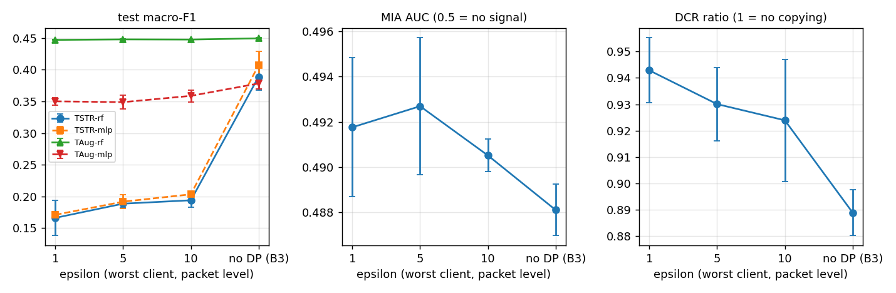

# Phase 9 - M1: CVAE + FedAvg + client-side DP-SGD (6class)

Auto-generated by `ppfeddata m1`. Opacus 1.6.0 (Poisson sampling, flat per-sample clipping C = 1.0, RDP accountant), delta = 1e-05, 5 non-IID clients (alpha 0.5), 30 rounds x 2 local epochs, same partition and seeds as B3. sigma_i is calibrated once per client for the whole run; epsilon is recomputed from the counted steps.

## What epsilon means here

- **Record level (one packet), for the model weights**, against an observer who sees the updates of that one client. The configuration's epsilon is the **maximum over clients** (worst case); the median is shown next to it. No privacy amplification from secure aggregation is claimed.
- **Packets of one TCP stream are strongly correlated.** By group privacy, protection of a whole attack session (many packets) is much weaker than the number suggests; no exact conversion is claimed. The partition is by row, so a stream can sit in several clients.
- **The class label (the conditioning input) is not protected by DP-SGD.**
- **Headline variant = `-plain`** (plain decoder): depends only on the DP-trained weights. The variant without the suffix adds per-class residual noise whose 78 scales are computed from the pooled train data and are **not** covered by epsilon; it is shown for comparison only (SPEC_DEVIATIONS 7.1, 8.8).
- Hyper-parameters (`configs/best_cvae.yaml`) were tuned without DP on centralised data; they were not re-tuned for DP. The clipping bound is the config default, not tuned.

## Epsilon achieved (gate: eps_i <= 1.02 x target for every client)

| target eps | seed | sigma (min-max over clients) | eps max | eps median | eps max / target | DP steps (all clients) |
|---|---|---|---|---|---|---|
| 1 | 0 | 2.617 - 7.344 | 1.000 | 0.994 | 1.000 | 20880 |
| 1 | 1 | 2.051 - 9.219 | 0.997 | 0.991 | 0.997 | 20880 |
| 1 | 2 | 2.363 - 6.406 | 0.999 | 0.993 | 0.999 | 20880 |
| 5 | 0 | 0.885 - 1.875 | 4.999 | 4.993 | 1.000 | 20880 |
| 5 | 1 | 0.774 - 2.300 | 4.999 | 4.996 | 1.000 | 20880 |
| 5 | 2 | 0.834 - 1.670 | 4.996 | 4.994 | 0.999 | 20880 |
| 10 | 0 | 0.680 - 1.187 | 9.997 | 9.995 | 1.000 | 20880 |
| 10 | 1 | 0.618 - 1.405 | 10.000 | 9.997 | 1.000 | 20880 |
| 10 | 2 | 0.652 - 1.082 | 9.998 | 9.997 | 1.000 | 20880 |

Per client, target eps 5, seed 0 (clients differ in size, so sigma, q and eps_i differ):

| client | rows | q | sigma | steps | eps_i |
|---|---|---|---|---|---|
| 0 | 7557 | 0.0333 | 1.550 | 1800 | 4.993 |
| 1 | 7270 | 0.0345 | 1.572 | 1740 | 4.991 |
| 2 | 4810 | 0.0526 | 1.875 | 1140 | 4.999 |
| 3 | 28757 | 0.0088 | 0.970 | 6780 | 4.996 |
| 4 | 40106 | 0.0064 | 0.885 | 9420 | 4.991 |

## Utility, headline (plain decoder; mean ± std over seeds)

| config | runs | macro-F1 (test) | balanced acc | PR-AUC macro |
|---|---|---|---|---|
| B0-rf | 3 | 0.4477 ± 0.0005 | 0.4807 ± 0.0003 | 0.5720 ± 0.0001 |
| B0-mlp | 3 | 0.3427 ± 0.0056 | 0.4179 ± 0.0018 | 0.5778 ± 0.0046 |
| B1b-rf | 3 | 0.5051 ± 0.0015 | 0.5160 ± 0.0014 | 0.6008 ± 0.0016 |
| B1b-mlp | 3 | 0.4765 ± 0.0139 | 0.4848 ± 0.0120 | 0.6112 ± 0.0078 |
| B3-plain-TSTR-rf | 3 | 0.3889 ± 0.0214 | 0.4034 ± 0.0185 | 0.4281 ± 0.0286 |
| B3-plain-TSTR-mlp | 3 | 0.4073 ± 0.0214 | 0.4200 ± 0.0184 | 0.4675 ± 0.0132 |
| B3-plain-TAug-rf | 3 | 0.4496 ± 0.0008 | 0.4814 ± 0.0006 | 0.5656 ± 0.0037 |
| B3-plain-TAug-mlp | 3 | 0.3783 ± 0.0090 | 0.4322 ± 0.0028 | 0.5533 ± 0.0068 |
| M1-eps1-plain-TSTR-rf | 3 | 0.1663 ± 0.0281 | 0.2586 ± 0.0023 | 0.2213 ± 0.0091 |
| M1-eps1-plain-TSTR-mlp | 3 | 0.1711 ± 0.0050 | 0.2665 ± 0.0161 | 0.2184 ± 0.0102 |
| M1-eps1-plain-TAug-rf | 3 | 0.4471 ± 0.0005 | 0.4806 ± 0.0005 | 0.5687 ± 0.0007 |
| M1-eps1-plain-TAug-mlp | 3 | 0.3502 ± 0.0058 | 0.4160 ± 0.0004 | 0.5407 ± 0.0046 |
| M1-eps5-plain-TSTR-rf | 3 | 0.1886 ± 0.0070 | 0.2824 ± 0.0025 | 0.2496 ± 0.0092 |
| M1-eps5-plain-TSTR-mlp | 3 | 0.1918 ± 0.0110 | 0.2824 ± 0.0151 | 0.2321 ± 0.0085 |
| M1-eps5-plain-TAug-rf | 3 | 0.4479 ± 0.0007 | 0.4809 ± 0.0004 | 0.5677 ± 0.0005 |
| M1-eps5-plain-TAug-mlp | 3 | 0.3489 ± 0.0107 | 0.4148 ± 0.0043 | 0.5507 ± 0.0106 |
| M1-eps10-plain-TSTR-rf | 3 | 0.1940 ± 0.0108 | 0.2815 ± 0.0207 | 0.2501 ± 0.0097 |
| M1-eps10-plain-TSTR-mlp | 3 | 0.2034 ± 0.0024 | 0.2871 ± 0.0102 | 0.2500 ± 0.0072 |
| M1-eps10-plain-TAug-rf | 3 | 0.4476 ± 0.0004 | 0.4810 ± 0.0004 | 0.5680 ± 0.0014 |
| M1-eps10-plain-TAug-mlp | 3 | 0.3588 ± 0.0093 | 0.4222 ± 0.0040 | 0.5431 ± 0.0065 |

### Recall per class (test)

| config | NORMAL | BCF | DELAYED | SYN | INVALID | WILL |
|---|---|---|---|---|---|---|
| B0-rf | 0.964 | 0.780 | 0.231 | 0.472 | 0.161 | 0.276 |
| B0-mlp | 0.967 | 0.780 | 0.055 | 0.458 | 0.037 | 0.211 |
| B1b-rf | 0.930 | 0.643 | 0.342 | 0.470 | 0.309 | 0.401 |
| B1b-mlp | 0.959 | 0.488 | 0.291 | 0.393 | 0.340 | 0.437 |
| B3-plain-TSTR-rf | 0.743 | 0.403 | 0.401 | 0.343 | 0.235 | 0.295 |
| B3-plain-TSTR-mlp | 0.746 | 0.497 | 0.376 | 0.312 | 0.297 | 0.293 |
| B3-plain-TAug-rf | 0.964 | 0.776 | 0.234 | 0.465 | 0.171 | 0.279 |
| B3-plain-TAug-mlp | 0.968 | 0.754 | 0.079 | 0.425 | 0.150 | 0.218 |
| M1-eps1-plain-TSTR-rf | 0.769 | 0.616 | 0.064 | 0.078 | 0.010 | 0.014 |
| M1-eps1-plain-TSTR-mlp | 0.751 | 0.686 | 0.021 | 0.095 | 0.033 | 0.012 |
| M1-eps1-plain-TAug-rf | 0.964 | 0.781 | 0.232 | 0.472 | 0.158 | 0.276 |
| M1-eps1-plain-TAug-mlp | 0.969 | 0.767 | 0.044 | 0.404 | 0.102 | 0.211 |
| M1-eps5-plain-TSTR-rf | 0.832 | 0.667 | 0.109 | 0.047 | 0.006 | 0.034 |
| M1-eps5-plain-TSTR-mlp | 0.760 | 0.737 | 0.099 | 0.075 | 0.019 | 0.005 |
| M1-eps5-plain-TAug-rf | 0.964 | 0.780 | 0.232 | 0.472 | 0.161 | 0.276 |
| M1-eps5-plain-TAug-mlp | 0.971 | 0.757 | 0.055 | 0.410 | 0.087 | 0.210 |
| M1-eps10-plain-TSTR-rf | 0.789 | 0.658 | 0.075 | 0.072 | 0.031 | 0.064 |
| M1-eps10-plain-TSTR-mlp | 0.765 | 0.699 | 0.073 | 0.091 | 0.012 | 0.081 |
| M1-eps10-plain-TAug-rf | 0.964 | 0.780 | 0.232 | 0.475 | 0.158 | 0.277 |
| M1-eps10-plain-TAug-mlp | 0.970 | 0.748 | 0.067 | 0.446 | 0.087 | 0.214 |

### Trend with epsilon (TSTR macro-F1, plain decoder; eps 1, 5, 10, then no DP)

rf: 0.1663 -> 0.1886 -> 0.1940 -> 0.3889; mlp: 0.1711 -> 0.1918 -> 0.2034 -> 0.4073. Non-decreasing as the budget grows (within 0.005), as expected.

## Validation loss (ELBO at the final beta) of the final global model

Less noisy than macro-F1: it uses all 12,000 validation rows and no classifier. Lower is better; a simulation-side diagnostic, not available in a real federation.

| eps | val loss (per seed) | mean | numeric | binary | categorical | KL |
|---|---|---|---|---|---|---|
| 1 | 5.31, 10.65, 5.95 | 7.31 | 2.48 | 1.88 | 1.46 | 6.20 |
| 5 | 4.29, 7.71, 5.43 | 5.81 | 1.99 | 1.65 | 1.14 | 4.33 |
| 10 | 4.18, 8.55, 5.17 | 5.97 | 1.91 | 1.95 | 1.17 | 3.92 |
| no DP (B3) | 1.23, 2.48, 1.27 | 1.66 | 0.29 | 0.31 | 0.08 | 4.09 |

The loss does not grow monotonically as the budget shrinks: the DP-trained models are much worse generators than B3, and the drop from eps = 10 to eps = 1 is visible here even though TSTR macro-F1 (above) is already at its floor at eps = 10.

## Paired difference vs B3-plain (test macro-F1; stratified bootstrap)

Criterion: paired CI excludes 0 and |diff| > std of macro-F1 over seeds.

| comparison | seed | diff | 95% CI | excludes 0 | \|diff\| > seed std |
|---|---|---|---|---|---|
| M1-eps1-plain-TSTR-rf - B3-plain-TSTR-rf | 0 | -0.2085 | [-0.2145, -0.2028] | True | True |
| M1-eps1-plain-TSTR-rf - B3-plain-TSTR-rf | 1 | -0.2415 | [-0.2469, -0.2358] | True | True |
| M1-eps1-plain-TSTR-rf - B3-plain-TSTR-rf | 2 | -0.2179 | [-0.2233, -0.2121] | True | True |
| M1-eps1-plain-TSTR-mlp - B3-plain-TSTR-mlp | 0 | -0.2663 | [-0.2724, -0.2603] | True | True |
| M1-eps1-plain-TSTR-mlp - B3-plain-TSTR-mlp | 1 | -0.2232 | [-0.2287, -0.2180] | True | True |
| M1-eps1-plain-TSTR-mlp - B3-plain-TSTR-mlp | 2 | -0.2189 | [-0.2248, -0.2128] | True | True |
| M1-eps1-plain-TAug-rf - B3-plain-TAug-rf | 0 | -0.0010 | [-0.0028, +0.0006] | False | True |
| M1-eps1-plain-TAug-rf - B3-plain-TAug-rf | 1 | -0.0041 | [-0.0058, -0.0023] | True | True |
| M1-eps1-plain-TAug-rf - B3-plain-TAug-rf | 2 | -0.0023 | [-0.0043, -0.0004] | True | True |
| M1-eps1-plain-TAug-mlp - B3-plain-TAug-mlp | 0 | -0.0258 | [-0.0300, -0.0214] | True | True |
| M1-eps1-plain-TAug-mlp - B3-plain-TAug-mlp | 1 | -0.0234 | [-0.0271, -0.0195] | True | True |
| M1-eps1-plain-TAug-mlp - B3-plain-TAug-mlp | 2 | -0.0354 | [-0.0395, -0.0310] | True | True |
| M1-eps5-plain-TSTR-rf - B3-plain-TSTR-rf | 0 | -0.2169 | [-0.2233, -0.2112] | True | True |
| M1-eps5-plain-TSTR-rf - B3-plain-TSTR-rf | 1 | -0.2021 | [-0.2081, -0.1956] | True | True |
| M1-eps5-plain-TSTR-rf - B3-plain-TSTR-rf | 2 | -0.1817 | [-0.1877, -0.1755] | True | True |
| M1-eps5-plain-TSTR-mlp - B3-plain-TSTR-mlp | 0 | -0.2423 | [-0.2483, -0.2362] | True | True |
| M1-eps5-plain-TSTR-mlp - B3-plain-TSTR-mlp | 1 | -0.2113 | [-0.2164, -0.2059] | True | True |
| M1-eps5-plain-TSTR-mlp - B3-plain-TSTR-mlp | 2 | -0.1928 | [-0.1990, -0.1863] | True | True |
| M1-eps5-plain-TAug-rf - B3-plain-TAug-rf | 0 | -0.0016 | [-0.0032, +0.0002] | False | True |
| M1-eps5-plain-TAug-rf - B3-plain-TAug-rf | 1 | -0.0027 | [-0.0045, -0.0009] | True | True |
| M1-eps5-plain-TAug-rf - B3-plain-TAug-rf | 2 | -0.0007 | [-0.0028, +0.0011] | False | True |
| M1-eps5-plain-TAug-mlp - B3-plain-TAug-mlp | 0 | -0.0483 | [-0.0521, -0.0448] | True | True |
| M1-eps5-plain-TAug-mlp - B3-plain-TAug-mlp | 1 | -0.0116 | [-0.0158, -0.0076] | True | True |
| M1-eps5-plain-TAug-mlp - B3-plain-TAug-mlp | 2 | -0.0284 | [-0.0319, -0.0247] | True | True |
| M1-eps10-plain-TSTR-rf - B3-plain-TSTR-rf | 0 | -0.2329 | [-0.2390, -0.2276] | True | True |
| M1-eps10-plain-TSTR-rf - B3-plain-TSTR-rf | 1 | -0.1821 | [-0.1877, -0.1763] | True | True |
| M1-eps10-plain-TSTR-rf - B3-plain-TSTR-rf | 2 | -0.1697 | [-0.1764, -0.1629] | True | True |
| M1-eps10-plain-TSTR-mlp - B3-plain-TSTR-mlp | 0 | -0.2347 | [-0.2409, -0.2292] | True | True |
| M1-eps10-plain-TSTR-mlp - B3-plain-TSTR-mlp | 1 | -0.1873 | [-0.1929, -0.1814] | True | True |
| M1-eps10-plain-TSTR-mlp - B3-plain-TSTR-mlp | 2 | -0.1896 | [-0.1968, -0.1821] | True | True |
| M1-eps10-plain-TAug-rf - B3-plain-TAug-rf | 0 | -0.0016 | [-0.0033, -0.0000] | True | True |
| M1-eps10-plain-TAug-rf - B3-plain-TAug-rf | 1 | -0.0026 | [-0.0044, -0.0009] | True | True |
| M1-eps10-plain-TAug-rf - B3-plain-TAug-rf | 2 | -0.0016 | [-0.0035, +0.0004] | False | True |
| M1-eps10-plain-TAug-mlp - B3-plain-TAug-mlp | 0 | -0.0180 | [-0.0214, -0.0145] | True | True |
| M1-eps10-plain-TAug-mlp - B3-plain-TAug-mlp | 1 | +0.0004 | [-0.0031, +0.0040] | False | False |
| M1-eps10-plain-TAug-mlp - B3-plain-TAug-mlp | 2 | -0.0411 | [-0.0451, -0.0368] | True | True |

## Fidelity and empirical privacy of the synthetic set (plain decoder, mean over classes)

The MIA only detects near-copies of training rows (positive control in b2_cvae.md: AUC 0.98 for exact copies, 0.67 at 0.05 sd of noise, 0.53 at 0.2 sd, and an over-fitted CVAE was not detected), so values near 0.5 mean 'no copying', not 'no leakage'. It is an empirical check next to, not a replacement for, the formal epsilon.

| eps | C2ST AUC | Wasserstein | JS | dup rate | DCR ratio | MIA AUC |
|---|---|---|---|---|---|---|
| 1 | 1.0000 ± 0.0000 | 0.2414 ± 0.0042 | 0.0175 ± 0.0011 | 0.0000 ± 0.0000 | 0.9428 ± 0.0123 | 0.4918 ± 0.0031 |
| 5 | 1.0000 ± 0.0000 | 0.1881 ± 0.0024 | 0.0129 ± 0.0010 | 0.0000 ± 0.0000 | 0.9301 ± 0.0139 | 0.4927 ± 0.0030 |
| 10 | 0.9999 ± 0.0000 | 0.1732 ± 0.0087 | 0.0112 ± 0.0023 | 0.0000 ± 0.0000 | 0.9239 ± 0.0231 | 0.4905 ± 0.0007 |
| no DP (B3) | 0.9994 ± 0.0002 | 0.0998 ± 0.0020 | 0.0024 ± 0.0004 | 0.0007 ± 0.0002 | 0.8890 ± 0.0087 | 0.4881 ± 0.0011 |

## Plain decoder vs residual noise (RF macro-F1, test)

The with-noise rows use scales that are not covered by epsilon; the gap shows how much of the utility depends on that extra, non-DP statistic.

| eps | generator | TSTR-rf | TAug-rf |
|---|---|---|---|
| 1 | plain decoder | 0.1663 ± 0.0281 | 0.4471 ± 0.0005 |
| 1 | with residual noise | 0.2272 ± 0.0304 | 0.4484 ± 0.0004 |
| 5 | plain decoder | 0.1886 ± 0.0070 | 0.4479 ± 0.0007 |
| 5 | with residual noise | 0.2298 ± 0.0202 | 0.4481 ± 0.0003 |
| 10 | plain decoder | 0.1940 ± 0.0108 | 0.4476 ± 0.0004 |
| 10 | with residual noise | 0.2349 ± 0.0156 | 0.4479 ± 0.0002 |
| no DP (B3) | plain decoder | 0.3889 ± 0.0214 | 0.4496 ± 0.0008 |
| no DP (B3) | with residual noise | 0.3975 ± 0.0053 | 0.4488 ± 0.0009 |

## Cost (wall time per round, 5 clients in parallel on one machine)

| eps | median s/round (rounds 2+) | B3 median s/round | overhead (DP / plain) |
|---|---|---|---|
| 1 | 22.38 | 1.92 | 11.67x |
| 5 | 23.27 | 1.92 | 12.13x |
| 10 | 21.52 | 1.92 | 11.22x |

## Sanity checks (seed 0)

- **sigma = 0, C = 1e6 vs B3:** validation loss 1.2070 vs 1.2344, relative difference 2.23 % (gate < 5 %): OK.
- **Resume (target eps 5):** stopped at round 10 of a 20-round plan, then resumed: max |weight difference| 0.00e+00; DP step counters equal: True; eps max 4.9993 vs 4.9993 for the uninterrupted run (OK).

## Gate Phase 9 checks

- epsilon_within_2pct: OK
- sigma_increases_as_eps_decreases: OK
- tstr_f1_trend_monotone: OK
- val_loss_monotone_in_eps: FAIL
- sigma0_matches_b3: OK
- resume_identical: OK
