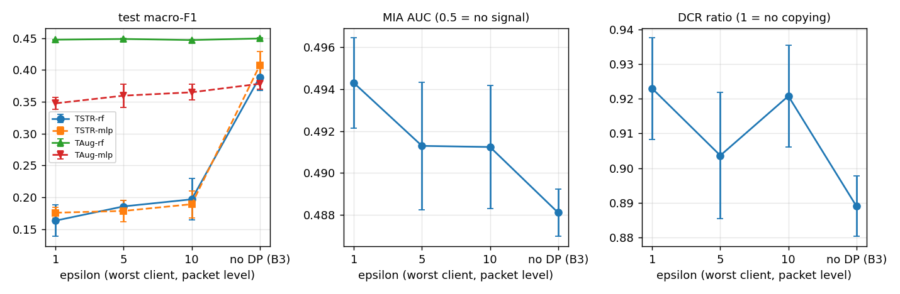

# Phase 9 - M1: CVAE + FedAvg + client-side DP-SGD (6class) - DP-tuned hyper-parameters

Auto-generated by `ppfeddata m1`. Opacus 1.6.0 (Poisson sampling, flat per-sample clipping C = 1.0, RDP accountant), delta = 1e-05, 5 non-IID clients (alpha 0.5), 30 rounds x 2 local epochs, same partition and seeds as B3. sigma_i is calibrated once per client for the whole run; epsilon is recomputed from the counted steps. **DP-specific hyper-parameters** (`configs/best_cvae_dp.yaml`, trial 18, searched at eps 5 on a single-client proxy and confirmed in real FL runs on validation): latent 16, hidden [64, 32], beta 0.569, lr 1.60e-03, batch 1024, clipping bound C = 0.13.

## What epsilon means here

- **Record level (one packet), for the model weights**, against an observer who sees the updates of that one client. The configuration's epsilon is the **maximum over clients** (worst case); the median is shown next to it. No privacy amplification from secure aggregation is claimed.
- **Packets of one TCP stream are strongly correlated.** By group privacy, protection of a whole attack session (many packets) is much weaker than the number suggests; no exact conversion is claimed. The partition is by row, so a stream can sit in several clients.
- **The class label (the conditioning input) is not protected by DP-SGD.**
- **Headline variant = `-plain`** (plain decoder): depends only on the DP-trained weights. The variant without the suffix adds per-class residual noise whose 78 scales are computed from the pooled train data and are **not** covered by epsilon; it is shown for comparison only (SPEC_DEVIATIONS 7.1, 8.8).
- Hyper-parameters (`configs/best_cvae.yaml`) were tuned without DP on centralised data; they were not re-tuned for DP. The clipping bound is the config default, not tuned.

## Epsilon achieved (gate: eps_i <= 1.02 x target for every client)

| target eps | seed | sigma (min-max over clients) | eps max | eps median | eps max / target | DP steps (all clients) |
|---|---|---|---|---|---|---|
| 1 | 0 | 5.078 - 14.219 | 0.994 | 0.993 | 0.994 | 5400 |
| 1 | 1 | 3.906 - 18.281 | 1.000 | 0.995 | 1.000 | 5280 |
| 1 | 2 | 4.531 - 12.031 | 0.998 | 0.992 | 0.998 | 5400 |
| 5 | 0 | 1.384 - 3.447 | 4.999 | 4.993 | 1.000 | 5400 |
| 5 | 1 | 1.141 - 4.395 | 4.999 | 4.997 | 1.000 | 5280 |
| 5 | 2 | 1.272 - 2.944 | 4.999 | 4.996 | 1.000 | 5400 |
| 10 | 0 | 0.936 - 2.012 | 9.998 | 9.994 | 1.000 | 5400 |
| 10 | 1 | 0.813 - 2.520 | 9.999 | 9.994 | 1.000 | 5280 |
| 10 | 2 | 0.880 - 1.744 | 9.995 | 9.992 | 0.999 | 5400 |

Per client, target eps 5, seed 0 (clients differ in size, so sigma, q and eps_i differ):

| client | rows | q | sigma | steps | eps_i |
|---|---|---|---|---|---|
| 0 | 7557 | 0.1250 | 2.769 | 480 | 4.993 |
| 1 | 7270 | 0.1250 | 2.769 | 480 | 4.993 |
| 2 | 4810 | 0.2000 | 3.447 | 300 | 4.999 |
| 3 | 28757 | 0.0345 | 1.572 | 1740 | 4.991 |
| 4 | 40106 | 0.0250 | 1.384 | 2400 | 4.991 |

## Utility, headline (plain decoder; mean ± std over seeds)

| config | runs | macro-F1 (test) | balanced acc | PR-AUC macro |
|---|---|---|---|---|
| B0-rf | 3 | 0.4477 ± 0.0005 | 0.4807 ± 0.0003 | 0.5720 ± 0.0001 |
| B0-mlp | 3 | 0.3427 ± 0.0056 | 0.4179 ± 0.0018 | 0.5778 ± 0.0046 |
| B1b-rf | 3 | 0.5051 ± 0.0015 | 0.5160 ± 0.0014 | 0.6008 ± 0.0016 |
| B1b-mlp | 3 | 0.4765 ± 0.0139 | 0.4848 ± 0.0120 | 0.6112 ± 0.0078 |
| B3-plain-TSTR-rf | 3 | 0.3889 ± 0.0214 | 0.4034 ± 0.0185 | 0.4281 ± 0.0286 |
| B3-plain-TSTR-mlp | 3 | 0.4073 ± 0.0214 | 0.4200 ± 0.0184 | 0.4675 ± 0.0132 |
| B3-plain-TAug-rf | 3 | 0.4496 ± 0.0008 | 0.4814 ± 0.0006 | 0.5656 ± 0.0037 |
| B3-plain-TAug-mlp | 3 | 0.3783 ± 0.0090 | 0.4322 ± 0.0028 | 0.5533 ± 0.0068 |
| M1d-t18-eps1-plain-TSTR-rf | 3 | 0.1632 ± 0.0249 | 0.2357 ± 0.0172 | 0.1917 ± 0.0105 |
| M1d-t18-eps1-plain-TSTR-mlp | 3 | 0.1756 ± 0.0085 | 0.2292 ± 0.0225 | 0.2135 ± 0.0291 |
| M1d-t18-eps1-plain-TAug-rf | 3 | 0.4476 ± 0.0004 | 0.4809 ± 0.0002 | 0.5695 ± 0.0016 |
| M1d-t18-eps1-plain-TAug-mlp | 3 | 0.3476 ± 0.0093 | 0.4130 ± 0.0058 | 0.5663 ± 0.0074 |
| M1d-t18-eps5-plain-TSTR-rf | 3 | 0.1855 ± 0.0092 | 0.2658 ± 0.0089 | 0.2087 ± 0.0097 |
| M1d-t18-eps5-plain-TSTR-mlp | 3 | 0.1784 ± 0.0166 | 0.2483 ± 0.0030 | 0.1911 ± 0.0075 |
| M1d-t18-eps5-plain-TAug-rf | 3 | 0.4488 ± 0.0014 | 0.4815 ± 0.0009 | 0.5693 ± 0.0009 |
| M1d-t18-eps5-plain-TAug-mlp | 3 | 0.3597 ± 0.0183 | 0.4229 ± 0.0068 | 0.5585 ± 0.0021 |
| M1d-t18-eps10-plain-TSTR-rf | 3 | 0.1967 ± 0.0326 | 0.2906 ± 0.0184 | 0.2338 ± 0.0145 |
| M1d-t18-eps10-plain-TSTR-mlp | 3 | 0.1890 ± 0.0213 | 0.2700 ± 0.0047 | 0.2199 ± 0.0090 |
| M1d-t18-eps10-plain-TAug-rf | 3 | 0.4471 ± 0.0006 | 0.4805 ± 0.0005 | 0.5687 ± 0.0016 |
| M1d-t18-eps10-plain-TAug-mlp | 3 | 0.3649 ± 0.0123 | 0.4271 ± 0.0034 | 0.5690 ± 0.0056 |

### Recall per class (test)

| config | NORMAL | BCF | DELAYED | SYN | INVALID | WILL |
|---|---|---|---|---|---|---|
| B0-rf | 0.964 | 0.780 | 0.231 | 0.472 | 0.161 | 0.276 |
| B0-mlp | 0.967 | 0.780 | 0.055 | 0.458 | 0.037 | 0.211 |
| B1b-rf | 0.930 | 0.643 | 0.342 | 0.470 | 0.309 | 0.401 |
| B1b-mlp | 0.959 | 0.488 | 0.291 | 0.393 | 0.340 | 0.437 |
| B3-plain-TSTR-rf | 0.743 | 0.403 | 0.401 | 0.343 | 0.235 | 0.295 |
| B3-plain-TSTR-mlp | 0.746 | 0.497 | 0.376 | 0.312 | 0.297 | 0.293 |
| B3-plain-TAug-rf | 0.964 | 0.776 | 0.234 | 0.465 | 0.171 | 0.279 |
| B3-plain-TAug-mlp | 0.968 | 0.754 | 0.079 | 0.425 | 0.150 | 0.218 |
| M1d-t18-eps1-plain-TSTR-rf | 0.718 | 0.484 | 0.030 | 0.057 | 0.088 | 0.038 |
| M1d-t18-eps1-plain-TSTR-mlp | 0.557 | 0.547 | 0.061 | 0.076 | 0.030 | 0.103 |
| M1d-t18-eps1-plain-TAug-rf | 0.964 | 0.781 | 0.231 | 0.472 | 0.159 | 0.277 |
| M1d-t18-eps1-plain-TAug-mlp | 0.973 | 0.749 | 0.038 | 0.406 | 0.102 | 0.209 |
| M1d-t18-eps5-plain-TSTR-rf | 0.700 | 0.674 | 0.098 | 0.021 | 0.020 | 0.082 |
| M1d-t18-eps5-plain-TSTR-mlp | 0.567 | 0.659 | 0.107 | 0.035 | 0.032 | 0.090 |
| M1d-t18-eps5-plain-TAug-rf | 0.964 | 0.780 | 0.233 | 0.474 | 0.162 | 0.276 |
| M1d-t18-eps5-plain-TAug-mlp | 0.970 | 0.774 | 0.057 | 0.407 | 0.119 | 0.211 |
| M1d-t18-eps10-plain-TSTR-rf | 0.775 | 0.747 | 0.075 | 0.037 | 0.018 | 0.092 |
| M1d-t18-eps10-plain-TSTR-mlp | 0.639 | 0.737 | 0.061 | 0.025 | 0.053 | 0.105 |
| M1d-t18-eps10-plain-TAug-rf | 0.965 | 0.780 | 0.231 | 0.473 | 0.158 | 0.276 |
| M1d-t18-eps10-plain-TAug-mlp | 0.968 | 0.769 | 0.069 | 0.435 | 0.111 | 0.210 |

### Trend with epsilon (TSTR macro-F1, plain decoder; eps 1, 5, 10, then no DP)

rf: 0.1632 -> 0.1855 -> 0.1967 -> 0.3889; mlp: 0.1756 -> 0.1784 -> 0.1890 -> 0.4073. Non-decreasing as the budget grows (within 0.005), as expected.

## Validation loss (ELBO at the final beta) of the final global model

Less noisy than macro-F1: it uses all 12,000 validation rows and no classifier. Lower is better; a simulation-side diagnostic, not available in a real federation.

| eps | val loss (per seed) | mean | numeric | binary | categorical | KL |
|---|---|---|---|---|---|---|
| 1 | 8.65, 7.29, 9.40 | 8.45 | 3.26 | 2.38 | 1.45 | 2.39 |
| 5 | 5.95, 7.55, 7.65 | 7.05 | 2.48 | 2.07 | 1.24 | 2.21 |
| 10 | 6.03, 7.42, 7.01 | 6.82 | 2.48 | 1.96 | 1.16 | 2.14 |
| no DP (B3) | 1.23, 2.48, 1.27 | 1.66 | 0.29 | 0.31 | 0.08 | 4.09 |

The loss grows as the budget shrinks and every DP level is far above the non-DP model: the DP-trained models are much worse generators than B3, and the drop from eps = 10 to eps = 1 is visible here even though TSTR macro-F1 (above) is already at its floor at eps = 10.

## Paired difference vs B3-plain (test macro-F1; stratified bootstrap)

Criterion: paired CI excludes 0 and |diff| > std of macro-F1 over seeds.

| comparison | seed | diff | 95% CI | excludes 0 | \|diff\| > seed std |
|---|---|---|---|---|---|
| M1d-t18-eps1-plain-TSTR-rf - B3-plain-TSTR-rf | 0 | -0.2232 | [-0.2301, -0.2169] | True | True |
| M1d-t18-eps1-plain-TSTR-rf - B3-plain-TSTR-rf | 1 | -0.2225 | [-0.2283, -0.2162] | True | True |
| M1d-t18-eps1-plain-TSTR-rf - B3-plain-TSTR-rf | 2 | -0.2315 | [-0.2375, -0.2249] | True | True |
| M1d-t18-eps1-plain-TSTR-mlp - B3-plain-TSTR-mlp | 0 | -0.2732 | [-0.2791, -0.2678] | True | True |
| M1d-t18-eps1-plain-TSTR-mlp - B3-plain-TSTR-mlp | 1 | -0.2097 | [-0.2155, -0.2034] | True | True |
| M1d-t18-eps1-plain-TSTR-mlp - B3-plain-TSTR-mlp | 2 | -0.2121 | [-0.2187, -0.2055] | True | True |
| M1d-t18-eps1-plain-TAug-rf - B3-plain-TAug-rf | 0 | -0.0010 | [-0.0028, +0.0007] | False | True |
| M1d-t18-eps1-plain-TAug-rf - B3-plain-TAug-rf | 1 | -0.0034 | [-0.0053, -0.0017] | True | True |
| M1d-t18-eps1-plain-TAug-rf - B3-plain-TAug-rf | 2 | -0.0013 | [-0.0033, +0.0007] | False | True |
| M1d-t18-eps1-plain-TAug-mlp - B3-plain-TAug-mlp | 0 | -0.0403 | [-0.0445, -0.0359] | True | True |
| M1d-t18-eps1-plain-TAug-mlp - B3-plain-TAug-mlp | 1 | -0.0052 | [-0.0086, -0.0018] | True | False |
| M1d-t18-eps1-plain-TAug-mlp - B3-plain-TAug-mlp | 2 | -0.0467 | [-0.0505, -0.0426] | True | True |
| M1d-t18-eps5-plain-TSTR-rf - B3-plain-TSTR-rf | 0 | -0.2190 | [-0.2253, -0.2127] | True | True |
| M1d-t18-eps5-plain-TSTR-rf - B3-plain-TSTR-rf | 1 | -0.2021 | [-0.2083, -0.1960] | True | True |
| M1d-t18-eps5-plain-TSTR-rf - B3-plain-TSTR-rf | 2 | -0.1889 | [-0.1950, -0.1823] | True | True |
| M1d-t18-eps5-plain-TSTR-mlp - B3-plain-TSTR-mlp | 0 | -0.2355 | [-0.2417, -0.2291] | True | True |
| M1d-t18-eps5-plain-TSTR-mlp - B3-plain-TSTR-mlp | 1 | -0.2198 | [-0.2257, -0.2135] | True | True |
| M1d-t18-eps5-plain-TSTR-mlp - B3-plain-TSTR-mlp | 2 | -0.2314 | [-0.2379, -0.2249] | True | True |
| M1d-t18-eps5-plain-TAug-rf - B3-plain-TAug-rf | 0 | -0.0002 | [-0.0020, +0.0015] | False | False |
| M1d-t18-eps5-plain-TAug-rf - B3-plain-TAug-rf | 1 | -0.0034 | [-0.0051, -0.0016] | True | True |
| M1d-t18-eps5-plain-TAug-rf - B3-plain-TAug-rf | 2 | +0.0012 | [-0.0007, +0.0030] | False | False |
| M1d-t18-eps5-plain-TAug-mlp - B3-plain-TAug-mlp | 0 | -0.0465 | [-0.0503, -0.0429] | True | True |
| M1d-t18-eps5-plain-TAug-mlp - B3-plain-TAug-mlp | 1 | -0.0030 | [-0.0069, +0.0007] | False | False |
| M1d-t18-eps5-plain-TAug-mlp - B3-plain-TAug-mlp | 2 | -0.0065 | [-0.0106, -0.0023] | True | False |
| M1d-t18-eps10-plain-TSTR-rf - B3-plain-TSTR-rf | 0 | -0.1825 | [-0.1889, -0.1764] | True | True |
| M1d-t18-eps10-plain-TSTR-rf - B3-plain-TSTR-rf | 1 | -0.1854 | [-0.1912, -0.1794] | True | True |
| M1d-t18-eps10-plain-TSTR-rf - B3-plain-TSTR-rf | 2 | -0.2088 | [-0.2146, -0.2032] | True | True |
| M1d-t18-eps10-plain-TSTR-mlp - B3-plain-TSTR-mlp | 0 | -0.2203 | [-0.2266, -0.2140] | True | True |
| M1d-t18-eps10-plain-TSTR-mlp - B3-plain-TSTR-mlp | 1 | -0.2037 | [-0.2098, -0.1974] | True | True |
| M1d-t18-eps10-plain-TSTR-mlp - B3-plain-TSTR-mlp | 2 | -0.2309 | [-0.2372, -0.2245] | True | True |
| M1d-t18-eps10-plain-TAug-rf - B3-plain-TAug-rf | 0 | -0.0023 | [-0.0040, -0.0007] | True | True |
| M1d-t18-eps10-plain-TAug-rf - B3-plain-TAug-rf | 1 | -0.0035 | [-0.0050, -0.0019] | True | True |
| M1d-t18-eps10-plain-TAug-rf - B3-plain-TAug-rf | 2 | -0.0017 | [-0.0036, +0.0004] | False | True |
| M1d-t18-eps10-plain-TAug-mlp - B3-plain-TAug-mlp | 0 | -0.0261 | [-0.0299, -0.0228] | True | True |
| M1d-t18-eps10-plain-TAug-mlp - B3-plain-TAug-mlp | 1 | -0.0097 | [-0.0133, -0.0058] | True | False |
| M1d-t18-eps10-plain-TAug-mlp - B3-plain-TAug-mlp | 2 | -0.0044 | [-0.0084, -0.0004] | True | False |

## Fidelity and empirical privacy of the synthetic set (plain decoder, mean over classes)

The MIA only detects near-copies of training rows (positive control in b2_cvae.md: AUC 0.98 for exact copies, 0.67 at 0.05 sd of noise, 0.53 at 0.2 sd, and an over-fitted CVAE was not detected), so values near 0.5 mean 'no copying', not 'no leakage'. It is an empirical check next to, not a replacement for, the formal epsilon.

| eps | C2ST AUC | Wasserstein | JS | dup rate | DCR ratio | MIA AUC |
|---|---|---|---|---|---|---|
| 1 | 1.0000 ± 0.0000 | 0.2352 ± 0.0204 | 0.0159 ± 0.0016 | 0.0000 ± 0.0000 | 0.9229 ± 0.0146 | 0.4943 ± 0.0021 |
| 5 | 1.0000 ± 0.0000 | 0.1944 ± 0.0225 | 0.0128 ± 0.0030 | 0.0000 ± 0.0000 | 0.9036 ± 0.0182 | 0.4913 ± 0.0030 |
| 10 | 0.9999 ± 0.0000 | 0.1755 ± 0.0061 | 0.0103 ± 0.0014 | 0.0001 ± 0.0000 | 0.9208 ± 0.0147 | 0.4912 ± 0.0029 |
| no DP (B3) | 0.9994 ± 0.0002 | 0.0998 ± 0.0020 | 0.0024 ± 0.0004 | 0.0007 ± 0.0002 | 0.8890 ± 0.0087 | 0.4881 ± 0.0011 |

## Plain decoder vs residual noise (RF macro-F1, test)

The with-noise rows use scales that are not covered by epsilon; the gap shows how much of the utility depends on that extra, non-DP statistic.

| eps | generator | TSTR-rf | TAug-rf |
|---|---|---|---|
| 1 | plain decoder | 0.1632 ± 0.0249 | 0.4476 ± 0.0004 |
| 1 | with residual noise | 0.2188 ± 0.0263 | 0.4485 ± 0.0004 |
| 5 | plain decoder | 0.1855 ± 0.0092 | 0.4488 ± 0.0014 |
| 5 | with residual noise | 0.2623 ± 0.0127 | 0.4481 ± 0.0002 |
| 10 | plain decoder | 0.1967 ± 0.0326 | 0.4471 ± 0.0006 |
| 10 | with residual noise | 0.2620 ± 0.0109 | 0.4489 ± 0.0009 |
| no DP (B3) | plain decoder | 0.3889 ± 0.0214 | 0.4496 ± 0.0008 |
| no DP (B3) | with residual noise | 0.3975 ± 0.0053 | 0.4488 ± 0.0009 |

## Cost (wall time per round, 5 clients in parallel on one machine)

| eps | median s/round (rounds 2+) | B3 median s/round | overhead (DP / plain) |
|---|---|---|---|
| 1 | 3.62 | 1.92 | 1.89x |
| 5 | 3.63 | 1.92 | 1.89x |
| 10 | 3.65 | 1.92 | 1.90x |

## Effect of the DP-specific tuning (plain decoder, RF TSTR)

Same budgets, partitions and seeds; only the CVAE hyper-parameters and the clipping bound differ. The tuning used validation data only (the test split plays no part in it).

| eps | hyper-parameters | seeds | val TSTR-rf F1 | test TSTR-rf F1 | val ELBO |
|---|---|---|---|---|---|
| 1 | Phase 7 hyper-parameters (no DP tuning) | 3 | 0.1712 ± 0.0284 | 0.1663 ± 0.0281 | 7.31 |
| 1 | DP-tuned (M1d-t18) | 3 | 0.1717 ± 0.0253 | 0.1632 ± 0.0249 | 8.45 |
| 5 | Phase 7 hyper-parameters (no DP tuning) | 3 | 0.1829 ± 0.0108 | 0.1886 ± 0.0070 | 5.81 |
| 5 | DP-tuned (M1d-t18) | 3 | 0.1830 ± 0.0095 | 0.1855 ± 0.0092 | 7.05 |
| 10 | Phase 7 hyper-parameters (no DP tuning) | 3 | 0.1911 ± 0.0115 | 0.1940 ± 0.0108 | 5.97 |
| 10 | DP-tuned (M1d-t18) | 3 | 0.1828 ± 0.0272 | 0.1967 ± 0.0326 | 6.82 |

## Gate Phase 9 checks

- epsilon_within_2pct: OK
- sigma_increases_as_eps_decreases: OK
- tstr_f1_trend_monotone: OK
- val_loss_monotone_in_eps: OK
